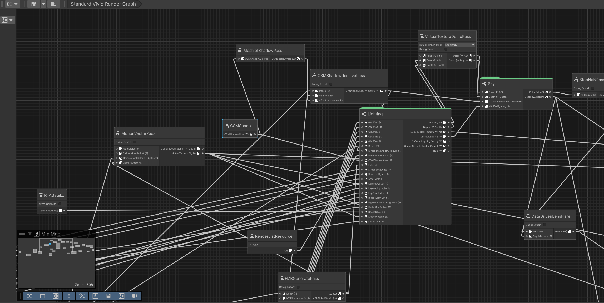
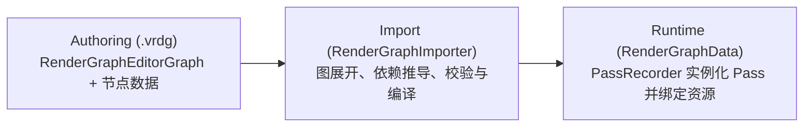

# RenderGraph 编辑器 (Graph Toolkit)

返回索引：[Documentation~ 索引](README.md) · 相关文档：[SubSystem 局部子图](RenderGraphSubSystem.md) | [可序列化资源描述符](RenderGraphResourceDescriptors.md) | [RTAS 加速结构支持](AccelerationStructureSupport.md)

## 目标

基于 `com.unity.graphtoolkit` 在 Editor 中提供可视化 RenderGraph 资产（`.vrdg`）的编辑、预览与静态校验能力，并通过 `ScriptedImporter` 编译为运行时扁平数据模型 `RenderGraphData`。

## 资产流转闭环

| 阶段 | 核心类型 | 说明 |
| --- | --- | --- |
| **Authoring** | `.vrdg`（`RenderGraphEditorGraph` + 各类 `NodeData`） | 唯一源文件（Source of Truth），在 Graph Toolkit 窗口中编辑 |
| **Import** | `RenderGraphImporter` → `RenderGraphData` | 监听 `.vrdg` 变更，展开 `SubSystem` 并生成扁平运行时数据资产 |
| **Runtime** | `VividRenderPipelineAsset.RenderGraphAsset` + `PassRecorder` | 管线资产引用 `RenderGraphData`，由 `PassRecorder` 实例化 Pass、管理生命周期并向 CoreRP RenderGraph 录制 |

---

## 支持的节点类型

### 1. 资源节点

| 节点类型 | 内部描述符 / 配置 | 输出端口类型 |
| --- | --- | --- |
| `TextureResourceNodeData` | `RenderGraphTextureDesc` | `RenderGraphTexture` |
| `BufferResourceNodeData` | `RenderGraphBufferDesc` | `RenderGraphBuffer` |
| `RenderListResourceNodeData` | `RenderGraphRenderListDesc` | `RenderGraphRenderList` |
| `AccelerationStructureResourceNodeData` | `RenderGraphAccelerationStructureDesc` | `RenderGraphAccelerationStructure` |

### 2. Pass 节点

- **编译期生成的专用 Pass 节点**：`VividRP.Runtime` 中符合条件的 `IRenderPass` 实现类由 `VividRP.RenderPassNodeGenerator`（Roslyn 增量生成器）在编译期自动生成专用节点，直接按分类出现在创建菜单中。
- **通用 `RenderPassNodeData` 节点**：用于消费方程序集（非 `VividRP.Runtime`）中的自定义 `IRenderPass`，通过节点的 `PassScript` 选项指定脚本类型。
- **端口生成规则**：基于 Pass 字段上的 `[RenderGraphResource(Access = ...)]` 特性自动生成输入/输出端口，并由字段名作为端口序列化契约。

---

## Pass 资源绑定模式与生命周期

| 模式 / 特性 | 用途 | 图端口表现 | 跨 Pass / 跨帧能力 |
| --- | --- | --- | --- |
| `[RenderGraphResource]`（默认 `External`） | 标准图资源输入/输出 | 暴露输入端口（可读）与输出端口（可写） | 可跨 Pass 传递，单帧生命周期 |
| `BindingMode = PassOwnedOverrideable` | Pass 在构造函数自持默认实例、在 `Prepare()` 中修正描述符的固定资源 | 默认隐藏输入端口（若可写仍暴露输出端口）；勾选 `Override <Name>` 后重新暴露输入端口 | 可跨 Pass 传递；未连接外部输入时回退到节点内嵌描述符 |
| `[TransientResource]` | 仅在单个 Pass 内部使用的临时 `RenderGraphTexture` / `RenderGraphBuffer` | 不生成输入/输出/Debug 端口，也不显示 Override 选项 | 录制时通过 `CreateTransientTexture/Buffer` 创建，**不可**跨 Pass 或跨帧 |
| `CameraHistoryTexture` / `CameraHistoryBuffer` | 相机所有的跨帧持久化纹理与 Buffer | 通过 History 节点或 `CameraHistoryRenderGraphBridge` 导入，对 Pass 仍暴露为 `RenderGraphTexture` / `RenderGraphBuffer` | 跨帧双缓冲物理存储（`BufferedRTHandleSystem`），图执行成功后由 `PassRecorder` 自动提交 |
| `[PassBypass(nameof(m_Source))]` | 当 `IsActive()` 返回 `false` 时零 GPU 开销跳过该 Pass | 保持原输入/输出端口连接 | 自动将输出句柄转发至指定的可读源字段句柄（详见 [PassBypass 说明](RenderGraphResourceDescriptors.md#pass-旁路pass-bypass)） |

> [!NOTE]
> **自持资源示例（`DrawObjectPass`）**：其 `RenderList` 字段启用了 `PassOwnedOverrideable`，默认直接在节点 Inspector 中配置 `Render List Descriptor` 而不暴露输入端口；勾选 `Override RenderList` 后可接入图中共享的 `RenderGraphRenderList`。仅建议对已具备完整默认描述符初始化逻辑的字段启用该模式。

### Pass 节点命名规则

- RenderPass 节点标题会编译为运行时 Pass 名称，同时用于 RenderGraph pass、Profiler 生命周期 marker 和编译预览。
- 空白标题自动回退到 Pass C# 类型名；允许图中多个节点使用相同标题。
- 实现 `IRenderGraphRecordingPass` 的 Pass 在内部创建的子 pass 继续使用代码显式提供的名称，外层 authored pass marker 使用节点标题。

---

## 快速上手（最小闭环）

1. **创建图资产**：
   - 推荐从模板创建：`Assets/Create/VividRP/Standard Render Graph`（基于 `Editor/RenderGraph/Templates/StandardRenderGraph.vrdg.txt`，包含预深度、GBuffer、阴影、天空、延迟光照、后处理、抗锯齿与最终 Blit 完整链路）。
   - 或创建空图：`Assets/Create/VividRP/Render Graph`。
2. **编辑节点**：双击打开 `.vrdg`，添加资源节点与 Pass 节点并连接对应端口。
3. **折叠子图（可选）**：对包含较多私有中间资源的局部链路，可使用基于 `Local Subgraph` 的 [`SubSystem`](RenderGraphSubSystem.md) 折叠为高层节点。
4. **绑定管线**：在 `VividRenderPipelineAsset` 的 **Render Graph Asset** 字段中引用该 `.vrdg` 资产（其导入主对象即为 `RenderGraphData`）。

---

## 运行时执行机制 (`PassRecorder`)

当首次渲染或检测到 `.vrdg` 的 `ImportVersion` 变化时，`PassRecorder` 会执行以下流程：

1. **解析编译结果**：从 `RenderGraphData` 读取扁平 Pass 列表、节点标题、序列化参数与资源连接关系。
2. **实例化与注入**：实例化 Pass，并将绑定的运行时资源副本写入对应的 `[RenderGraphResource]` 字段。
3. **初始化**：调用 `Create()` / `Initialize()` 完成 Pass 资源准备。
4. **逐帧录制**：每帧依次调用 `IsActive()`（处理 `[PassBypass]` 转发）、`Prepare()`，并将活跃 Pass 记录到 CoreRP `RenderGraph`（通过每帧缓存避免同一逻辑资源被重复 `CreateTexture` / `CreateBuffer`）。
5. **提交 History**：在整张图成功录制并执行后，经由 `CameraHistoryRenderGraphBridge` 自动提交本帧更新的相机 History 资源，无需在图尾编写显式 Copy Pass。
