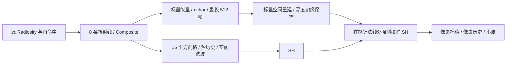

VividRP Screen Probe 与 Lumen 5.7.4 的实现对照
============================================

## 当前状态与下一步推进方案（HEAD `95373b42`，2026-11-20）

对齐目标为**逐区域贴近 UE 5.7.4 Lumen**，路径追踪只作参考。验收门槛沿用本文前几步：区域均值差 ≤ 3%，带通 RMS 不高于 UE，半影宽度及中点 ±1 px，接触对比度 ±2 pt，阴影恢复 ±2 帧。本节只汇总下文已记录的测量并给出计划，没有新增采集。

### 各区域最近一次测量

各行取自不同步骤的采集，ROI 与像素定义不完全相同（例如第 4 步的半影中点使用另一条剖面），不能跨行合成同一基线。

| 指标 | 来源 | Vivid | UE | Vivid / UE − 1 | 门槛 |
| --- | --- | ---: | ---: | ---: | --- |
| 天花距光片 16–32 px | 第 2 步 B | 7.113 | 14.164 | −49.8% | ✗ |
| 天花距光片 32–64 px | 第 2 步 B | 3.322 | 3.941 | −15.7% | ✗ |
| 天花距光片 > 64 px | 第 2 步 B | 2.630 | 2.904 | −9.4% | ✗（`ee10ddec` 为 −2.3%，接入屏幕追踪后变差） |
| 地面采样点 | 第 2 步 B | 10.882 | 12.060 | −9.8% | ✗ |
| 背墙采样点 | 第 2 步 B | 11.877 | 11.186 | +6.2% | ✗（`ee10ddec` 为 +1.6%） |
| 边缘采样点 | 第 2 步 B | 10.484 | 10.241 | +2.4% | ✓ |
| 整面背墙 | 第 4 步 B | — | — | +1.54% | ✓ |
| 背墙带通 RMS | 第 4 步 B | 2.253% | 2.100% | — | ✗（略高） |
| 高箱半影宽度 | 第 4 步 B | 11.81 px | 12.52 px | −0.71 px | ✓ |
| 高箱半影中点 | 第 4 步 B | 905.86 px | 903.80 px | +2.06 px | ✗ |
| 矮箱接触对比度 | 第 4 步 B | 65.96% | 64.51% | +1.45 pt | ✓ |
| 阴影恢复 | 第 5 步 B | +16 帧 | +12 帧 | +4 帧 | ✗ |
| Sponza 远场均值 | 第 5 步 B | 249.71 | 29.46 | ×8.48 | ✗（输入未标定） |

屏幕追踪本身已经对齐：第 2 步 B 的屏幕命中率与散射前加权亮度在天花近灯（46.5% / 47.8%，3.545 / 3.055）、地面（59.0% / 54.1%）、背墙（45.4% / 45.1%）都接近 UE。剩余差距位于屏幕来源之外。

### 推进顺序

#### 1. 统一基线（不改代码）
在 `95373b42` 上用同一采集脚本重采 Cornell 静止与运动序列，一次输出上表全部指标和 UE 列。第 4、5 步改变了 AO 施加位置和像素历史，第 2 步的区域数值需要在当前代码上重测。此后每一步都只与这张表比较。

#### 2. 天花近灯：全分辨率插值与像素历史（当前最大差距）
在第 639 帧的阶段读回中，Vivid 直到本帧全分辨率积分都不低于 UE（10.648 / 9.365），128 帧均值却变成 7.113 / 14.164。UE 历史均值 14.320 明显高于该帧的积分值，说明 UE 的长期均值由**跨帧变化的积分输入**形成，单帧并不代表它。

最可疑的是一项尚未移植的本地实现：

| 项 | VividRP（`SdfScreenProbeGather.compute::GetScreenProbeInterpolationPixel` / `CalculateScreenProbeInterpolation`） | UE 5.7.4 |
| --- | --- | --- |
| 全分辨率抖动 | 半径 `0.25 × ProbeSpacing` 并随深度减半，法线点积 ≥ 0.95 且共面才接受 | `FullResolutionJitterWidth = 1`，即整个 16 px tile |
| 插值方式 | 四探针双边加权 | `StochasticInterpolation = 1`，按权重随机选一个探针 |
| 权重 | Vivid 接收平面和屏幕距离权重 | `CalculateUpsampleInterpolationWeights` |

近灯像素在 UE 中会周期性取到更靠近光片、看到掠射发光的探针，再由 10 帧历史平均。Vivid 的 4 px 抖动和四点平均抹掉了这类尾部样本。

做法：
1. 先测量：两端各取一整个 8 相位周期（或 128 帧）的逐帧积分输入、重投影历史和输出，针对同一组 48 个近灯像素和整圈像素。若 UE 的积分输入跨帧均值约 14、Vivid 约 7，则差距在插值；若两者的积分均值相近，再检查历史混合。
2. 再移植：按 `LumenScreenProbeGather.usf` 的随机插值、抖动宽度和上采样权重原样搬运，旧实现保留开关。
3. 验收天花三个距离带、地面和背墙；预期也会影响天花远区（−9.4%）和背墙采样点（+6.2%）。

#### 3. 地面偏暗：离屏来源拆分
地面的屏幕加权亮度已略高于 UE（1.767 / 1.568），最终仍低 9.8%；S1 卡片光照中 Vivid 的地面卡反而亮 36.5%。差距应来自 Mesh SDF ≤ 1.8 m、Global SDF 页内对象、世界缓存，以及经这些路径命中光片的直接发光。

做法：把 S2 扩展到全部来源（屏幕 / Mesh SDF / Global SDF / Radiance Cache / 天空），逐区域输出命中率和散射前加权亮度，并单列命中光片的射线。光片边缘的实例归属已在独立候选上做到 15/15 与 UE 一致，需要确认生产路径是否用上了同一排序（包括薄壳半厚度还原）。第 2 项完成后再做本项，避免插值差异混入。

#### 4. 卡片光照：移植 Lumen Scene radiosity
S1 显示 Vivid 卡片相对 UE 为地面 +34–37%、背墙 +38–42%、天花 −36%。生产路径仍是 8 阶批量求解，UE 是逐帧 probe radiosity 加 FinalLighting 反馈。材质页和网格距离场已经可以从 UE 导入，输入已对齐。

做法：按 `Radiosity/LumenRadiosity.usf`（`LumenRadiosityDistanceFieldTracingCS`、`LumenRadiositySpatialFilterProbeRadiance`、`LumenRadiosityConvertToSH`、`LumenRadiosityIntegrateCS`）和 `LumenSceneLighting.usf` 的合成原样移植。8 阶求解保留为参考开关。验收先比较 S1 逐卡 texel（目标 ±5%），再看最终区域表。

这项工作量最大。如果第 2、3 项完成后剩余区域差已经落入门槛，可以推迟；但 Sponza 一定需要它。

#### 5. 阴影恢复 +16 / +12 帧
第 5 步打开 UE 的 R8 历史并关闭裁剪后，Vivid 从偏快变为慢 4 帧。仍保留的本地部分是像素几何重投影、前景拒绝、世界缓存的 0.25 混合，以及刚体运动时的探针驻留复用。

做法：逐帧对比 UE dump 的 `FastUpdateMode_NumFramesAccumulated` 与 Vivid R8 码，定位哪一帧开始分歧；再分别关闭世界缓存驻留复用、0.25 混合各做一次 A/B。按结果移植 UE 的重投影权重或缓存历史。

#### 6. Sponza：先标定输入
远场均值相差 8.48 倍，远超算法层面的差异。两端天空和材质各自独立，需要先像 Cornell 一样导入或对照材质、天空立方体和太阳单位，再比较算法。依次检查：GBuffer 反照率逐材质对照 → 天空辐亮度对照 → S1 卡片光照。

#### 7. 收尾
- 半影中点差 2 px、带通 RMS 略高：在第 2 项移植插值后重测，二者都受全分辨率插值影响。
- 本文较早的“与 UE 5.7.4 的实现差异”一节仍写着 R16 fast-update，第 5 步已改为 R8，需要更新。
- 每项最终候选跑 A-B-A-B，中间迭代只做单次 A/B。

## 第 2 步　全方向屏幕探针的屏幕追踪（基线 `66ff6729`）

在 Screen Probe Gather 的全方向路径中，`lumenScreenTracing` 默认开启。关闭该 Volume 开关可复测 Lambert 直接光历史与卡片补光。两条路径使用独立的相机颜色和几何历史标识；切换、尺寸变化和相机历史重置都会拒绝旧历史。

对照 UE 5.7.4 的 `HZBTracing.ush::TraceHZB`、`LumenScreenProbeTracing.usf::ScreenProbeTraceScreenTexturesCS` 和 `LumenReflectionTracing.cpp::SetupHZBScreenTraceParameters`。按半像素角点的法向投影偏移起点，从全分辨率深度进入最近深度 HZB。默认最多 50 次遍历，相对厚度 0.02；默认跳过 foliage 时确定性步数为 0，最低 wave 占用为 0。历史重投影在亚像素命中位置使用无抖动相机矩阵或对象 XYZ 运动，随后用两帧屏幕边缘衰减和 `0.005 × lerp(0.5, 2, noise)` 的设备深度阈值判定。通过后点采上一帧后处理输入颜色，以当前预曝光除以上帧预曝光校正，在写回探针之前转换回 Vivid 的场景线性单位。屏幕命中直接返回这份光照。未命中保留距离和已到达世界缓存标记，传给已有的软件追踪链。

### Cornell 的线性读回

同机位 1920×1080，64 条射线、原重要性采样、32 px AO 和 10 帧像素历史。A/B 各取第 512–639 帧，UE 使用已有的同帧区间读回。先完成 A-B-A-B，再在收紧缓存读取条件后复核一对独立进程。首次 B 的 D32 深度附件读回失败，已改取同帧全分辨率 R32 深度副本；失败进程未计入结果。下表为最终代码复核值。

| 最终均值图指标 | A · Lambert | B · 屏幕追踪 | UE |
| --- | ---: | ---: | ---: |
| 距光片 16–32 px 天花亮度 | 3.917 | 7.113 | 14.164 |
| 距光片 32–64 px 天花亮度 | 3.224 | 3.322 | 3.941 |
| 距光片 >64 px 天花亮度 | 2.836 | 2.630 | 2.904 |
| 天花采样点亮度 | 3.275 | 3.838 | 5.472 |
| 地面采样点亮度 | 11.031 | 10.882 | 12.060 |
| 背墙采样点亮度 | 11.357 | 11.877 | 11.186 |
| 边缘采样点亮度 | 10.055 | 10.484 | 10.241 |
| 整面背墙亮度 | 6.914 | 7.606 | 7.463 |
| 背墙带通 RMS（%） | 2.101 | 2.303 | 2.100 |
| 高箱半影 P10–P90 宽度（px） | 12.223 | 12.111 | 12.522 |
| 矮箱接触对比度（%） | 71.907 | 65.775 | 64.513 |
| 高箱共同阈值 P50 位置（px） | 908.40 | 909.32 | 906.78 |

静止背墙小区域的相邻帧平均绝对亮度差由 0.55% 降到 0.46%，高箱地面小区域由 2.59% 升到 2.93%，均按本区域均值归一化。背墙整面能量进入 3% 门槛，带通 RMS 超过 UE。高箱半影宽度进入 1 px 门槛，P50 位置仍差 2.53 px。近灯亮环已经出现，16–32 px 区域的亮度仍低 49.8%。移动箱体回放的脚本停止帧受一个 Editor 更新内多次渲染影响，此次不据此验收恢复帧数。

| 第 639 帧规则探针 | 屏幕命中率 A / B / UE | 散射前屏幕加权亮度 A / B / UE |
| --- | ---: | ---: |
| 天花 16–32 px | 19.7% / 46.5% / 47.8% | 0.822 / 3.545 / 3.055 |
| 天花 32–64 px | 23.6% / 47.1% / 48.4% | 0.836 / 1.299 / 1.329 |
| 地面 | 30.7% / 59.0% / 54.1% | 0.221 / 1.767 / 1.568 |
| 背墙 | 40.6% / 45.4% / 45.1% | 1.358 / 1.899 / 1.978 |

各区域以全部射线为分母，屏幕以外的来源计零。这里的 16–32 px 统计整圈规则探针。上表最终均值图的 7.113 / 14.164 只统计光片上方的 48 个天花像素。下文将各级读回对到同一位置。

### 近灯探针从散射到 SH 的能量变化（`3c19f169`）

Cornell 1920×1080、每探针 64 条射线。两端各补取一次第 639 帧的 D3D12 中间纹理，复用第 512–639 帧最终均值图。以左上为原点，上方区域取 y = 103、107 和 x = 914、918、…、1006，共 48 个像素。探针阶段在各自实际规则探针位置上用相同的双线性方法插值，两端各涉及 21 个天花探针。全分辨率阶段直接读这 48 个像素，包含各引擎实际的探针选择、插值及 AO。整圈像素另以天花对象掩码与距光片轮廓 (16, 32] px 的交集统计。

全部数值为去预曝光的线性亮度。前两行取全天球 64 格的平均入射辐亮度。此后各行为沿天花法线的漫反射 E/π。探针阶段用同一三带球谐核（L0–L2）评估每级方向场，再与两端 GPU 写出的 SH 系数独立交叉验证。

| 光片上方 48 点 | VividRP | Lumen 5.7.4 |
| --- | ---: | ---: |
| 全来源射线经 PDF 加权及限幅，散射前 | 6.843 | 6.084 |
| 散射后方向格的平均辐亮度 | 6.842 | 6.054 |
| 散射后方向格按 SH 评估 | 9.521 | 7.077 |
| 第二次空间滤波后按 SH 评估 | 9.197 | 7.098 |
| 第三次空间滤波后按 SH 评估 | 9.064 | 6.988 |
| GPU 写出的 SH 按天花法线评估 | 9.061 | 6.953 |
| 本帧全分辨率积分，像素历史前 | 10.648 | 9.365 |
| 本帧最终 GI，含像素历史和各自 AO | 7.346 | 13.843 |
| 128 帧最终均值 | 7.113 | 14.164 |

在 Vivid，三次空间滤波使这组位置的 SH 估值下降 4.8%，UE 下降 1.3%。用最终方向格独立投影对比 GPU 系数求值，均值分别相差 −0.04% 和 −0.50%，21 个探针逐个比较的最大相对偏差分别为 0.052% 和 0.747%。使用同一方向场直接离散余弦积分得到 8.394 / 5.914，三带 SH 给出 9.064 / 6.988。格中心恰好沿天花切线的方向在余弦积分中权重为零，在 SH 近似中贡献 +1.026 / +1.304，其余方向部分抵消了这一增量。

这帧全分辨率积分后 Vivid 仍高 13.7%，最终 GI 转为低 46.9%。UE 这 48 点均重投影到原像素，传入的历史均值为 14.320，累积帧数全部达到 10。按当前帧权重 1/11 重算为 13.869，实际输出为 13.843。Vivid 在像素历史之后还应用 Bent Normal AO。其可见度均值为 0.969，按读回可见度及生产 shader 允许的反照率范围反推，应用该 AO 前约为 7.49–7.59。

整圈单独统计的 70 / 71 个规则探针，最终 SH 均值为 5.062 / 4.819。整圈 18,124 个天花像素在 128 帧最终均值图上为 8.668 / 10.834，Vivid 低 20.0%。这次只在第 639 帧取齐中间纹理，能定位这一帧的强弱反转。区分长期差异来自历史输入还是历史混合，需要同一批像素的逐帧积分输入和重投影历史。

### 移植差异与验证范围

- Vivid 采用米制、Unity 的矩阵乘法和渲染目标 Y 方向，使用 reversed-Z。最近深度 HZB 采用 R16 单纹理分行存放各级，用整数地址执行最近点取样。每四级重新加载一次保守 FP16 深度。Cornell GPU 读回从 1024² 到 2² 共 10 级，包含边缘填充，逐 texel 与同帧深度的 UE 规则重建相同。
- UE 默认从 ResolveSceneColor 取历史。Vivid 通过图中首个后处理颜色输入保存 HDR，同时保存设备深度和生产帧的 FP32 预曝光。Cornell 读到全图 0.0625。没有上一帧有效颜色和深度时，现有 SDF 链承接射线。此次实测覆盖固定曝光、全分辨率透视相机；动态曝光、正交相机和其他渲染图尚待实测。
- 追踪暂存复用 RGBA32F 的 RGB 和 A。RGB 在预曝光域按 R11G11B10 精度抖动和打包解包，再转换至 Vivid 无预曝光的 gather 单位；A 复用 UE 的距离、命中、运动和世界缓存标志位。世界缓存覆盖、SDF 实际发射原点和后续卡片查询由已有 Vivid 实现提供。无有效探针的本地逐像素屏幕修补使用旧 Lambert 输入，因此新模式绕过该补洞分支。
- 当前验证覆盖软件追踪的 Cornell 不透明材质与 Meshlet。Meshlet 的 SDF 实例索引提供距离场表示标记，关联不到实例时使用 2 倍厚度；没有可绑定表示位的普通栅格变体使用 UE 关闭该位的排列。Vivid 光栅 G-buffer 尚无 Lumen 双面植被、发丝类别及 HairStrands 深度，本轮没有验证这些材质。Cornell 天空泄漏项为零。UE 与 Vivid 使用各自的探针方向与抖动序列，逐射线比较按接收区域汇总。
- 13 个 DXC 入口通过编译，Unity 7000.0.0a16 在隔离工程完成 D3D12 端到端采集。当前任务的验收范围为 Cornell；Sponza 尚未复测。

## 已接受基线 ee10ddec 对 UE 5.7.4 的区域差（2026-11-20）

Cornell 使用软件 Lumen、Epic、SH3、64 条射线和已接受的分段追踪与四级世界缓存。两端重新读回第 512–639 帧，先得到各自的线性均值图，再在相同的屏幕坐标比较。均值差为 Vivid / UE − 1，成对去均值残差为 std(Vivid − UE) / mean(UE)。路径追踪列复用同机位的线性参考。

| 区域 | 采样点 | Vivid | UE | 路径追踪 | 均值差 | 成对去均值残差 |
| --- | ---: | ---: | ---: | ---: | ---: | ---: |
| 天花 | 288 | 3.276 | 5.472 | 3.125 | -40.14% | 71.56% |
| 天花距光片 16–32 px | 48 | 3.915 | 14.164 | 3.464 | -72.36% | 22.27% |
| 天花距光片 32–64 px | 192 | 3.225 | 3.941 | 3.120 | -18.16% | 25.08% |
| 天花距光片 >64 px | 48 | 2.838 | 2.904 | 2.806 | -2.29% | 1.40% |
| 地面 | 384 | 11.030 | 12.060 | 11.520 | -8.54% | 7.06% |
| 背墙参考点 | 384 | 11.362 | 11.186 | 10.557 | +1.57% | 4.54% |
| 边缘 | 1280 | 10.056 | 10.241 | 9.420 | -1.81% | 9.18% |

整面背墙的均值为 6.922 / 7.463（Vivid / UE），带通 RMS 为 2.101% / 2.100%。高箱半影宽度为 12.22 / 12.52 px，矮箱接触对比度为 71.94% / 64.51%。在共同的 1,388 个地面像素上，以采集脚本指定的停止帧计算，残差连续四帧低于 10% 的首帧为 +4 / +12。UE 用渲染深度校准了停止时刻。Vivid 的 64 个渲染帧 ID 连续，但单次 Editor 更新可能渲染两帧，旧采集未记录每一帧的实际箱体变换。+4 只作为估计。

### 最早可测的差异

S1 在 Cornell 的五个朝室内的表面各配对 64 个卡片 texel。Vivid 使用 8×8 radiosity 的代表采样点、所属实例矩阵、烘焙深度和接收面反照率，还原无太阳场景的出射辐亮度。UE 复用同一 Cornell 场景此前的卡片快照，通过所属卡片、常驻页表和有效深度 texel 对 SceneFinalLighting 采样，按卡片曝光乘 256。两端卡片快照来自独立运行。

| S1 出射亮度 | Vivid | UE | 差值 |
| --- | ---: | ---: | ---: |
| 地面 | 3.377 | 2.475 | +36.5% |
| 背墙 | 3.341 | 2.358 | +41.7% |
| 天花 | 1.406 | 2.196 | -36.0% |
| 红墙 | 0.918 | 0.824 | +11.4% |
| 绿墙 | 1.822 | 1.400 | +30.1% |

S2 在第 639 帧读取 UE 的 LumenScreenProbeGather / TraceScreen(Scene) 输出，以及 Vivid 的命中类别、方向射线和逆 PDF。仅统计规则探针，按各自的接收位置分区。非屏幕来源在本表计零，分母保留每探针全部 64 条射线。两个引擎的探针抖动和方向序列不同。加权亮度已扣除 UE 的 1/16 视图预曝光。

| S2 区域 | 探针数 V / UE | 屏幕命中率 V / UE | 散射限幅前 V / UE |
| --- | ---: | ---: | ---: |
| 天花距光片 16–32 px | 70 / 71 | 19.7% / 47.8% | 0.886 / 3.055 |
| 天花距光片 32–64 px | 161 / 159 | 23.4% / 48.4% | 0.807 / 1.329 |
| 地面 | 748 / 825 | 30.6% / 54.1% | 0.220 / 1.568 |
| 背墙 | 909 / 911 | 40.6% / 45.1% | 1.360 / 1.978 |

地面和背墙的 S1 差值与最终整面均值差符号相反。把全部卡片调亮会扩大卡片级误差。近灯的屏幕来源在限幅前已经缺失，将两边都按 10 的预曝光强度限幅，该区域仍为 0.857 / 2.901。UE 的真实 pass 绑定上一帧 HDR SceneColor、历史深度和最近深度 HZB。现有读回尚不能把缺额分别归因给遍历、历史拒绝和返回颜色。

### Sponza 同机位范围

217 个具名部件对应中有 214 个参与两端坐标拟合，太阳照度均为 110,000 lx。第 512–527 帧有 1,011 个有效远场采样，深度相对差中位数为 0.022%，P90 为 0.269%。在两端深度配对且均有光照的 509 个采样上，Vivid / UE 亮度为 139.91 / 29.46，逐帧闪动为 2.74% / 4.04%。两端使用各自的天空和材质，世界缓存调参仍需标定入射天空和反照率。

### 公共运动纹理与移动表面的历史深度

光栅运动纹理改用 RGBA16 UNorm。相机、材质运动通道和 GPU Driven 刚体输出当前减上一帧的运动。Meshlet 用可见性缓冲定位实例，检查 primitive generation 后，用当前逆模型矩阵和上一帧模型矩阵重建同一表面点。变换历史按管线渲染帧推进，多相机在同一管线帧共用前一帧变换。物体运动模式与 VSM 的静态缓存位独立。

GI 使用对象的设备深度差重建上一帧深度。TAA、TSR、FSR3、SSR、景深和 SIGMA 读取解码后的 XY。STP 和光栅 DLSS 在原生接口前转换为双通道有符号 UV。路径追踪自己的 NRD 和 DLSS-RR 使用像素位移及视空间深度，仍遵循各自接口。

**移植差异。** RG 使用 UE 5.7.4 桌面速度的 gamma 编码，BA 按 `VELOCITY_Z_LOW_MASK = 0xFFFE` 保存 float 设备深度差。Vivid 把解码的 NDC 换算成纹理 UV，保留原有渲染目标 Y 约定、亚像素阈值和 XY 限幅。由于相机与物体共同写入公共纹理，Vivid 用 W 的最低位标记物体速度覆盖；UE 用已写入的 X 判断动态像素，最低位有像素动画语义。保留旧双通道有符号 UV 输入的点采样解码。GPU Driven 此处只覆盖有前后刚体矩阵的几何。

D3D12 Cornell 以静止相机让矮箱沿视线移动一次。第 12 个采样帧 GPU 当前 / 历史模型矩阵中的 Z 为 1.31 / 1.25 m，下一帧为 1.31 / 1.31 m。解析投影与纹理逐像素比较，排除几何边缘，117,306 个箱体像素均有有效的物体速度。设备深度差中位数为 −0.000143158，绝对误差 P99 为 4.46×10⁻⁹，XY 重投影误差 P99 为 0.00316 px。运动前和停止后的首帧，全画面的设备深度差绝对值均小于 2.3×10⁻⁹。

静止 128 帧的均值图中，候选距灯 16–32 px 的天花比 UE 暗 72.45%，整面背墙暗 7.18%，背墙带通 RMS 为 2.104%。高箱半影宽 12.22 px，矮箱接触对比度为 71.88%。背墙小区域的相邻帧平均亮度差由 0.514% 变为 0.525%，高箱地面小区域由 2.590% 变为 2.591%。这是运动输入的功能回归检查。

另用 UE 第 639 帧的 SceneDepthZ 离线重建 HZBClosest。按 2×2 最近深度规约、四级一批和 HZB.usf 的向上保守半精度转换，从 1024² 到 2² 的 10 级与原生读回逐位相等。该基线的 Vivid 屏幕射线遍历全分辨率起始的 R32 深度金字塔，并从 Lambert 历史取色。校验过的 UE HZB 可以作为移植遍历和上一帧 SceneColor 的对照输入。

### 第 3 步 Cornell 卡片材质与网格距离场输入（2026-11-20）

在 `3c19f169` 上按两个引擎各自的静态 Cornell 第 639 帧重新配对 S1，每个面 64 点。原求解器相对 UE 的出射亮度差为地面 +34.2%、背墙 +37.9%、天花 −35.5%、红墙 +10.9%、绿墙 +28.9%。这些数值是改动前的差距。

UE 5.7.4 导出了 8 个网格的全部 24 层稀疏距离场。Unity 导入后的索引与 R8 砖块逐字节相同。每个实例绑定独立资产，UE 网格中已烘入的尺寸由绑定上的 bake scale 还原。在两个引擎的 D3D12 上比较相同世界位置的 512 次物体表面距离查询，8 个对象均有 3 层 mip 驻留；最终距离 RMS 差为 0.007 mm，最大差为背墙的 0.158 mm。矮箱有一点接近中间 mip 的四分之一距离带阈值，CPU 理想插值会选到另一层，两端 GPU 在该点选择相同。原生对象距离查询已用于 Vivid 的 Global SDF 合成。

材质快照包括 44 张卡片的 44 个驻留页、页表和 Mesh Cards 元数据。Unity 按原物理地址恢复分配，导入 2,848 个 BC7/BC5/BC6H 材质块组及相应的 G16 深度与 G8 覆盖率。固定相机推得的 44 个常驻分辨率均与 UE 一致。Unity 对 45,568 个驻留 texel 的 D3D12 读回与 UE 的 DumpGPU 逐层一致。颜色和法线在 DumpGPU 的半精度输出格式下比较，深度和覆盖率按整数码值比较。

实现偏差与验证边界如下。

- 网格距离场从 UE 局部厘米转换为 Unity 米和轴序。R8 砖块图集使用场景所需尺寸，三层 mip 全部驻留。近期固定相机的像素检查没有覆盖流式装卸。
- 原材质图集为 4096×4096，Cornell 占用区域为 1024×128。物理 texel 地址和原始 BC 块得到保留，页的归一化图集坐标按导入尺寸更新。页更新时间和光照历史从零开始。
- 导入快照只提供捕获时驻留的材质页。动态压缩写入和 Vivid 距离场烘焙器后续实现。当前渲染的卡片间接光仍由原 8 阶求解，原生 Global SDF 的覆盖与 mip 追踪、probe radiosity 的滤波、SH 积分和 FinalLighting 反馈需单独接入。上述输入读回未验收最终 GI 能量与半影。

### 第 4 步 Cornell 短程 AO 与 SH3 积分（2026-11-20）

对照 UE 5.7.4 `LumenScreenSpaceBentNormal.usf::CalculateAOHorizonSearch` 的软件 HZB、Bent Normal、关闭 Short Range GI 的分支，以及 `SHCommon.ush::EvaluateSHIrradiance`。使用两个视空间切片、每侧三步、前景拒绝距离比例 0.3，搜索半径为两个探针间距，即当前 32 px，另加参考实现的 1 texel 起始偏移。通过最远 HZB mip 0 搜索地平线，输出 11/11/10 位方向乘可见度，按 UE 的 `ApplyDuringIntegration=1` 路径在全分辨率积分。按可见锥分别缩放三个 SH 频带，之后进入现有像素历史。Volume 开关 `screenProbeBentNormalApplyDuringIntegration` 选择该模式，关闭时走原独立 AO 历史。

以 `4eec045c` 的 Cornell 输入为起点，同机位 1920×1080、64 条射线、10 帧像素历史。最终线性 GI 按像素累计 `RGB × coverage`，A 和 B 各取第 512–639 帧。UE 列复用既有同机位 SH3 读回。

| 指标 | A 独立 AO | B SH3 AO | UE |
| --- | ---: | ---: | ---: |
| 矮箱接触对比度 | 66.03% | 65.96% | 64.51% |
| 高箱半影 10–90% 宽度 | 12.12 px | 11.81 px | 12.52 px |
| 高箱半影中点 y | 905.40 px | 905.86 px | 903.80 px |
| 背墙能量相对 UE | +1.20% | +1.54% | 0% |
| 背墙带通 RMS | 2.287% | 2.253% | 2.100% |
| 高箱半影相邻帧平均亮度差 | 2.94% | 3.15% | — |

首次 GPU 读回定位到视空间切片与 Unity 渲染目标 Y 的方向不一致，地面可见度均值为 0.152。修正后复采 B，地面均值为 0.948，UE 参考帧为 0.939。高箱剖面的可见度均值为 0.714 / 0.713（Vivid / UE），单帧逐点 RMS 差为 0.214，两端使用各自的深度、法线与采样序列。SH3 笛卡尔布局与 UE 球谐基的 8,192 对离线计算最大绝对差为 2.19×10⁻⁶。

**移植差异。** Unity 按 GPU 逆投影重建视空间坐标，处理渲染目标 Y、视空间 Z 与 UE 的 ZXY 打包轴序。只生成搜索实际读取的最远 HZB mip 0，以 2×2 最远设备深度归约后写 R16F。复用 Vivid 的 STBN 图集、渲染帧索引、GBuffer 和笛卡尔 SH 表示，并保留 AO 强度调节。Cornell 以强度 1 验收。UE Epic 默认的半分辨率独立 AO 时域路径、材质与反射通道的 AO 组合属于其他分支。

### 第 5 步像素时域与世界缓存（2026-11-20）

像素时域按 UE 5.7.4 的 `LumenScreenProbeGatherTemporal.usf` 使用 R8 历史，高四位保存向上量化的本帧 fast-update，低四位保存累计帧数。按通过几何重投影的四个 tap 混合历史。继承的 fast-update 先限制到 0.9，再与当前值取大，只影响本次混合。全方向路径按 UE 默认关闭 fast-update 邻域裁剪，并从历史长度与当前 fast-update 直接求混合权重。Cornell 读回确认静止历史达到 10 帧，运动时的最大码为 14/15，停止后观测码回到零。把继承值写回会延长快更新状态，因此写回沿用 UE 的本帧观测值。

世界缓存按 `LumenRadianceCacheUpdate.usf` 的 16 桶追踪成本直方图和最后一个桶的剩余预算分派。预算为 100 个全分辨率探针的追踪成本。默认 40 m 以外按 16² 追踪，新探针超出预算时也先以 16² 填充已有 32² 方向图；其余使用全分辨率。固定在方向 texel 中心追踪，保存原始辐亮度和命中距离，随后按 `FilterProbeRadianceWithGatherCS` 对六个同级邻居做双向遮挡测试与命中角滤波。已有探针的图集内容保留到下一次更新。仅刚体运动时允许复用驻留。Sponza 复核中 1,046 个首级驻留探针均有追踪记录。

用 `962308d4` 作为 A，采集同机位 D3D12 候选 B。Cornell 使用 64 条屏幕探针射线、SH3 AO 和 10 帧历史。地面 1,104 个配对点的恢复定义为矮箱完成最后一步后归一化阴影残差连续四帧低于 10%。Sponza 使用第 512–527 帧的 509 个深度配对且有光照的远场点。

| 指标 | A | B | UE |
| --- | ---: | ---: | ---: |
| Cornell 阴影恢复 | +0 帧 | +16 帧 | +12 帧 |
| Cornell 停止后第 12 帧残差 | 2.27% | 13.84% | 9.58% |
| Sponza 远场平均线性 GI | 249.00 | 249.71 | 29.46 |
| Sponza 相邻帧 RMS / 均值 | 2.89% | 2.74% | 4.04% |

保留 Vivid 裁剪的中间候选仍为 +0 帧。关闭裁剪且保留刚体移动时的探针驻留后，时间响应向 UE 靠近，但最终仍晚 4 帧。Sponza 远场均值仅变动 +0.29%，约为 UE 的 8.48 倍。该组结果未达到最终画面收口，现有对照也无法从最终 GI 反推同端点的卡片与天空入射差异。

**移植差异。** 保留 Vivid 的像素几何、前景拒绝、覆盖和能量存储；R8 只接管 fast-update 与累计帧数。世界缓存保留现有世界坐标槽、场景线性辐亮度和 Vivid Global SDF / 卡片着色。六邻居过滤额外使用一张持久的 2048² RGBA32F 原始图集，每相机约 64 MiB，尚无 GPU 计时。UE 此次 Screen Probe 配置的天空辐亮度已在追踪时合入，独立天空可见性关闭。探针重定位在 UE 的 irradiance 分支使用，该分支未用于此参考场景。Sponza 读回只覆盖首级，40 m 降采样、外三级过渡和全局灯光突变没有单独验收。

## Cornell 三方线性对照（基线 `e8bac5af`）

同机位 1920×1080，64 条射线，静态取第 512–639 帧。Vivid 用 Game View 每帧实际消费的 `GI.rgb × GI.a`，UE 用 DiffuseIndirectComposite 真实输入除以预曝光 1/16。UE 采用软件 Lumen、Epic GI、8×8 tracing、Bent Normal，并显式启用 ApplyDuringIntegration 取得 SH3。Vivid 使用 32 px AO、10 帧像素历史。两端均在显示变换之前读取。UE 保留 TSR 的相机子像素抖动，Vivid 相机 AA 关闭。解析相机校验的几何有效性分歧为零，UE 深度相对误差 P99 为 0.162%，平均法线点积为 0.99991。

以下为相对路径追踪的亮度均值偏差及去均值残差 RMS，均以该区域参考均值归一化。背部采样点与整面背墙采用不同的空间权重。

| 区域 | 点数 | Vivid 偏差 / 残差 | UE 偏差 / 残差 |
| --- | ---: | ---: | ---: |
| 天花 | 288 | +7.13% / 6.95% | +75.06% / 130.11% |
| 地面 | 384 | −3.40% / 4.82% | +4.69% / 4.16% |
| 背部 | 384 | −0.13% / 5.99% | +5.92% / 7.20% |
| 边缘 | 1,280 | +3.89% / 9.58% | +8.70% / 16.55% |

天花差异集中在发光片附近。距光片轮廓 16–32 px 的 48 个点，线性亮度为 Vivid 4.10、UE 14.17、路径参考 3.46，占全部天花点 UE 与 Vivid 亮度差总和的 79.1%。超过 64 px 的 48 个点分别为 2.86、2.90、2.81。整面背墙相对路径参考的能量偏差为 Vivid +6.74%、UE +22.55%，墙内 8–32 px 高斯带通 RMS 为 2.24%、2.10%。

| 阴影指标 | Vivid | UE | 路径参考 |
| --- | ---: | ---: | ---: |
| 高箱 10–90% 半影宽度，x=1240 | 11.88 px | 12.62 px | 2.98 px |
| 高箱在公共亮度中点处的屏幕 y | 908.93 px | 906.78 px | 909.60 px |
| 矮箱接触阴影对比度 | 63.05% | 64.48% | 65.12% |
| 矮箱停止后，残差连续四帧低于 10% 的首帧 | +5 帧 | +12 帧 | — |

运动测试每帧水平移动 0.06 m，共六步。用 UE 的实际渲染深度确认每一步及停止帧，再对同一批 967 个地面像素求残差。此前 7 帧的 Vivid 记录使用另一组掩码。以上数据表明两套实时实现在该剖面都有宽半影，Vivid 在共同掩码上更快恢复。

### 能量来源与默认散射

从同一帧读回规则探针的几何、三阶 SH 系数和直接余弦积分，覆盖八个连续抖动相位。按表面汇总，SH 在天花比直接积分高 8.83%，地面高 1.40%，背墙低 0.45%。该比较发生在 Bent Normal 和全分辨率插值之前。单独关闭屏幕追踪后，天花最终偏差从 +7.13% 降到 −1.45%，整面背墙从 +6.74% 降到 +4.46%。单独关闭 MaxRayIntensity 后，两者分别升到 +8.46%、+7.20%。这些差值包含重要性引导和历史的反馈，不是逐射线的可加能量分量。

本轮将全球路径的方向散射抖动默认打开，并显式应用到 Cornell 发光顶棚 Profile。只改这一项时，整面背墙能量误差从 +6.74% 降到 +5.12%，固定带通 RMS 从 2.238% 降到 2.182%。高箱半影从 11.88 变为 12.07 px，地面轮廓 ROI 的逐帧差从 3.74% 变为 3.75%。矮箱接触对比度从 63.05% 降到 62.21%，地面均值偏差从 −3.40% 变为 −4.70%。采用该默认值是对齐 UE 的散射选择，未对所有指标取得改善。Unity 蓝噪声图集、方向坐标约定及浮点规约仍沿用下文记录的实现。

## 全球 Screen Probe 路径（2026-11-19）

Cornell 发光顶棚场景从 `9f4b44df` 起使用世界空间 8×8 等面积八面体、每探针 64 条射线和历史重要性引导。旧的每探针 8 条射线仍可由 `screenProbeFullSphere` 切换。下表对应 GPU 上各阶段的输入和输出。

| 阶段 | VividRP 全球路径 | 对照的 Lumen 阶段 |
| --- | --- | --- |
| 采样 | 邻域材质法线的漫反射传输与上一帧空间滤波 radiance 共同引导细分。四个子射线各携带原方向格四分之一的质量 | Screen probe BRDF / lighting PDF、structured importance sampling |
| 散射 | `screenProbeDitherTraceDirections` 默认按连续坐标和蓝噪声把射线分到相邻方向格。关闭时沿用原方向格。两种方式都在预曝光空间按射线质量限幅 | `ScreenProbeCompositeTracesWithScatterCS` 的 `DITHER_TRACE_DIRECTIONS` |
| 过滤与投影 | 默认关闭探针级时域。三轮同世界方向的空间滤波后投影到 SH3，标量 anchor 仅供旧路径或诊断使用 | 方向 radiance 过滤、SH irradiance |
| 世界缓存 | 四级 48³ 逻辑网格，首级单元 50/48 m，逐级翻倍。每探针 32² 方向，每帧更新预算 100 个探针。按屏幕探针需求分配物理槽 | `GetRadianceCacheCoverage`、`SampleRadianceCacheInterpolated` |
| 近场拼接 | Cornell 与 Sponza 在 1.8 m 后切换到 Global SDF。首级世界缓存探针的射线起点约 1.80 m，接收点的近场上限约 3.61 m，随缓存层级翻倍 | Radiance Cache 的 probe TMin、单元对角线和 parallax radius |
| 自适应放置 | 每 tile 用 PCG16 和 Hammersley16 检查 8 个位置，帧相位为模 8。标记和最终插值共用接收平面深度权重与屏幕距离权重。更低序号的候选参与去重，额外探针最多为均匀探针数的 50% | `ScreenProbeAdaptivePlacementMarkCS`、`ScreenProbeAdaptivePlacementSpawnCS` 与 `CalculateUpsampleInterpolationWeights`。5.7.4 此路径使用 8 个候选 |
| 像素时域与运动 | 从相对命中运动生成 fast-update，在几何重投影通过时与上帧值取大。独立 R16 只写本帧观测值。变换更新保留可重投影的历史，实例身份、网格或材质变化仍走失效判断 | 像素时域的 fast-update 与历史长度限制 |

Bent Normal AO 使用独立历史。光源亮度变化仍沿既有光照历史失效逻辑处理。8 射线半球模式、ReSTIR 和 anchor 诊断都有独立调用方。

### Cornell 验收

独立进程依次运行 `cb71d3ee`、`9f4b44df`、`cb71d3ee`、`9f4b44df`。每次用同一相机预热 256 帧，取第 512 至 639 帧的线性 GI 均值。两个版本各自重复采集的均值逐像素一致。在隔离相机上，8 条升至 64 条伴随天花、地面和边缘采样点的能量误差下降，背部采样点的正偏由 15.30% 升到 23.59%。四次独立进程的 GPU marker 读数未能给出可信的成本倍率。

| 隔离相机区域 | 8 条能量误差 | 64 条能量误差 | 8 条去均值残差 | 64 条去均值残差 |
| --- | ---: | ---: | ---: | ---: |
| 天花 | +24.86% | +17.19% | 4.49% | 7.96% |
| 地面 | +8.55% | −0.27% | 10.73% | 5.88% |
| 背部参考点 | +15.30% | +23.59% | 10.33% | 3.85% |
| 边缘 | +14.91% | +13.28% | 10.56% | 5.46% |

可复用的较早 Game View 计时中，8 条与 64 条两档的 pass 中位数如下。该次 8 条对照已包含 P0，比较范围限于那一对采集。

| GPU pass（ms） | 8 条，含 P0 | 64 条 |
| --- | ---: | ---: |
| Screen trace | 0.118 | 0.838 |
| Mesh SDF gather | 0.399 | 2.943 |
| Guide | 0.016 | 0.073 |
| Composite | 0.034 | 0.119 |
| Directional filter | 0.107 | 0.091 |

下表使用 Cornell 实际 Game View 相机、同一组参考像素和同一帧序列。基线与候选都使用 64 条射线、32 px Bent Normal AO、10 帧像素历史。候选的世界缓存和方向散射抖动均关闭。

| 指标 | `9f4b44df` | 更新后的候选 | 路径追踪参考 |
| --- | ---: | ---: | ---: |
| 整面背墙平均能量误差 | +6.77% | +6.74% | 0% |
| 背墙内部固定斑块的带通 RMS / 均值 | 2.232% | 2.238% | — |
| 高箱地面半影中心（画面上方起算的 y） | 909.00 px | 908.93 px | 909.60 px |
| 高箱地面半影 10% 至 90% 宽度 | 11.61 px | 11.88 px | 2.98 px |
| 高箱轮廓 17×17 像素连续帧差 RMS / 均值 | 4.51% | 3.80% | — |
| 矮箱接触阴影对比度 | 63.05% | 63.05% | 65.12% |
| 边缘参考点的能量误差 / 去均值空间残差 | +4.72% / 5.45% | +3.91% / 9.49% | 0% / 0% |

最早的轮廓回归出现在 AO 之前。放置只按接收平面判断，而全分辨率插值额外拒绝法线不符的探针，导致高箱轮廓的 36,992 个像素帧中有 1,278 个丢失覆盖。统一使用 UE 全球路径的接收平面权重后，原始积分和最终 GI 的零覆盖数均为 0。最终 PCG16 序列在 Cornell 八个相位上的标记、分配均为零，GPU 与独立几何回放逐 tile 一致。此场景中的变化来自插值权重。保留了半球路径原有的几何约束。

移动矮箱的 64 帧中重投影历史持续有效。移动期间地面 fast-update 平均 0.415，最高 0.900，静止后为零。在两次采集共同识别的 1,103 个地面像素上，停下后持续四帧低于 10% 阴影残差的首次位置由 3 帧变为 7 帧。旧实现移动时会重置历史。此项验证了运动检测和历史延续，拖影长度仍有差距。

### Sponza 世界缓存验收

使用 SponzaNoon 的 Camera_1、1920×1080 原生分辨率、64 条射线和 64 m 追踪范围。开发中的缓存开关对照在相同的 999 个远处接收点上测得，连续帧差 RMS / 均值由 79.60% 变为 78.98%。两端都启用方向散射抖动。Trace 的 GPU 时间没有呈现可确认的下降，世界缓存继续默认关闭。

最终代码另做一次来源检查。隔离副本直接导出追踪循环结束时的天空及远场计数。170 个世界探针就绪，自适应分配 99 个屏幕探针。在 8,160 个均匀探针的 522,240 条射线中，缓存分支计数为 24,699 条（4.73%），天空为 6 条。5,190 个接收点至少一次进入缓存返回分支。同帧逐射线诊断读出的 `RayFarCache` 标志却为 0；按命中距离和缺失命中平面筛选，方向纹理中也只找到 36 条可能的记录。分支已执行，返回值写入方向图、再进入散射的对应关系尚待验证。这份单帧来源检查不用于估算性能。

本轮在循环入口为每个槽写入射线号、帧号、探针号和哨兵，并在正常写回处记录状态。第 319 帧的 522,240 个规则射线槽全部匹配 8×8 地址。139,386 个保留入口哨兵，逐探针等于缓存、天空、未解析三类计数之和，8,160 个探针全部吻合。这些槽中有 132,416 个在方向纹理里仍有正命中距离，而本帧累计只记录了 24,673 个缓存返回、6 个天空返回。首次分歧已缩小到当前射线结果写入，在方向散射之前。

修复将有效探针的各类射线终止结果统一交给一次写回。Sponza 同帧逐探针核对分支计数与逐射线状态，8,160 个探针的四个通道全部吻合。29,911 条缓存返回全部带正命中距离，29,886 条带非零辐亮度；6 条天空返回距离为 −1，109,320 条未解析射线距离均为 0。该帧验证了缓存返回值进入散射的输入纹理。

在打开散射抖动的 Cornell 基线上，仅替换写回实现，再取相同的 128 帧最终均值。整面背墙的能量偏差由 +5.124% 变为 +5.122%，固定带通 RMS 由 2.1825% 变为 2.1832%。高箱半影宽度由 12.075 变为 12.077 px，矮箱接触对比度由 62.210% 变为 62.212%，地面轮廓帧差由 3.7519% 变为 3.7518%。这一组数据用于保留 Cornell 基线。

本轮 UE dump 实际记录了 Mesh SDF 180 cm、Radiance Cache 四级、首级半径 2500 cm、每轴 48 格、方向分辨率 32 和更新预算 CVar 100。使用同帧 Sponza 几何重放 UE 的 clipmap 选级和八角索引，8,160 个规则接收点全部选中首级，共需 937 个不同的角点。首级近场上限为 3.608 m；该镜头无法覆盖外三级的跨级过渡。UE 的 `EvaluateGlobalDistanceFieldHit` 从命中页内的对象网格取得候选实例，再按 Mesh Cards 累积光照；Vivid 的 `VividGlobalSdfHit` 只有距离、法线和级别，当前页表只绑定距离图集页。现有 `segmentedSdfTracing` 使用 Global SDF 命中缩小 Mesh SDF 复查区间。要让 1.8 m 以外的射线直接返回 Global SDF 表面光照，需要补齐页内实例到卡片的查询。这与保存远处方向辐亮度的四级 Radiance Cache 是两套资源。

### Global SDF 页内对象网格独立验证

在 Unity D3D12 中运行 UE 5.7.4 的原始页合成内核，固定 Cornell 相机可见的 8 个 Mesh SDF 实例。512 页共 32,768 个格，2,634 个非空。直接生成、倒排物理页号后复用、分两批经父页合并，三种结果均与按相反顺序穷举实例的结果逐格一致。换页改写了 4,008 个物理格。父页内有 1,850 个非空格，合并改变 1,440 个子格，父页内容完整。

回放沿用 UE 的 4³ 格/页、每格四项、距离高 8 位、实例低 24 位、Morton 寻址及父页逻辑。输入来自 Vivid 的烘焙距离、实例槽和单精度世界坐标，视图平移设为零。测试用显式页列表与全量可见实例驱动内核，父子按交替实例划分。页表的 mip 0 整数加载绑定到等值的 uint 缓冲区。验证覆盖候选生成和页合并，生产渲染仍使用原有的距离页。

另外复用 Vivid 三级 Global SDF 的驻留分配，两个窗口共检查 88,512 个格记录，同一输入下候选、排序与页内地址完全一致。UE 的 8 体素图集页含边界，逻辑跨度为 7；Vivid 的无边界页跨度为 8，物理槽号也按级独立。两个回放固定的格心各自不同。下一处生产接入点是同一世界命中位置的格心与实例身份，随后才能验证其返回的卡片光照。

### 从页内对象到发光卡的远场返回

固定背墙和高箱两个接收探针的几何与方向，重放 16 帧、每探针每帧 64 条射线。2,048 条中有 993 条的 Mesh SDF 首命中超过 1.8 m，其中 981 条也命中了 Vivid 首级 Global SDF。两种对象页布局在完全相同的端点和法线上求值。使用 Vivid 距离采样时，7 体素和 8 体素页跨度的首选实例有 81 处不同，但沿用 Vivid 的 Mesh SDF 卡片测试，两种布局选出的首张有效卡全部一致，均有 638 条射线无卡返回。

强制查询 Mesh SDF 首命中的实例，使用 Mesh SDF 自身端点能找到 981 张对应卡；换用 Global SDF 端点与法线后只剩 335 次有效。只替换位置丢失 646 次，只替换法线丢失 60 次。两种距离场的命中距离绝对差中位数为 2.83 cm，P95 为 13.00 cm。保留全部对象候选、移植 UE 的四点深度可见性和实例间累计权重后，981 次均有覆盖，新增问题转为光片边缘的表面归属。

下表使用同一组 Vivid 烘焙距离场和卡片，固定 UE 的 7 体素逻辑页与 12.5 cm 体素。是否实际击中发光片由 Cornell 的盒体和单面矩形解析求交决定，981 个端点中有 130 个应收到直接自发光。表中只统计发光实例是否分到正权重。

| 对象距离与 Mesh Cards 输入 | 非光片命中分到光片权重 | 光片命中权重为零 |
| --- | ---: | ---: |
| Vivid 距离与统一卡片偏移 | 10 | 6 |
| 改用 UE 的距离场体积包围盒距离函数 | 19 | 1 |
| 再应用 UE 光片的双面距离场构建标记 | 28 | 1 |

与 Mesh SDF 实例身份分歧的 15 条边缘射线均来自高箱接收探针。初始独立候选的对象列表都含天花板和发光片，两者的量化距离均无并列。第一项超过 0.9 后结束遍历，第二项单独查询也有正权重。改用 Mesh SDF 的精确端点与法线、保留列表顺序，15 条结果均未纠正。解析几何与 Mesh SDF 的发光归属在其中 13 条上一致。

UE 原生 `TraceVoxels` 读回确认光片只有上下两张可见卡，`bMostlyTwoSided` 为真。以同一批 15 个 Vivid 端点、固定朝下的平面法线、相同实例顺序和 18.75 cm 基础偏移，运行 UE 的 `SampleLumenMeshCards` 与 `EvaluateRayHitFromCardSampleAccumulator`。直接绑定 UE 驻留页表、卡片、深度和 FinalLighting 图集。所有端点上，分别查询两张卡的权重都是 1。光片优先的 7 条返回线性亮度 208.00–210.71，天花板优先的 8 条为 3.71–9.29。这些读数在单射线强度限制和探针累计之前。

在独立 UE 工程中直接读取同一视图的合并页表、页内四个候选和实例到 Mesh Cards 的映射。15 个端点覆盖 4 个物理页、9 个不同对象格。两个表面始终都在列表中。首级实际体素宽度为 19.8413 cm，36³ 个逻辑页，基础卡片偏移为 29.7619 cm。以原生格心和距离函数重算 Vivid 对象格后，天花板的距离码在 9 格中均为 72。光片的距离码分成两组，Vivid 为 51 和 68，UE 为 56 和 74。第二组跨过天花板的 72，交换了四个格的实例顺序。

Vivid 的光片烘焙厚度为 2.5 cm。烘焙器将到源三角形的距离减去 1.25 cm，供 Mesh SDF 追踪薄壳使用。独立候选只在**对象网格取样**时将这半厚度加回，再执行 UE 的体积包围盒距离运算、量化和排序。逐格 CPU 重算先复现了 GPU 原始距离码；随后 D3D12 重建相同四页，9/9 个目标格的**光片和天花板距离码**均与原生 UE 相等，15/15 条射线的首选实例一致。四页内两个候选共有的 192 个非光片条目距离码均未改变。15 条中 UE 和新候选有 13 条符合解析几何，另两条都选到了发光片。本项验证的目标是复现 UE 的页内排序，不能据此推断最终图的能量变化。

| 15 条已知有分歧的光片边缘射线 | 首选实例与原生 UE 一致 |
| --- | ---: |
| 初始 12.5 cm 对象格、Vivid 距离函数 | 0/15 |
| 使用 UE 距离函数 | 7/15 |
| 再使用 UE 实测格心和体素尺度 | 8/15 |
| 对象排序恢复光片的源表面距离 | 15/15 |

**移植边界。** 第一组逐格对照使用 Vivid 的单精度坐标、烘焙体素、实例槽、单层卡片切片和覆盖纹理。距离函数使用 UE 原始算式，将 Vivid 格点包围盒与采样值换算到 UE 的归一化体积空间。UE 的稀疏距离场按 mip 查询，Vivid 在当前烘焙层采样。薄壳半厚度还原是 Vivid 的数据适配，只在独立对象网格启用。双面构建标记取自该 Cornell 网格，和单面材质的发光方向是两个属性。原生卡片回放按 Unity 至 UE 的轴顺序和米至厘米换算，反馈关闭，读取常驻页。Unity 无法直接上传抓取的 R11G11B10 纹理，三个颜色通道按位无损展开到半精度后采样，曝光按该次 UE 抓取的缓存 EV 8 还原。查询测试固定 Vivid 远场端点和平面朝下的法线。原生页表由隔离的 UE 只读模块获得，逐条复核了世界坐标、物理页与 Morton 地址。Cornell 的最终均值图与 Sponza 性能此次均未复测，独立候选未接入生产 GI。

### 第 3 步候选的追踪链路与最终画面

在独立工作树 `codex/step3-global-sdf-cache` 中接入 1.8 m Mesh SDF、Global SDF 页内对象网格、Mesh Cards 返回和四级世界辐亮度缓存。首级探针间距为 50/48 m，逐级翻倍，每帧更新预算 100 个探针。Cornell 基线保留已验证的射线写回修复。以下结果来自一组 D3D12 A/B，两端均用 1920×1080、每屏幕探针 64 条射线、相同 AO 和历史设置。预热 256 帧，在相同的第 512–639 帧读回最终线性 GI。

| 最终画面指标 | A 基线 | B 分段追踪与四级缓存 |
| --- | ---: | ---: |
| Cornell 整面背墙对路径追踪的能量偏差 | +5.05% | +13.77% |
| Cornell 背墙内部固定斑块 RMS（8–32 px 高斯差分，相对内部均值） | 2.18% | 2.11% |
| Cornell 背墙 384 个路径追踪参考点的能量偏差 | −0.16% | +7.72% |
| Cornell 高箱半影 50% 位置 / 10–90% 宽度 | 909.01 / 12.08 px | 908.40 / 12.22 px |
| Cornell 矮箱接触阴影对比度 / 高箱半影相邻帧相对 RMS | 62.08% / 3.76% | 71.89% / 3.49% |
| Sponza 远场配对点平均亮度 / 相邻帧绝对 RMS | 562.32 / 35.65 | 241.29 / 26.13 |
| Sponza 远场相邻帧 RMS 占各自均值 | 6.34% | 10.83% |

Sponza 的 1,009 个接收点深度均超过 8.66 m，两端的世界位置误差小于 2 μm。最后一帧 522,240 条常规探针射线中，B 有 86,645 条直接返回 Global SDF 表面，168,575 条由世界缓存返回。后者全部写回正命中距离，168,402 条返回非零辐亮度。该视角读到 1,046 个首级驻留探针，三个外级的运行时覆盖仍待验证。

将各返回类别的未加权亮度和除以全部射线数，Mesh SDF 从 803.02 降至 183.32，B 的 Global SDF 和世界缓存分别贡献 18.08 和 72.77，屏幕返回从 449.91 升至 479.00。这将亮度下降的排查范围缩至离屏命中着色与缓存返回。两端的重要性采样随历史变化，单帧分类和无法分摊最终图的因果误差。Sponza 的 Gather GPU 标记中位数分别为 0.001536 与 0.000256 ms，屏幕追踪两端均为计时数据的最小正刻度 0.000256 ms。该读数不足以判定实际 Trace 耗时收益。

**移植差异。** 对象网格使用 UE 实测晶格与页内 Morton 排序，通过 Vivid 的 CPU BVH 枚举对象，以世界坐标键替代 UE 的平移坐标。距离仍取 Vivid 三层距离 clipmap 和已有烘焙 mip，保留薄壳二次追踪，远场端点缺少 UE 的表面膨胀。双面距离场使用资产显式标记。卡片利用 Vivid 的覆盖、深度、辐射度和逐 tap 直接光求值，UE 使用驻留 FinalLighting 图集与页反馈。世界缓存沿用 Vivid 32² 方向图、64² 物理探针槽、固定探针更新成本、0.25 历史混合与未就绪时的重追。当前返回使用线性 HDR，未接入 UE 的探针重定位、独立天空可见性及按距离分配方向分辨率。追踪和缓存更新的 D3D12 着色器显式使用 DXC。

**基线决定。** 已接受 B 作为 Cornell 和 Sponza 的第 3 步工作区基线。背墙固定斑块 RMS 略降，整墙能量偏差增加 8.71 个百分点，Sponza 远场相对闪动从 6.34% 升至 10.83%。两场景的分段追踪和世界缓存均已启用。复现 Sponza 上表数值时，采集器还会将共享 Gather 通道的 `m_MaxDistance` 从 12 m 临时设为 64 m；场景 Profile 自身的 `farTraceDistance` 已设为 64 m。后续可用同一批离屏命中端点，对照 UE 驻留 FinalLighting 图集的卡片深度权重和加权返回辐亮度。

### 与 UE 5.7.4 的实现差异

- 第 3 步以前的全球路径使用 2.5 m 单元、单级环形窗口和每帧 16 个探针预算。当前四级缓存的资源与调度差异见上节。VividRP 将天空辐亮度写入同一方向图，使用有效距离标记，并在方向数据缺失时重追。
- 自适应列表按行求前缀和并顺序分配。UE 使用线程组计数、原子分配和间接列表。预算相同，达到上限时跨 tile 的保留顺序可能不同。屏幕边界按 Unity 实际尺寸截断。本次对齐覆盖 Cornell 的不透明漫反射材质。UE 另有 foliage 深度系数。全球最终插值沿用 VividRP 的像素抖动检查与 SH 覆盖归一化。
- 散射使用 Unity 蓝噪声图集及其垂直坐标约定，按固定射线顺序做浮点规约。UE 使用自身的蓝噪声和组内量化累加。两个探针各 16 帧的回放中，存入半精度纹理前后的加权总能量相对差小于 0.04%。这项检查只覆盖散射守恒。
- fast-update 使用独立 R16 历史。UE 将更新量与历史长度分别编码进一个字节的高、低四位。VividRP 保留像素几何重投影与当前帧的前景运动保护，下一帧只继承光照运动观测。单独的光照变化仍走现有失效机制。

本轮检查了 25 个 D3D12 内核和实际加载的 SDF 实例 CPU 布局。实例步长为 128 字节，运动帧偏移为 68，上一帧的三个矩阵行偏移为 80、96、112。Cornell 的 7 节点 SDF 场景预热后连续执行 64 次相同实例更新，调用线程托管分配为 0 字节。以上测量范围只含该更新方法。

## 历史分析 · 半球基线 `31f34144`

2026-11-17。当前基线 `31f34144`，Unity 7000.0.0a16 / CoreRP 17.7.0；Lumen 对照为本机 UE 5.7.4 源码。本文是源码与已有证据分析，没有新增画质 A/B，也不宣称噪点已修复。

后续已实现并实测不依赖标量 anchor 的方向 radiance 候选，见 [实现与验收](ScreenProbeDirectionalRadianceExperiment.md)。它未通过全部区域的能量 / 均值图门槛，但随后按用户“先不管实验效果，保留和 Lumen 的对齐结果”的要求移入生产路径。当前 SH 能量来自过滤后的方向场；下文描述的是 `31f34144` 旧基线，不能理解为当前仍由 scalar anchor 决定，也不能理解为“移除 anchor 必然改善画质”。

已按 `E:/VividRP_GI_Evidence/ScreenProbeRepeatabilityFix-20261116/production-precision/source-manifest.json` 恢复 Common / Filtering / Gather / GatherTemporal / Tracing 五个 shader；五个 SHA256 均与改动前一致。Quadrature 生成器的精度兼容修改一并撤销，已跟踪代码的 `git diff` 为空。Editor 已 Refresh，保持 EditMode。原诊断工具、候选与采集证据保留；此前精度实验的 A/A 结论不能移用于撤销后的代码。既有 anchor512 等配置和采样预算未改变。

**最重要的实现结论：平面的最终能量由独立标量 anchor 主导，方向域滤波改善不必然传到平面。**

实际绑定见 [RecordDirectionalCache](E:/VividRP_Reborn/Packages/VividRP/Runtime/RenderPass/Core/GlobalIllumination/SdfDiffuseGatherPass.cs:2667)：方向 temporal / spatial 与标量 anchor 从 Composite 分叉；PrepareAnchor 读的是原始 Composite，而不是已滤波的方向辐亮度。方向 temporal 自身进入下一帧历史，空间结果另外供采样 guide 使用。



在 [Filtering:1207](E:/VividRP_Reborn/Packages/VividRP/Shaders/Core/Private/GlobalIllumination/SdfScreenProbeFiltering.compute:1207)，设校准前 SH 在探针法线 n 的值为 Q(n)，方向 covered mass 为 C，空间重建 anchor 为 A：

```
DC += A.rgb * C - Q(n)
SHout = SH / C
所以 Evaluate(SHout, n) = A.rgb
```

这是 C > 0、未触发数值 clamp 时的代数结果，存储量化会引入舍入。最终 [Gather:616](E:/VividRP_Reborn/Packages/VividRP/Shaders/Core/Private/GlobalIllumination/SdfScreenProbeGather.compute:616) 用空间权重 w 和 anchor coverage c 加权 SH；在同法线、无额外 AO / repair 的平面，conditional RGB 为 `sum(w*c*A) / sum(w*c)`，coverage 为 `sum(w*c) / sum(w)`（后式假定权重充分、未触发分母下限）。消耗的能量仍来自 anchor。像素法线与量化探针法线稍有不同时，方向形状仍有作用。

因此，单独让 16 个方向格更稳定，不能保证墙面、地板的标量斑块下降。该设计原本用于保持能量，不能直接删掉校准而假定质量会改善；应先确认 anchor 和方向估计量为何产生不同空间误差。

**“静态”还包含慢变残差，不能直接等同于无限收敛偏差。**

[PrepareAnchor](E:/VividRP_Reborn/Packages/VividRP/Shaders/Core/Private/GlobalIllumination/SdfScreenProbeFiltering.compute:942) 汇总原始射线；[时间累积](E:/VividRP_Reborn/Packages/VividRP/Shaders/Core/Private/GlobalIllumination/SdfScreenProbeFiltering.compute:925) 在接收点稳定、历史有效时放宽到 512。满龄以后新样本权重约为 1/512，继续运行是固定窗口强度的 EMA，不是不断增加有效样本数的累计平均。

简化为独立、等方差输入的稳态 EMA，相关系数为 511/512，半衰期约 354.5 帧；128 帧均值的方差为单帧 EMA 输出方差的 0.92156，RMS 为 0.95998。这个解析示例不是 GPU 测量，实际 guide、覆盖和失效会改变相关性；它解释了为何长历史能大幅压低帧差，却仍让短均值图呈现近乎不动的云纹。

**重建使用了同一份带噪亮度作为边缘依据。**

- [ReconstructProbeAnchor:1042](E:/VividRP_Reborn/Packages/VividRP/Shaders/Core/Private/GlobalIllumination/SdfScreenProbeFiltering.compute:1042) 用未滤波 anchor 的亮度差控制扩散，年龄 8→64 后逐渐信任它，权重乘 `exp2(-32*contrast)`。年龄说明历史持续存在，不证明该亮度差是真实阴影，也不证明其统计误差足够小。持续的源误差或慢变采样残差可能因此被保留。
- [StableRadianceFootprint:530](E:/VividRP_Reborn/Packages/VividRP/Shaders/Core/Private/GlobalIllumination/SdfScreenProbeGather.compute:530) 也以成熟 anchor 的对比度压缩插值抖动范围。它只在规定的较大对比度范围触发，不能据截图断言所有平面都关闭了抖动。
- 标量扩散的对称权重和固定归一化有保持整体平面能量的意图；这不等于保持每个像素正确，也不能从整体能量接近参考推出空间云纹消失。

**源缓存的“未解析”和“有效黑”没有与 Gather 的语义完全对齐。**

[TraceCardRadiance:261](E:/VividRP_Reborn/Packages/VividRP/Shaders/Core/Private/GlobalIllumination/SdfSurfaceCacheLighting.hlsl:261) 返回值只有 RGB：SDF 追踪 incomplete、卡片查询失败与合法黑色都可能返回零。[GatherCardIndirect:102](E:/VividRP_Reborn/Packages/VividRP/Shaders/Core/Private/GlobalIllumination/SdfRadiosity.compute:102) 仍除以全部 rayCount，并为有效接收卡片输出 `alpha = 1 + depth`。这里 alpha 保存卡片有效性 / 深度，不携带射线未解析率。因此下游无法区分“物理黑”与“源求解失败形成的零”；对应射线若本应非零，就会形成负能量误差。

当前 Cornell 配置为 8 orders / 64 samples / 32 batches。[更新控制:2013](E:/VividRP_Reborn/Packages/VividRP/Runtime/RenderPass/Core/GlobalIllumination/SdfDiffuseGatherPass.cs:2013) 到 batch limit 后停止采样，直到相关失效或重光照条件改变。有限采样误差、SDF 轮廓误差和上述失败零值可以成为稳定源纹理。继续积累 Gather 只能逼近这份源提供的照明，不能恢复源中丢失的信息。源码确认了传播路径；这些成分各自占最终云纹多少，尚未量化。

不能把所有零都改成无效：材质背面、被遮挡和真正黑色必须继续计入合法能量。应分离失败状态，再验证其物理返回值与覆盖，而不是对剩余非零样本重新归一化增亮。

光片边缘是另外已观测到的几何不一致。[既有端点证据](E:/VividRP_Reborn/Packages/VividRP/Documentation~/ScreenProbeCardCoverage.md) 显示边缘 SDF 梯度会选到错误卡片，且还存在已接受的膨胀轮廓误命中。此前候选只修复查询失败的一小部分，没有处理所有原已接受的错误首命中。精度实验配置下复测也未通过最终画面门槛；天花板、地板输出不变，不能把全画面云纹归因于这一个局部缺口。

**与 Lumen 对照时，算法中的量和预算必须分别比较。**

| 环节 | 当前 VividRP | 本机 UE 5.7.4 对应路径 |
| --- | --- | --- |
| 方向表示 | 法线局部 cosine 半球的 4×4 等 cosine mass 格；实际射线归入格，SH 用格中心重建 | 全球 equal-area 方向图；按采样层级权重散射，并用实际采样位置作方向格抖动 |
| 探针滤波 | 方向 age 上限 8，另有独立最长 512 的标量 anchor，最后 DC 强制校准 | 方向 radiance temporal → spatial → SH；该投影路径没有独立标量 anchor 的强制回填 |
| 空间复用 | 方向滤波之外还有标量扩散、基于 anchor 年龄和亮度的保护 | 对方向 radiance 依据深度、命中距离 / 角度和运动过滤，源码默认 3 次空间 pass |
| 射线数 | 每探针 8 条，重建 16 个方向格 | tracing resolution 默认 8，意为 8×8；quality=1、无其他覆盖时是 64 条，实际随质量配置改变 |

Lumen 代码入口：[方向散射](E:/UnrealEngine/Engine/Shaders/Private/Lumen/LumenScreenProbeFiltering.usf:77)、[radiance temporal](E:/UnrealEngine/Engine/Shaders/Private/Lumen/LumenScreenProbeFiltering.usf:272)、[命中角度过滤](E:/UnrealEngine/Engine/Shaders/Private/Lumen/LumenScreenProbeFiltering.usf:352)、[SH 投影](E:/UnrealEngine/Engine/Shaders/Private/Lumen/LumenScreenProbeFiltering.usf:618)、[采样分辨率](E:/UnrealEngine/Engine/Source/Runtime/Renderer/Private/Lumen/LumenScreenProbeGather.cpp:445)。上述默认值不是同预算实测，也不意味着 64 条的效果可以直接移植到 8 条；本轮保持原预算。

Vivid 的 cosine chart 本身可以构成合法估计量，不能仅因与 Lumen 使用不同参数化就判错。但只有 8 条新样本更新 16 个方向格，再以格中心表示方向、跨法线重投影及借用邻居时，方向形状存在额外近似；这更直接影响法线变化、遮挡边界与接触区域。同法线平面的能量经上面的 DC 校准后，应优先检查标量链路。

另已核对两项容易误判的归一化：Composite 存 conditional RGB 和 covered mass；anchor 历史在 `RGB*coverage` 与 coverage 上分别累积，并非直接平均 conditional RGB。Radiosity 存 E/PI，读取时乘一次反照率；目前没有由这段代码支持“多除了一次 PI”的结论。

Epic 官方也要求 Lumen Scene 与可见几何匹配，并说明卡片未覆盖处不能正常反弹光，小型发光体可出现照明不一致。这支持检查几何 / 覆盖契约，但不能替代本项目误差测量。[Lumen 5.7 Technical Details](https://dev.epicgames.com/documentation/en-us/unreal-engine/lumen-technical-details-in-unreal-engine?application_version=5.7)

**后续应对齐的顺序**：先分清源返回值的有效性与黑色、接收点 / 首命中 / 卡片表面的几何身份；再让标量与方向重建共享可解释的能量和置信度，检查 DC 回填及亮度边缘保护；最后处理方向离散和像素重建。每项仍需同预算、可配对的 A/A 与 A/B，并分别验收最终均值图的空间残差、分物体能量误差及参考不确定性。时间方差只作为辅助指标。本次只完成精度撤销和实现分析，没有安装新的 GI 候选或执行 Unity Test Framework。
