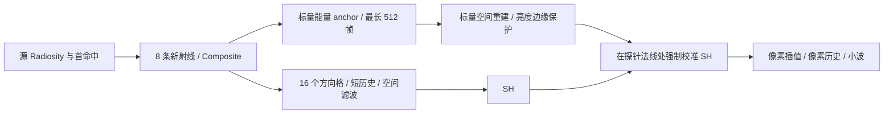

VividRP Screen Probe 与 Lumen 5.7.4 的实现对照
============================================

## 全球 Screen Probe 路径（2026-11-19）

Cornell 发光顶棚场景从 `9f4b44df` 起使用世界空间 8×8 等面积八面体、每探针 64 条射线和历史重要性引导。旧的每探针 8 条射线仍可由 `screenProbeFullSphere` 切换。下表对应 GPU 上各阶段的输入和输出。

| 阶段 | VividRP 全球路径 | 对照的 Lumen 阶段 |
| --- | --- | --- |
| 采样 | 邻域材质法线的漫反射传输与上一帧空间滤波 radiance 共同引导细分。四个子射线各携带原方向格四分之一的质量 | Screen probe BRDF / lighting PDF、structured importance sampling |
| 散射 | 可选 `screenProbeDitherTraceDirections` 按连续坐标和蓝噪声把射线分到相邻方向格。默认沿用原方向格。两种方式都在预曝光空间按射线质量限幅 | `ScreenProbeCompositeTracesWithScatterCS` 的 `DITHER_TRACE_DIRECTIONS` |
| 过滤与投影 | 默认关闭探针级时域。三轮同世界方向的空间滤波后投影到 SH3，标量 anchor 仅供旧路径或诊断使用 | 方向 radiance 过滤、SH irradiance |
| 世界缓存 | 2.5 m 单元、16³ 环形窗口、每探针 32² 等面积方向。按屏幕可见需求刷新，每帧最多 16 个世界探针。八邻角键与方向样本有效时提供远场辐亮度，也可补充缺失的历史引导 | `GetRadianceCacheCoverage`、`SampleRadianceCacheInterpolated`。本实现使用一个窗口，UE 支持多级 clipmap |
| 近场拼接 | 当前单元边长下，缓存射线起点约 4.33 m，接收点射线近场上限约 8.66 m。1.5 倍系数用于方向查找时的视差校正球半径 | Radiance Cache 的 probe TMin、单元对角线和 parallax radius |
| 自适应放置 | 每 tile 用 PCG16 和 Hammersley16 检查 8 个位置，帧相位为模 8。标记和最终插值共用接收平面深度权重与屏幕距离权重。更低序号的候选参与去重，额外探针最多为均匀探针数的 50% | `ScreenProbeAdaptivePlacementMarkCS`、`ScreenProbeAdaptivePlacementSpawnCS` 与 `CalculateUpsampleInterpolationWeights`。5.7.4 此路径使用 8 个候选 |
| 像素时域与运动 | 从相对命中运动生成 fast-update，在几何重投影通过时与上帧值取大。独立 R16 只写本帧观测值。变换更新保留可重投影的历史，实例身份、网格或材质变化仍走失效判断 | 像素时域的 fast-update 与历史长度限制 |

Bent Normal AO 使用独立历史。光源亮度变化仍沿既有光照历史失效逻辑处理。8 射线半球模式、ReSTIR 和 anchor 诊断都有独立调用方。

### Cornell 验收

独立进程依次运行 `cb71d3ee`、`9f4b44df`、`cb71d3ee`、`9f4b44df`。每次用同一相机预热 256 帧，取第 512 至 639 帧的线性 GI 均值。两个版本各自重复采集的均值逐像素一致。在隔离相机上，8 条升至 64 条伴随天花、地面和边缘采样点的能量误差下降，背部采样点的正偏由 15.30% 升到 23.59%。四次独立进程的 GPU marker 读数未能给出可信的成本倍率。

| 隔离相机区域 | 8 条能量误差 | 64 条能量误差 | 8 条去均值残差 | 64 条去均值残差 |
| --- | ---: | ---: | ---: | ---: |
| 天花 | +24.86% | +17.19% | 4.49% | 7.96% |
| 地面 | +8.55% | −0.27% | 10.73% | 5.88% |
| 背部参考点 | +15.30% | +23.59% | 10.33% | 3.85% |
| 边缘 | +14.91% | +13.28% | 10.56% | 5.46% |

可复用的较早 Game View 计时中，8 条与 64 条两档的 pass 中位数如下。该次 8 条对照已包含 P0，比较范围限于那一对采集。

| GPU pass（ms） | 8 条，含 P0 | 64 条 |
| --- | ---: | ---: |
| Screen trace | 0.118 | 0.838 |
| Mesh SDF gather | 0.399 | 2.943 |
| Guide | 0.016 | 0.073 |
| Composite | 0.034 | 0.119 |
| Directional filter | 0.107 | 0.091 |

下表使用 Cornell 实际 Game View 相机、同一组参考像素和同一帧序列。基线与候选都使用 64 条射线、32 px Bent Normal AO、10 帧像素历史。候选的世界缓存和方向散射抖动均关闭。

| 指标 | `9f4b44df` | 更新后的候选 | 路径追踪参考 |
| --- | ---: | ---: | ---: |
| 整面背墙平均能量误差 | +6.77% | +6.74% | 0% |
| 背墙内部固定斑块的带通 RMS / 均值 | 2.232% | 2.238% | — |
| 高箱地面半影中心（画面上方起算的 y） | 909.00 px | 908.93 px | 909.60 px |
| 高箱地面半影 10% 至 90% 宽度 | 11.61 px | 11.88 px | 2.98 px |
| 高箱轮廓 17×17 像素连续帧差 RMS / 均值 | 4.51% | 3.80% | — |
| 矮箱接触阴影对比度 | 63.05% | 63.05% | 65.12% |
| 边缘参考点的能量误差 / 去均值空间残差 | +4.72% / 5.45% | +3.91% / 9.49% | 0% / 0% |

最早的轮廓回归出现在 AO 之前。放置只按接收平面判断，而全分辨率插值额外拒绝法线不符的探针，导致高箱轮廓的 36,992 个像素帧中有 1,278 个丢失覆盖。统一使用 UE 全球路径的接收平面权重后，原始积分和最终 GI 的零覆盖数均为 0。最终 PCG16 序列在 Cornell 八个相位上的标记、分配均为零，GPU 与独立几何回放逐 tile 一致。此场景中的变化来自插值权重。保留了半球路径原有的几何约束。

移动矮箱的 64 帧中重投影历史持续有效。移动期间地面 fast-update 平均 0.415，最高 0.900，静止后为零。在两次采集共同识别的 1,103 个地面像素上，停下后持续四帧低于 10% 阴影残差的首次位置由 3 帧变为 7 帧。旧实现移动时会重置历史。此项验证了运动检测和历史延续，拖影长度仍有差距。

### Sponza 世界缓存验收

使用 SponzaNoon 的 Camera_1、1920×1080 原生分辨率、64 条射线和 64 m 追踪范围。开发中的缓存开关对照在相同的 999 个远处接收点上测得，连续帧差 RMS / 均值由 79.60% 变为 78.98%。两端都启用方向散射抖动。Trace 的 GPU 时间没有呈现可确认的下降，世界缓存继续默认关闭。

最终代码另做一次来源检查。隔离副本直接导出追踪循环结束时的天空及远场计数。170 个世界探针就绪，自适应分配 99 个屏幕探针。在 8,160 个均匀探针的 522,240 条射线中，缓存分支计数为 24,699 条（4.73%），天空为 6 条。5,190 个接收点至少一次进入缓存返回分支。同帧逐射线诊断读出的 `RayFarCache` 标志却为 0；按命中距离和缺失命中平面筛选，方向纹理中也只找到 36 条可能的记录。分支已执行，返回值写入方向图、再进入散射的对应关系尚待验证。这份单帧来源检查不用于估算性能。

### 与 UE 5.7.4 的实现差异

- 世界缓存沿用 VividRP 的 Mesh SDF、Surface Cache、2.5 m 单元、单级环形窗口和每帧 16 个探针预算。按可见需求更新，使用原始方向层、显式四点和八角插值。UE 支持多级 clipmap、间接索引、带 mip 的过滤图集以及独立天空可见性。VividRP 将天空辐亮度写入同一方向图，使用有效距离标记，并在方向数据缺失时重追。更新调度、按距离拒绝历史及 0.25 混合系数属于本地实现。
- 自适应列表按行求前缀和并顺序分配。UE 使用线程组计数、原子分配和间接列表。预算相同，达到上限时跨 tile 的保留顺序可能不同。屏幕边界按 Unity 实际尺寸截断。本次对齐覆盖 Cornell 的不透明漫反射材质。UE 另有 foliage 深度系数。全球最终插值沿用 VividRP 的像素抖动检查与 SH 覆盖归一化。
- 散射使用 Unity 蓝噪声图集及其垂直坐标约定，按固定射线顺序做浮点规约。UE 使用自身的蓝噪声和组内量化累加。两个探针各 16 帧的回放中，存入半精度纹理前后的加权总能量相对差小于 0.04%。这项检查只覆盖散射守恒。
- fast-update 使用独立 R16 历史。UE 将更新量与历史长度分别编码进一个字节的高、低四位。VividRP 保留像素几何重投影与当前帧的前景运动保护，下一帧只继承光照运动观测。单独的光照变化仍走现有失效机制。

本轮检查了 25 个 D3D12 内核和实际加载的 SDF 实例 CPU 布局。实例步长为 128 字节，运动帧偏移为 68，上一帧的三个矩阵行偏移为 80、96、112。Cornell 的 7 节点 SDF 场景预热后连续执行 64 次相同实例更新，调用线程托管分配为 0 字节。以上测量范围只含该更新方法。

## 历史分析 · 半球基线 `31f34144`

2026-11-17。当前基线 `31f34144`，Unity 7000.0.0a16 / CoreRP 17.7.0；Lumen 对照为本机 UE 5.7.4 源码。本文是源码与已有证据分析，没有新增画质 A/B，也不宣称噪点已修复。

后续已实现并实测不依赖标量 anchor 的方向 radiance 候选，见 [实现与验收](ScreenProbeDirectionalRadianceExperiment.md)。它未通过全部区域的能量 / 均值图门槛，但随后按用户“先不管实验效果，保留和 Lumen 的对齐结果”的要求移入生产路径。当前 SH 能量来自过滤后的方向场；下文描述的是 `31f34144` 旧基线，不能理解为当前仍由 scalar anchor 决定，也不能理解为“移除 anchor 必然改善画质”。

已按 `E:/VividRP_GI_Evidence/ScreenProbeRepeatabilityFix-20261116/production-precision/source-manifest.json` 恢复 Common / Filtering / Gather / GatherTemporal / Tracing 五个 shader；五个 SHA256 均与改动前一致。Quadrature 生成器的精度兼容修改一并撤销，已跟踪代码的 `git diff` 为空。Editor 已 Refresh，保持 EditMode。原诊断工具、候选与采集证据保留；此前精度实验的 A/A 结论不能移用于撤销后的代码。既有 anchor512 等配置和采样预算未改变。

**最重要的实现结论：平面的最终能量由独立标量 anchor 主导，方向域滤波改善不必然传到平面。**

实际绑定见 [RecordDirectionalCache](E:/VividRP_Reborn/Packages/VividRP/Runtime/RenderPass/Core/GlobalIllumination/SdfDiffuseGatherPass.cs:2667)：方向 temporal / spatial 与标量 anchor 从 Composite 分叉；PrepareAnchor 读的是原始 Composite，而不是已滤波的方向辐亮度。方向 temporal 自身进入下一帧历史，空间结果另外供采样 guide 使用。



在 [Filtering:1207](E:/VividRP_Reborn/Packages/VividRP/Shaders/Core/Private/GlobalIllumination/SdfScreenProbeFiltering.compute:1207)，设校准前 SH 在探针法线 n 的值为 Q(n)，方向 covered mass 为 C，空间重建 anchor 为 A：

```
DC += A.rgb * C - Q(n)
SHout = SH / C
所以 Evaluate(SHout, n) = A.rgb
```

这是 C > 0、未触发数值 clamp 时的代数结果，存储量化会引入舍入。最终 [Gather:616](E:/VividRP_Reborn/Packages/VividRP/Shaders/Core/Private/GlobalIllumination/SdfScreenProbeGather.compute:616) 用空间权重 w 和 anchor coverage c 加权 SH；在同法线、无额外 AO / repair 的平面，conditional RGB 为 `sum(w*c*A) / sum(w*c)`，coverage 为 `sum(w*c) / sum(w)`（后式假定权重充分、未触发分母下限）。消耗的能量仍来自 anchor。像素法线与量化探针法线稍有不同时，方向形状仍有作用。

因此，单独让 16 个方向格更稳定，不能保证墙面、地板的标量斑块下降。该设计原本用于保持能量，不能直接删掉校准而假定质量会改善；应先确认 anchor 和方向估计量为何产生不同空间误差。

**“静态”还包含慢变残差，不能直接等同于无限收敛偏差。**

[PrepareAnchor](E:/VividRP_Reborn/Packages/VividRP/Shaders/Core/Private/GlobalIllumination/SdfScreenProbeFiltering.compute:942) 汇总原始射线；[时间累积](E:/VividRP_Reborn/Packages/VividRP/Shaders/Core/Private/GlobalIllumination/SdfScreenProbeFiltering.compute:925) 在接收点稳定、历史有效时放宽到 512。满龄以后新样本权重约为 1/512，继续运行是固定窗口强度的 EMA，不是不断增加有效样本数的累计平均。

简化为独立、等方差输入的稳态 EMA，相关系数为 511/512，半衰期约 354.5 帧；128 帧均值的方差为单帧 EMA 输出方差的 0.92156，RMS 为 0.95998。这个解析示例不是 GPU 测量，实际 guide、覆盖和失效会改变相关性；它解释了为何长历史能大幅压低帧差，却仍让短均值图呈现近乎不动的云纹。

**重建使用了同一份带噪亮度作为边缘依据。**

- [ReconstructProbeAnchor:1042](E:/VividRP_Reborn/Packages/VividRP/Shaders/Core/Private/GlobalIllumination/SdfScreenProbeFiltering.compute:1042) 用未滤波 anchor 的亮度差控制扩散，年龄 8→64 后逐渐信任它，权重乘 `exp2(-32*contrast)`。年龄说明历史持续存在，不证明该亮度差是真实阴影，也不证明其统计误差足够小。持续的源误差或慢变采样残差可能因此被保留。
- [StableRadianceFootprint:530](E:/VividRP_Reborn/Packages/VividRP/Shaders/Core/Private/GlobalIllumination/SdfScreenProbeGather.compute:530) 也以成熟 anchor 的对比度压缩插值抖动范围。它只在规定的较大对比度范围触发，不能据截图断言所有平面都关闭了抖动。
- 标量扩散的对称权重和固定归一化有保持整体平面能量的意图；这不等于保持每个像素正确，也不能从整体能量接近参考推出空间云纹消失。

**源缓存的“未解析”和“有效黑”没有与 Gather 的语义完全对齐。**

[TraceCardRadiance:261](E:/VividRP_Reborn/Packages/VividRP/Shaders/Core/Private/GlobalIllumination/SdfSurfaceCacheLighting.hlsl:261) 返回值只有 RGB：SDF 追踪 incomplete、卡片查询失败与合法黑色都可能返回零。[GatherCardIndirect:102](E:/VividRP_Reborn/Packages/VividRP/Shaders/Core/Private/GlobalIllumination/SdfRadiosity.compute:102) 仍除以全部 rayCount，并为有效接收卡片输出 `alpha = 1 + depth`。这里 alpha 保存卡片有效性 / 深度，不携带射线未解析率。因此下游无法区分“物理黑”与“源求解失败形成的零”；对应射线若本应非零，就会形成负能量误差。

当前 Cornell 配置为 8 orders / 64 samples / 32 batches。[更新控制:2013](E:/VividRP_Reborn/Packages/VividRP/Runtime/RenderPass/Core/GlobalIllumination/SdfDiffuseGatherPass.cs:2013) 到 batch limit 后停止采样，直到相关失效或重光照条件改变。有限采样误差、SDF 轮廓误差和上述失败零值可以成为稳定源纹理。继续积累 Gather 只能逼近这份源提供的照明，不能恢复源中丢失的信息。源码确认了传播路径；这些成分各自占最终云纹多少，尚未量化。

不能把所有零都改成无效：材质背面、被遮挡和真正黑色必须继续计入合法能量。应分离失败状态，再验证其物理返回值与覆盖，而不是对剩余非零样本重新归一化增亮。

光片边缘是另外已观测到的几何不一致。[既有端点证据](E:/VividRP_Reborn/Packages/VividRP/Documentation~/ScreenProbeCardCoverage.md) 显示边缘 SDF 梯度会选到错误卡片，且还存在已接受的膨胀轮廓误命中。此前候选只修复查询失败的一小部分，没有处理所有原已接受的错误首命中。精度实验配置下复测也未通过最终画面门槛；天花板、地板输出不变，不能把全画面云纹归因于这一个局部缺口。

**与 Lumen 对照时，算法中的量和预算必须分别比较。**

| 环节 | 当前 VividRP | 本机 UE 5.7.4 对应路径 |
| --- | --- | --- |
| 方向表示 | 法线局部 cosine 半球的 4×4 等 cosine mass 格；实际射线归入格，SH 用格中心重建 | 全球 equal-area 方向图；按采样层级权重散射，并用实际采样位置作方向格抖动 |
| 探针滤波 | 方向 age 上限 8，另有独立最长 512 的标量 anchor，最后 DC 强制校准 | 方向 radiance temporal → spatial → SH；该投影路径没有独立标量 anchor 的强制回填 |
| 空间复用 | 方向滤波之外还有标量扩散、基于 anchor 年龄和亮度的保护 | 对方向 radiance 依据深度、命中距离 / 角度和运动过滤，源码默认 3 次空间 pass |
| 射线数 | 每探针 8 条，重建 16 个方向格 | tracing resolution 默认 8，意为 8×8；quality=1、无其他覆盖时是 64 条，实际随质量配置改变 |

Lumen 代码入口：[方向散射](E:/UnrealEngine/Engine/Shaders/Private/Lumen/LumenScreenProbeFiltering.usf:77)、[radiance temporal](E:/UnrealEngine/Engine/Shaders/Private/Lumen/LumenScreenProbeFiltering.usf:272)、[命中角度过滤](E:/UnrealEngine/Engine/Shaders/Private/Lumen/LumenScreenProbeFiltering.usf:352)、[SH 投影](E:/UnrealEngine/Engine/Shaders/Private/Lumen/LumenScreenProbeFiltering.usf:618)、[采样分辨率](E:/UnrealEngine/Engine/Source/Runtime/Renderer/Private/Lumen/LumenScreenProbeGather.cpp:445)。上述默认值不是同预算实测，也不意味着 64 条的效果可以直接移植到 8 条；本轮保持原预算。

Vivid 的 cosine chart 本身可以构成合法估计量，不能仅因与 Lumen 使用不同参数化就判错。但只有 8 条新样本更新 16 个方向格，再以格中心表示方向、跨法线重投影及借用邻居时，方向形状存在额外近似；这更直接影响法线变化、遮挡边界与接触区域。同法线平面的能量经上面的 DC 校准后，应优先检查标量链路。

另已核对两项容易误判的归一化：Composite 存 conditional RGB 和 covered mass；anchor 历史在 `RGB*coverage` 与 coverage 上分别累积，并非直接平均 conditional RGB。Radiosity 存 E/PI，读取时乘一次反照率；目前没有由这段代码支持“多除了一次 PI”的结论。

Epic 官方也要求 Lumen Scene 与可见几何匹配，并说明卡片未覆盖处不能正常反弹光，小型发光体可出现照明不一致。这支持检查几何 / 覆盖契约，但不能替代本项目误差测量。[Lumen 5.7 Technical Details](https://dev.epicgames.com/documentation/en-us/unreal-engine/lumen-technical-details-in-unreal-engine?application_version=5.7)

**后续应对齐的顺序**：先分清源返回值的有效性与黑色、接收点 / 首命中 / 卡片表面的几何身份；再让标量与方向重建共享可解释的能量和置信度，检查 DC 回填及亮度边缘保护；最后处理方向离散和像素重建。每项仍需同预算、可配对的 A/A 与 A/B，并分别验收最终均值图的空间残差、分物体能量误差及参考不确定性。时间方差只作为辅助指标。本次只完成精度撤销和实现分析，没有安装新的 GI 候选或执行 Unity Test Framework。
