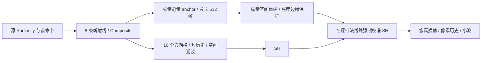

VividRP Screen Probe：精度撤销与实现对齐分析
================================================

2026-11-17。当前基线 `31f34144`，Unity 7000.0.0a16 / CoreRP 17.7.0；Lumen 对照为本机 UE 5.7.4 源码。本文是源码与已有证据分析，没有新增画质 A/B，也不宣称噪点已修复。

后续已实现并实测不依赖标量 anchor 的方向 radiance 候选，见 [实现与验收](ScreenProbeDirectionalRadianceExperiment.md)。它未通过全部区域的能量 / 均值图门槛，但随后按用户“先不管实验效果，保留和 Lumen 的对齐结果”的要求移入生产路径。当前 SH 能量来自过滤后的方向场；下文描述的是 `31f34144` 旧基线，不能理解为当前仍由 scalar anchor 决定，也不能理解为“移除 anchor 必然改善画质”。

已按 `E:/VividRP_GI_Evidence/ScreenProbeRepeatabilityFix-20261116/production-precision/source-manifest.json` 恢复 Common / Filtering / Gather / GatherTemporal / Tracing 五个 shader；五个 SHA256 均与改动前一致。Quadrature 生成器的精度兼容修改一并撤销，已跟踪代码的 `git diff` 为空。Editor 已 Refresh，保持 EditMode。原诊断工具、候选与采集证据保留；此前精度实验的 A/A 结论不能移用于撤销后的代码。既有 anchor512 等配置和采样预算未改变。

**最重要的实现结论：平面的最终能量由独立标量 anchor 主导，方向域滤波改善不必然传到平面。**

实际绑定见 [RecordDirectionalCache](E:/VividRP_Reborn/Packages/VividRP/Runtime/RenderPass/Core/GlobalIllumination/SdfDiffuseGatherPass.cs:2667)：方向 temporal / spatial 与标量 anchor 从 Composite 分叉；PrepareAnchor 读的是原始 Composite，而不是已滤波的方向辐亮度。方向 temporal 自身进入下一帧历史，空间结果另外供采样 guide 使用。



在 [Filtering:1207](E:/VividRP_Reborn/Packages/VividRP/Shaders/Core/Private/GlobalIllumination/SdfScreenProbeFiltering.compute:1207)，设校准前 SH 在探针法线 n 的值为 Q(n)，方向 covered mass 为 C，空间重建 anchor 为 A：

```
DC += A.rgb * C - Q(n)
SHout = SH / C
所以 Evaluate(SHout, n) = A.rgb
```

这是 C > 0、未触发数值 clamp 时的代数结果，存储量化会引入舍入。最终 [Gather:616](E:/VividRP_Reborn/Packages/VividRP/Shaders/Core/Private/GlobalIllumination/SdfScreenProbeGather.compute:616) 用空间权重 w 和 anchor coverage c 加权 SH；在同法线、无额外 AO / repair 的平面，conditional RGB 为 `sum(w*c*A) / sum(w*c)`，coverage 为 `sum(w*c) / sum(w)`（后式假定权重充分、未触发分母下限）。消耗的能量仍来自 anchor。像素法线与量化探针法线稍有不同时，方向形状仍有作用。

因此，单独让 16 个方向格更稳定，不能保证墙面、地板的标量斑块下降。该设计原本用于保持能量，不能直接删掉校准而假定质量会改善；应先确认 anchor 和方向估计量为何产生不同空间误差。

**“静态”还包含慢变残差，不能直接等同于无限收敛偏差。**

[PrepareAnchor](E:/VividRP_Reborn/Packages/VividRP/Shaders/Core/Private/GlobalIllumination/SdfScreenProbeFiltering.compute:942) 汇总原始射线；[时间累积](E:/VividRP_Reborn/Packages/VividRP/Shaders/Core/Private/GlobalIllumination/SdfScreenProbeFiltering.compute:925) 在接收点稳定、历史有效时放宽到 512。满龄以后新样本权重约为 1/512，继续运行是固定窗口强度的 EMA，不是不断增加有效样本数的累计平均。

简化为独立、等方差输入的稳态 EMA，相关系数为 511/512，半衰期约 354.5 帧；128 帧均值的方差为单帧 EMA 输出方差的 0.92156，RMS 为 0.95998。这个解析示例不是 GPU 测量，实际 guide、覆盖和失效会改变相关性；它解释了为何长历史能大幅压低帧差，却仍让短均值图呈现近乎不动的云纹。

**重建使用了同一份带噪亮度作为边缘依据。**

- [ReconstructProbeAnchor:1042](E:/VividRP_Reborn/Packages/VividRP/Shaders/Core/Private/GlobalIllumination/SdfScreenProbeFiltering.compute:1042) 用未滤波 anchor 的亮度差控制扩散，年龄 8→64 后逐渐信任它，权重乘 `exp2(-32*contrast)`。年龄说明历史持续存在，不证明该亮度差是真实阴影，也不证明其统计误差足够小。持续的源误差或慢变采样残差可能因此被保留。
- [StableRadianceFootprint:530](E:/VividRP_Reborn/Packages/VividRP/Shaders/Core/Private/GlobalIllumination/SdfScreenProbeGather.compute:530) 也以成熟 anchor 的对比度压缩插值抖动范围。它只在规定的较大对比度范围触发，不能据截图断言所有平面都关闭了抖动。
- 标量扩散的对称权重和固定归一化有保持整体平面能量的意图；这不等于保持每个像素正确，也不能从整体能量接近参考推出空间云纹消失。

**源缓存的“未解析”和“有效黑”没有与 Gather 的语义完全对齐。**

[TraceCardRadiance:261](E:/VividRP_Reborn/Packages/VividRP/Shaders/Core/Private/GlobalIllumination/SdfSurfaceCacheLighting.hlsl:261) 返回值只有 RGB：SDF 追踪 incomplete、卡片查询失败与合法黑色都可能返回零。[GatherCardIndirect:102](E:/VividRP_Reborn/Packages/VividRP/Shaders/Core/Private/GlobalIllumination/SdfRadiosity.compute:102) 仍除以全部 rayCount，并为有效接收卡片输出 `alpha = 1 + depth`。这里 alpha 保存卡片有效性 / 深度，不携带射线未解析率。因此下游无法区分“物理黑”与“源求解失败形成的零”；对应射线若本应非零，就会形成负能量误差。

当前 Cornell 配置为 8 orders / 64 samples / 32 batches。[更新控制:2013](E:/VividRP_Reborn/Packages/VividRP/Runtime/RenderPass/Core/GlobalIllumination/SdfDiffuseGatherPass.cs:2013) 到 batch limit 后停止采样，直到相关失效或重光照条件改变。有限采样误差、SDF 轮廓误差和上述失败零值可以成为稳定源纹理。继续积累 Gather 只能逼近这份源提供的照明，不能恢复源中丢失的信息。源码确认了传播路径；这些成分各自占最终云纹多少，尚未量化。

不能把所有零都改成无效：材质背面、被遮挡和真正黑色必须继续计入合法能量。应分离失败状态，再验证其物理返回值与覆盖，而不是对剩余非零样本重新归一化增亮。

光片边缘是另外已观测到的几何不一致。[既有端点证据](E:/VividRP_Reborn/Packages/VividRP/Documentation~/ScreenProbeCardCoverage.md) 显示边缘 SDF 梯度会选到错误卡片，且还存在已接受的膨胀轮廓误命中。此前候选只修复查询失败的一小部分，没有处理所有原已接受的错误首命中。精度实验配置下复测也未通过最终画面门槛；天花板、地板输出不变，不能把全画面云纹归因于这一个局部缺口。

**与 Lumen 对照时，算法中的量和预算必须分别比较。**

| 环节 | 当前 VividRP | 本机 UE 5.7.4 对应路径 |
| --- | --- | --- |
| 方向表示 | 法线局部 cosine 半球的 4×4 等 cosine mass 格；实际射线归入格，SH 用格中心重建 | 全球 equal-area 方向图；按采样层级权重散射，并用实际采样位置作方向格抖动 |
| 探针滤波 | 方向 age 上限 8，另有独立最长 512 的标量 anchor，最后 DC 强制校准 | 方向 radiance temporal → spatial → SH；该投影路径没有独立标量 anchor 的强制回填 |
| 空间复用 | 方向滤波之外还有标量扩散、基于 anchor 年龄和亮度的保护 | 对方向 radiance 依据深度、命中距离 / 角度和运动过滤，源码默认 3 次空间 pass |
| 射线数 | 每探针 8 条，重建 16 个方向格 | tracing resolution 默认 8，意为 8×8；quality=1、无其他覆盖时是 64 条，实际随质量配置改变 |

Lumen 代码入口：[方向散射](E:/UnrealEngine/Engine/Shaders/Private/Lumen/LumenScreenProbeFiltering.usf:77)、[radiance temporal](E:/UnrealEngine/Engine/Shaders/Private/Lumen/LumenScreenProbeFiltering.usf:272)、[命中角度过滤](E:/UnrealEngine/Engine/Shaders/Private/Lumen/LumenScreenProbeFiltering.usf:352)、[SH 投影](E:/UnrealEngine/Engine/Shaders/Private/Lumen/LumenScreenProbeFiltering.usf:618)、[采样分辨率](E:/UnrealEngine/Engine/Source/Runtime/Renderer/Private/Lumen/LumenScreenProbeGather.cpp:445)。上述默认值不是同预算实测，也不意味着 64 条的效果可以直接移植到 8 条；本轮保持原预算。

Vivid 的 cosine chart 本身可以构成合法估计量，不能仅因与 Lumen 使用不同参数化就判错。但只有 8 条新样本更新 16 个方向格，再以格中心表示方向、跨法线重投影及借用邻居时，方向形状存在额外近似；这更直接影响法线变化、遮挡边界与接触区域。同法线平面的能量经上面的 DC 校准后，应优先检查标量链路。

另已核对两项容易误判的归一化：Composite 存 conditional RGB 和 covered mass；anchor 历史在 `RGB*coverage` 与 coverage 上分别累积，并非直接平均 conditional RGB。Radiosity 存 E/PI，读取时乘一次反照率；目前没有由这段代码支持“多除了一次 PI”的结论。

Epic 官方也要求 Lumen Scene 与可见几何匹配，并说明卡片未覆盖处不能正常反弹光，小型发光体可出现照明不一致。这支持检查几何 / 覆盖契约，但不能替代本项目误差测量。[Lumen 5.7 Technical Details](https://dev.epicgames.com/documentation/en-us/unreal-engine/lumen-technical-details-in-unreal-engine?application_version=5.7)

**后续应对齐的顺序**：先分清源返回值的有效性与黑色、接收点 / 首命中 / 卡片表面的几何身份；再让标量与方向重建共享可解释的能量和置信度，检查 DC 回填及亮度边缘保护；最后处理方向离散和像素重建。每项仍需同预算、可配对的 A/A 与 A/B，并分别验收最终均值图的空间残差、分物体能量误差及参考不确定性。时间方差只作为辅助指标。本次只完成精度撤销和实现分析，没有安装新的 GI 候选或执行 Unity Test Framework。
