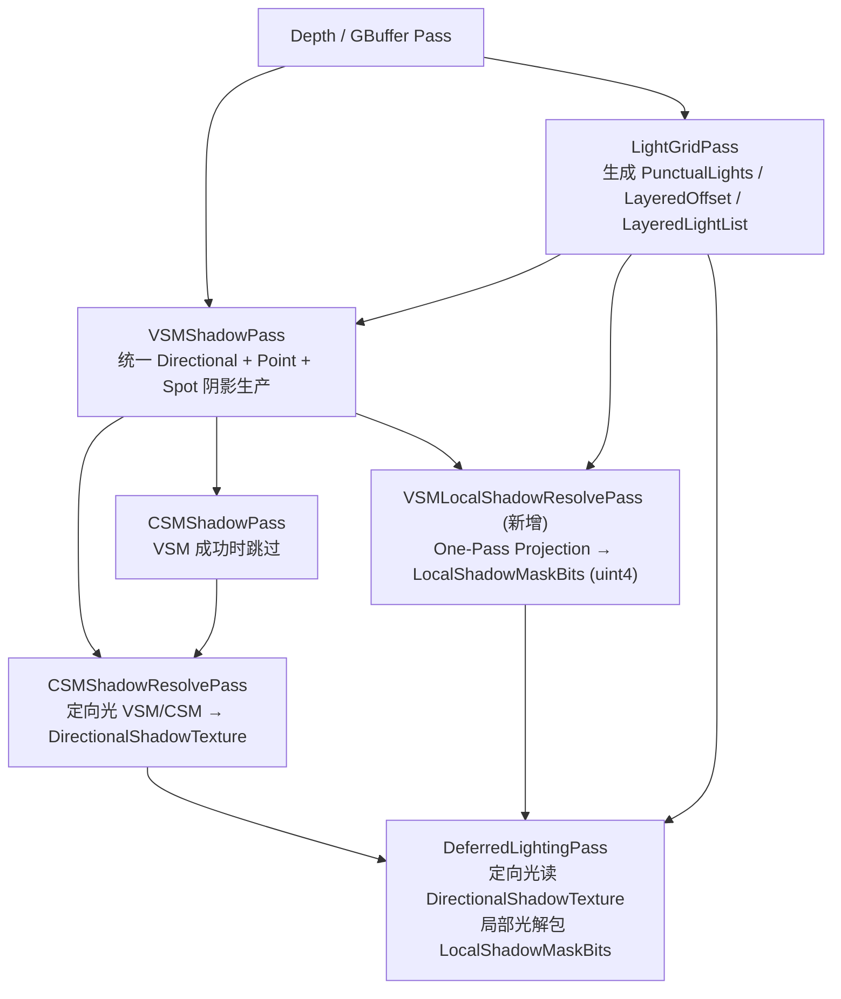
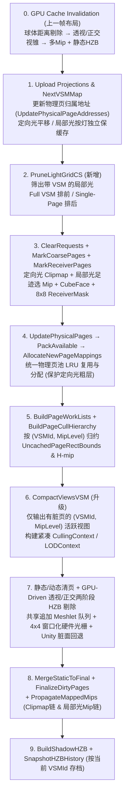

# 统一虚拟阴影图架构设计（Directional + Point + Spot）

返回索引：[Documentation~ 索引](README.md) · 相关文档：[VSM 代码布局](VirtualShadowMapCodeLayout.md) | [VSM Shader 与 Unreal 参考关系](VirtualShadowMapShaderReference.md)

> **文档状态**：架构设计稿（Implementation Spec）  
> **参考基线**：Unreal Engine 5.7.4 [ReferenceVSM](../Shaders/Core/Private/VirtualShadowMap/ReferenceVSM/) · VividRP 当前单层双 Slice 物理池与 GPU-Driven VSM 底座

---

## 1. 设计目标与边界

VividRP 当前 VSM 子系统已具备单层双 Slice 物理页池（`FinalDepthSlice = 0` / `StaticDepthSlice = 1`）、UE 风格 4 队列 `VSMPhysicalPageLists`、8×8 `ReceiverMask`、H-mip 裁剪、`UncachedPageRectBounds`、GPU 缓存失效、`VSMShadowHZB` 两阶段剔除与 4×4 窗口化硬件光栅，但整个虚拟寻址、投影结构、标页、裁剪、失效和阴影 Resolve 均绑定到**单一主定向光 Clipmap**。

本设计将现有 VSM 扩展为**单一统一架构**，原生支持：

1. **Directional Light（定向光）**：多级正交 Clipmap（每级 1 个 Full VSM，仅使用 Mip 0，沿 Clipmap 链传播与滚动平移）。
2. **Point Light（点光源）**：6 个连续透视 VSM（`+X, -X, +Y, -Y, +Z, -Z`），每面自带 Mip 金字塔（`Mip 0 .. MaxMip-1`），支持跨 Cube 面无缝 SMRT。
3. **Spot Light（聚光灯）**：1 个透视 VSM（与点光源单面共享 95%+ 代码，自带 Mip 金字塔与单面 SMRT，并可作为最小闭环验证载体）。
4. **Single-Page / Distant Light（远处局部光降级）**：屏幕投影较小的点/聚光灯自动降级为单页 VSM（每面仅占 1 个页表项），跳过逐像素标页与逐帧动态失效，采用轮转刷新（Round-Robin）。

### 约束与不变量

- **定向光零回归**：定向光 Clipmap 的平移缓存、静态/动态双池合并、HZB 与自适应 SMRT 语义完整保留。
- **热路径零托管分配**：CPU 准备、缓存身份查找、视图打包与上传全部复用预分配数组/`NativeArray`，稳定帧 0B GC。
- **CPU/GPU 布局强一致**：所有上传 GPU 的 C# 结构体强制 `[StructLayout(LayoutKind.Sequential)]`、16 字节对齐，并在 `Tests/Editor/` 中补充字段偏移断言。
- **遵循 Unity 坐标系与 Reverse-Z**：所有矩阵与 Cube Face 约定统一使用 Unity 左手 Y-up、Reverse-Z（近 = `1.0`，远 = `0.0`）与 `UNITY_UV_STARTS_AT_TOP`。

---

## 2. 总体渲染管线与 RenderGraph 拓扑

### 2.1 RenderGraph 阶段顺序

局部光 VSM 依赖 Clustered Light Grid 完成标页和 One-Pass Projection，因此必须明确 `LightGridPass` 与 `VSMShadowPass` 的先后顺序：



### 2.2 `VSMShadowPass` 内部执行流水线



### 2.3 资源生命周期分类

| 分类 | 资源 | 说明 |
|---|---|---|
| **跨帧持久** | `VSMPhysicalPagePool`（R32_UInt Tex2DArray, 2 slices） | Slice 0 = Final，Slice 1 = Static，定向光与局部光共享 |
| **跨帧持久** | `VSMShadowHZB`（R32_SFloat Tex2DArray, 2 slices × 7 mips） | 随物理页池存在，供下帧失效与两阶段遮挡剔除 |
| **跨帧持久** | `VSMPhysicalPageOwners`、`VSMPhysicalPageLists`、`VSMPhysicalReceiverMasks` | 物理槽反查归属、4 队列 LRU、动态页完成覆盖 |
| **跨帧持久** | `VSMPageMetadata`、`VSMPageTable`、`VSMPreviousProjections`、`VSMPreviousPageTable` | 虚拟页状态与上帧 HZB 快照（按上帧 VSMId 索引） |
| **跨帧持久** | `VSMInvalidationSources`、`VSMInvalidationStates` | PrimitiveScene 实例变化检测状态 |
| **帧内瞬态** | `VSMPrunedLightGridHeader`、`VSMPrunedLightGridData` | 仅含 VSM 局部光的裁剪 Cluster 列表 |
| **帧内瞬态** | `VSMPageRequestFlags`、`VSMPageReceiverMasks` | 当帧标页请求与接收面掩码 |
| **帧内瞬态** | `VSMPageCullHierarchy`、`VSMUncachedPageRectBounds`、`VSMAllocatedPageRectBounds` | 按 `(VSMId, MipLevel)` 构建的当帧空间加速结构 |
| **帧内瞬态** | `VSMActiveViews`、`VSMActiveCullingContexts`、`VSMSharedMeshletQueue` | 压缩后的活跃 `(VSMId, MipLevel)` 列表与共享 Meshlet 队列 |
| **帧内瞬态** | `LocalShadowMaskBits`（`R32G32B32A32_UInt` 全屏） | One-Pass Projection 打包输出，供 `DeferredLightingPass` 读取 |

---

## 3. 统一虚拟地址空间与句柄设计

### 3.1 `VSMHandle` 分段规则（对齐 UE `VirtualShadowMapHandle.ush`）

为支持大量远处小点光源而不膨胀页表，将全局 `VSMId`（`uint`）划分为两段：

```text
VSMId 空间:
  [0, VSM_MAX_SINGLE_PAGE_SHADOW_MAPS)             -> Single-Page VSM (Distant Light, 默认上限 512)
  [VSM_MAX_SINGLE_PAGE_SHADOW_MAPS, MaxTotalVSMs)  -> Full VSM (Clipmap 层 / Spot / Point 6 面)
  0xFFFFFFFFu                                      -> Invalid Handle
```

- **Directional Light**：占用连续 `ClipmapCount`（如 12~16）个 Full VSM ID，基址为 `dirBaseVsmId`。
- **Spot Light**：Full 模式占 1 个 Full VSM ID；Distant 模式占 1 个 Single-Page VSM ID。
- **Point Light**：Full 模式占 **6 个连续** Full VSM ID（`baseId + face`）；Distant 模式占 **6 个连续** Single-Page VSM ID（仅渲染被需要或轮转到的面，每面 1 页 `128×128`）。

### 3.2 虚拟页表布局选型与寻址公式

> **选型说明**：UE 5.7.4 使用 `Texture2D<uint>` 打包所有 VSM（Single-Page 放第 0 块，Full VSM 每张占 `128×192` 含 mip tail）。VividRP 当前所有页表/元数据/请求/ReceiverMask 均基于 `StructuredBuffer<uint>` 且虚拟分辨率可配置（`2048` / `4096` / `8192` / `16384`，`PageSize = 128`）。
>
> 为最小化对现有测试与 Compute 内核的破坏，**一期推荐采用“统一扁平偏移 + 抽象寻址接口”的 `StructuredBuffer` 方案**，所有访问必须经过 `VividVSMCalcPageIndex(vsmId, mipLevel, pageXY)`，为后续平滑切换到 `Texture2D<uint>` + `GatherLODRed` 保留清晰抽象边界。

设 Full VSM 最大轴向页数 `P = VirtualResolution / 128`（必须为 2 的幂，例如 `VirtualResolution = 4096 → P = 32, MaxMips = 6`；`16384 → P = 128, MaxMips = 8`）：

- **Single-Page VSM（`vsmId < VSM_MAX_SINGLE_PAGE_SHADOW_MAPS`）**：
  - 仅存在逻辑最粗层 `mipLevel = MaxMips - 1, pageXY = (0, 0)`；
  - 全局线性页索引：`pageIndex = vsmId`（仅占 **1 个槽位**！）。
- **Full VSM（`vsmId >= VSM_MAX_SINGLE_PAGE_SHADOW_MAPS`）**：
  - 令 `fullIndex = vsmId - VSM_MAX_SINGLE_PAGE_SHADOW_MAPS`；
  - 每个 Full VSM 占用固定页数 `EntriesPerFullVSM`：
    - 若为 **Directional Clipmap（仅需 Mip 0）** 与 **Local Mip-Chain（需 Mip 0..MaxMips-1）** 混合：
      - **方案 A（统一固定步长，推荐一期）**：每个 Full VSM 统一预留完整金字塔 `EntriesPerFullVSM = (4 * P * P - 1) / 3`（仅比单 Mip0 多 33.3%，无需查表，纯位运算 O(1) 寻址）；
      - **方案 B（按类型偏移表，适合高分辨率极省显存）**：在 `VividVSMProjection.pageTableBaseOffset` 中存入该 VSM 起始偏移，Directional 只分 `P * P`，Local 分 `(4 * P * P - 1) / 3`。
    - 给定 `mipLevel ∈ [0, MaxMips)`，该层轴向页数 `mipP = P >> mipLevel`，层内偏移为：
      $$\text{mipOffset}(\text{mip}) = \frac{4(P^2 - (P \gg \text{mip})^2)}{3}$$
    - 全局线性页索引：
      $$\text{pageIndex} = \text{BaseOffset}(\text{vsmId}) + \text{mipOffset}(\text{mip}) + \text{pageY} \cdot \text{mipP} + \text{pageX}$$

> **推荐**：采用 **方案 B（在 `VividVSMProjection` 中存 `pageTableBaseOffset`）**！仅多占 4 字节，却能同时满足：
> 1. Directional Clipmap 仅占 $P^2$（不浪费 33% 空间）；
> 2. Local Full VSM 占完整金字塔 $(4P^2-1)/3$，且允许 Local 与 Directional 采用**不同的最大虚拟分辨率**（例如 Directional 用 8K/16K，Point 单面用 4K/8K，大幅节省页表与元数据显存！）；
> 3. Single-Page 仅占 1 槽位。

### 3.3 页表项（PageTable Entry）与物理页归属位布局

**1. `PageTable[pageIndex]`（32-bit `uint`，沿用现有 UE ABI）**

```text
Bit [0..9]   : PhysicalPageX (0..1023)
Bit [10..19] : PhysicalPageY (0..1023)
Bit [20..25] : LODOffset     (0 = 本层原生映射; >0 = 指向更粗 Clipmap 或更粗 Mip 的层差)
Bit [26..29] : Reserved (0)
Bit [30]     : VIVID_VSM_PAGE_TABLE_RENDER (本帧需要光栅写入)
Bit [31]     : VIVID_VSM_PAGE_TABLE_VALID  (任意有效 LOD 映射存在)
```

**2. 物理槽结构化归属 `PhysicalPageDescriptors[slot]`（64-bit `uint2`，与现有 `uint PhysicalPageOwners[slot]` 并存）**

保留现有 `_VSMPrototypePhysicalPageOwners[slot]`（`pageIndex + 1u`，0 = 空槽），使 `Clear` / `Finalize` / `Merge` / `WorkLists` / `HZB` 及既有诊断与测试保持 O(1) 虚拟页直接访问、零破坏；同时新增 8B/槽的伴随缓冲 `_VSMPhysicalPageDescriptors[slot]`（2048 页仅占 **16 KiB**），记录任意类型、任意分辨率物理槽的结构化归属：

```text
word0:
  Bit [0..15]  : VSMId         (0..65534; 0xFFFF = 空槽/无效)
  Bit [16..19] : MipLevel      (0..15)
  Bit [20..27] : Flags         (bit0: IsValid, bit1: IsSinglePage, bit2: IsUnreferenced, bit3: IsDetailGeometry)
  Bit [28..31] : Reserved
word1:
  Bit [0..15]  : PageX         (0..127)
  Bit [16..31] : PageY         (0..127)
```

---

## 4. 核心数据结构草图（C# ↔ HLSL 精确 ABI）

> 所有结构体满足 `[StructLayout(LayoutKind.Sequential)]` 与 16 字节 stride 对齐，字段顺序 C# 与 HLSL 完全一致。

### 4.1 统一投影描述符 `VividVSMProjection`（256 Bytes）

替代当前 160B 的 [VirtualShadowMapProjection](file:///e:/VividRP_Reborn/Packages/VividRP/Runtime/SubSystem/VirtualShadowMap/VirtualShadowMapProjection.cs#L11-L18)：

```csharp
// C# (Runtime/SubSystem/VirtualShadowMap/VirtualShadowMapProjection.cs)
public enum VividVSMLightType : uint
{
    Directional = 0,
    Point = 1,
    Spot = 2,
}

[Flags]
public enum VividVSMProjectionFlags : uint
{
    None                 = 0,
    SinglePage           = 1u << 0, // Distant Light，仅 1 页 (128x128)
    Unreferenced         = 1u << 1, // 本帧未引用，保留缓存不渲染
    UseReceiverMask      = 1u << 2, // 启用 8x8 Receiver Mask
    IsCoarseClipLevel    = 1u << 3, // 定向光保底粗层
    Uncached             = 1u << 4, // 强制不走静态缓存（如实时移动光源）
    SkipDynamicInvalid   = 1u << 5, // 跳过逐帧动态失效（如 Single-Page）
}

// Total size: 256 bytes (16 * float4)
[StructLayout(LayoutKind.Sequential)]
internal struct VividVSMProjection
{
    // Offset 0   (64B): GPU Clip 矩阵 (已包含 GL.GetGPUProjectionMatrix Reverse-Z & Y-flip)
    internal Matrix4x4 WorldToClip;
    // Offset 64  (64B): 世界坐标 -> Shadow UV [0,1] + Reverse-Z 深度 [0,1]
    internal Matrix4x4 WorldToShadow;

    // Offset 128 (16B): Directional = (unsnappedCamPosWS.xyz, -levelRadius)
    //                   Point/Spot  = (lightPosWS.xyz, lightRange)
    internal Vector4 LightPositionOrSelectionSphere;

    // Offset 144 (16B): Directional = (worldTexelSize, normalBias, perfLodBias, maxDistance)
    //                   Point/Spot  = (sourceRadius, normalBias, resolutionLodBias, nearPlane)
    internal Vector4 Parameters;

    // Offset 160 (16B): Point/Spot = (lightForwardWS.xyz, cosOuterSpotAngle; Point=-2.0)
    //                   Directional = (toLightDirWS.xyz, sinHalfAngularDiameter)
    internal Vector4 LightDirectionAndSpot;

    // Offset 176 (16B): 透视投影 Z 参数 (用于透视斜率/遮挡距离/足迹计算，避免额外传 64B 矩阵)
    //   x = ShadowViewToClip.m00 (cotHalfFovX; Ortho 为 1/radius)
    //   y = ShadowViewToClip.m11 (cotHalfFovY; Ortho 为 1/radius)
    //   z = ShadowViewToClip.m22 (Reverse-Z 深度缩放)
    //   w = ShadowViewToClip.m23 (Reverse-Z 深度偏移)
    internal Vector4 ProjectionScales;

    // Offset 192 (16B): 寻址与层级元数据
    //   x = PageTableBaseOffset (本 VSM 在全局页表中的起始槽位)
    //   y = HierarchyBaseOffset (本 VSM 在 PageCullHierarchy 中的起始节点偏移)
    //   z = PagesPerAxis        (Mip0 轴向页数, 如 32/64/128; SinglePage 为 1)
    //   w = MaxMipLevels        (Directional = 1; Local Full = log2(PagesPerAxis)+1; SinglePage = 1)
    internal uint4 Addressing;

    // Offset 208 (16B): 类型、标志与局部光/Clipmap 参数
    //   x = LightType           (VividVSMLightType)
    //   y = Flags               (VividVSMProjectionFlags)
    //   z = MinMipLevel         (Local 最小允许 Mip，用于节流/ReceiverMask；Directional=0)
    //   w = ClipmapRemaining    (Directional 剩余粗层数；Point=FaceIndex 0..5；Spot=0)
    internal uint4 Meta;

    // Offset 224 (16B): 关联身份与 Clipmap 相对原点
    //   x = BaseVSMId           (Directional=首个Clipmap ID; Point=Face0 ID; Spot=自身ID)
    //   y = PrevVSMId           (上一帧对应的 VSMId, 无效为 0xFFFFFFFF，供 HZB 历史查询)
    //   z = ClipmapOriginRelX   (整数相对页偏移，局部光为 0)
    //   w = ClipmapOriginRelY
    internal uint4 IdentityAndOrigin;

    // Offset 240 (16B): 扩展控制参数
    //   x = TexelDitherScale    (局部光/定向光每灯抖动缩放)
    //   y = BoundRectBaseOffset (本 VSM 在 UncachedPageRectBounds/AllocatedPageRectBounds 中的起始索引)
    //   z = LightIndex          (对应 PunctualLightData 索引或 Directional 索引，供调试)
    //   w = Reserved
    internal uint4 Extended;
}
```

对应 HLSL（[VividVirtualShadowMapProjection.hlsl](file:///e:/VividRP_Reborn/Packages/VividRP/Shaders/Core/Public/Shadow/VirtualShadowMap/VividVirtualShadowMapProjection.hlsl)）：

```hlsl
struct VividVSMProjection
{
    float4x4 worldToClip;
    float4x4 worldToShadow;
    float4   lightPosOrSphere;
    float4   parameters;
    float4   lightDirAndSpot;
    float4   projectionScales;
    uint4    addressing;       // pageTableBase, hierarchyBase, pagesPerAxis, maxMipLevels
    uint4    meta;             // lightType, flags, minMipLevel, clipmapRemainingOrFace
    uint4    identityAndOrigin;// baseVsmId, prevVsmId, originRelX, originRelY
    uint4    extended;         // asfloat(x)=texelDitherScale, y=boundRectBase, z=lightIndex, w=reserved
};
```

> **说明**：为什么不额外塞一个 64B 的 `TranslatedWorldToShadowUVNormalMatrix`？对于标准对称透视投影（点光源 90° CubeFace 与标准聚光灯），`worldToShadow` 的上 3×3 正交旋转部分与 `projectionScales` 可直接解析求得法线变换（或由 3 条点积重建 `NormalPlaneUV`），节省 64B/视图带宽；若后续支持非对称视锥或斜投影，可再考虑单独附表或扩展字段。

### 4.2 跨帧映射表 `VividVSMNextMapEntry`（16 Bytes）

替代当前仅针对 clipmap 的 `m_Remap`（[VirtualShadowMapProjection.cs](file:///e:/VividRP_Reborn/Packages/VividRP/Runtime/SubSystem/VirtualShadowMap/VirtualShadowMapProjection.cs#L28)），索引为 **上一帧的 `PrevVSMId`**：

```csharp
// Total size: 16 bytes
[StructLayout(LayoutKind.Sequential)]
internal struct VividVSMNextMapEntry
{
    internal uint NextVSMId;    // 当前帧 VSMId；0xFFFFFFFF 表示该灯已消失或失效
    internal int  PageOffsetX;  // Clipmap 页平移差 dx；局部光为 0
    internal int  PageOffsetY;  // Clipmap 页平移差 dy；局部光为 0
    internal uint Flags;        // bit0: Valid, bit1: InvalidateAllPages (如光源移动/改半径)
}
```

### 4.3 活跃压缩视图 `VividVSMActiveView`（16 Bytes）

替代当前单 `uint` 的 `_VSMActiveViews`（[VSMViewCompaction.hlsl](file:///e:/VividRP_Reborn/Packages/VividRP/Shaders/Core/Private/VirtualShadowMap/Culling/VSMViewCompaction.hlsl#L6)），把逻辑 `(VSMId, MipLevel)` 压缩为紧凑的活跃工作视图：

```csharp
// Total size: 16 bytes
[StructLayout(LayoutKind.Sequential)]
internal struct VividVSMActiveView
{
    internal uint VSMId;              // 对应 _VSMProjections[VSMId]
    internal uint MipLevel;           // 当前需要绘制的 Mip 层级 (Directional=0, Local=0..MaxMip-1)
    internal uint VirtualResolution;  // (pagesPerAxis >> MipLevel) * 128
    internal uint BoundRectIndex;     // 直接索引 _VSMUncachedPageRectBounds[BoundRectIndex * 2 + layer]
}
```

### 4.4 `PunctualLightData` 零扩容升级（保持原 Stride）

当前 [VividLightData.cs](file:///e:/VividRP_Reborn/Packages/VividRP/Runtime/RenderGraph/FrameContext/VividLightData.cs#L74) 与 [Lighting.hlsl](file:///e:/VividRP_Reborn/Packages/VividRP/Shaders/Core/Public/Lighting.hlsl#L50-L51) 末尾已有 8 字节 padding，直接复用：

```hlsl
// Lighting.hlsl :: PunctualLightData 末尾两字段替换
int  vsmId;      // 原 padding0: 无阴影为 -1; Point 为 Face0 的 VSMId; Spot 为自身 VSMId
uint vsmFlags;   // 原 padding1: bit0=IsSinglePage, bit1=CastSoftShadow(SMRT), bit[8..15]=PackedLodBias
```

### 4.5 裁剪后局部光网格 `VSMPrunedLightGrid`

复用 [LightGridPass.cs](file:///e:/VividRP_Reborn/Packages/VividRP/Runtime/RenderPass/Core/Lighting/LightGridPass.cs) 的 Cluster 空间划分（`TileCountX × TileCountY × SliceCount`）：

```hlsl
// 与 VividClusteredLighting::FlattenClusterIndex(tileCoord, sliceIndex) 1:1 对齐
StructuredBuffer<uint> _VSMPrunedLightOffsetCount; // packed: [0..23]=offset, [24..31]=count (全为带VSM的局部光)
StructuredBuffer<uint> _VSMPrunedLightIndices;     // 存 PunctualLightData 索引；Full VSM 在前，Single-Page 在后
```

### 4.6 One-Pass Projection 打包阴影掩码 `LocalShadowMaskBits`

- **格式**：全屏 `GraphicsFormat.R32G32B32A32_UInt`（每像素 128 bit = `uint4`，1080p 约 31.6 MiB，1440p 约 56.2 MiB，与 `DirectionalShadowTexture` 并列作为瞬态 RenderGraph 资源）。
- **编码策略（对齐 UE `VirtualShadowMapMaskBitsCommon.ush`）**：
  - **生产默认（4-bit × 32 盏/像素 + 蓝噪声抖动）**：每灯 **4-bit**（`0..15`），结合屏幕蓝噪声抖动消除 4-bit 量化色带，每像素最多打包 **32 盏**重叠阴影局部光（`slot ∈ [0, 32)`）；
  - 第 `slot` 盏灯与 `_VSMPrunedLightIndices[cellOffset + slot]` 严格按序一一对应；超出 32 盏槽位上限的灯在 `DeferredLightingPass` 中回退到单次 `SampleVirtualShadowMapLocal`（无 SMRT）。

---

## 5. 核心算法与模块详细设计

### 5.1 Unity 坐标系 Point 6-Face 矩阵与 `GetCubeFace` 契约

点光源 6 个面必须保证 **CPU 构造的 6 个 View/Proj 矩阵** 与 **GPU 采样端 `VividVSMGetCubeFace(dirFromLight)`** 严格一致，且无 UV 镜像翻转：

```hlsl
// Dir = PositionWS - LightPositionWS (从光源指向接收点)
uint VividVSMGetCubeFace(float3 dir)
{
    float3 a = abs(dir);
    if (a.x >= a.y && a.x >= a.z) return dir.x > 0.0 ? 0u : 1u; // +X, -X
    if (a.y >  a.z)               return dir.y > 0.0 ? 2u : 3u; // +Y, -Y
    return                               dir.z > 0.0 ? 4u : 5u; // +Z, -Z
}
```

对应的 Unity 左手 Y-up 6 面基向量表（每个面 90° FOV，正方形投影 `aspect = 1.0`）：

| Face ID | 方向 | `Forward` | `Up` | 说明 |
|---|---|---|---|---|
| `0` | `+X` | `(+1, 0, 0)` | `(0, +1, 0)` | |
| `1` | `-X` | `(-1, 0, 0)` | `(0, +1, 0)` | |
| `2` | `+Y` | `(0, +1, 0)` | `(0, 0, -1)` | 避免与 Forward 共线 |
| `3` | `-Y` | `(0, -1, 0)` | `(0, 0, +1)` | |
| `4` | `+Z` | `(0, 0, +1)` | `(0, +1, 0)` | |
| `5` | `-Z` | `(0, 0, -1)` | `(0, +1, 0)` | |

- **View 矩阵**：遵循 Unity 相机视图约定（Z 取反），`view = Matrix4x4.Scale(1, 1, -1) * Matrix4x4.TRS(lightPosWS, Quaternion.LookRotation(forward, up), Vector3.one).inverse`。
- **透视 Projection 矩阵**：`proj = Matrix4x4.Perspective(90f, 1f, near, range)`，其中 `near = Mathf.Clamp(range * 0.002f, 0.02f, 0.2f)`（不可过小，防止 Reverse-Z 远处精度退化；也不宜过大，防止光源贴近物体漏光）。
- **Spot Light**：`fov = spotAngle`（Unity 外张角），`near = Mathf.Clamp(range * 0.002f, 0.02f, 0.2f)`，`far = range`，直接沿光源 `transform.rotation` 构造 1 个视图。
- **`WorldToClip` 与 `WorldToShadow`**：统一复用 `GL.GetGPUProjectionMatrix(proj, true) * view` 和 `VividShadowData.BuildWorldToShadowMatrix(proj, view)`，确保与 D3D12 `UNITY_UV_STARTS_AT_TOP` 和 `UNITY_REVERSED_Z` 完全一致。

### 5.2 CPU 侧 `VirtualShadowMapRegistry` 与按灯独立缓存（Zero-GC）

新建 `Runtime/SubSystem/VirtualShadowMap/VirtualShadowMapRegistry.cs`，按 `CameraEntityId` 维护每相机的持久化状态：

1. **收集本帧阴影光源**：
   - 主定向光（若启用）：分配 `ClipmapCount` 个连续 Full VSM ID。
   - 遍历 `VividLightData` 中可见且 `CastShadows` 的 Point / Spot 光源（按与相机距离/屏幕占比排序，超出全局上限如 `MaxFullLocalVSMs = 64` 截断或降级为 Single-Page）。
   - **Single-Page 判定**：估算光源影响球在屏幕上的最大像素直径 $D_{\text{screen}} = \frac{2 \cdot \text{range} \cdot \text{ViewportHeight}}{d_{\text{cam}} \cdot 2\tan(\text{fov}/2)}$；若 $D_{\text{screen}} \le \text{DistantLightThresholdPx}$（默认 `128` 像素，且光源不在相机内部），归入 Single-Page 分段，否则归入 Full VSM 分段。
2. **生成 `NextVSMMap`（跨帧重映射）**：
   - 使用固定容量字典/哈希数组按 `(LightEntityId, SubIndex)` 查找上一帧 `PrevVSMId`：
     - **Directional**：若旋转/分辨率/层级范围不变，填 `(NextVSMId, dx, dy, Valid)`（沿用现有 `VirtualShadowMapClipmapLayout` 逻辑）。
     - **Point / Spot**：若位置、旋转（Spot）、`range`、`spotAngle`、`resolution`、Full/SinglePage 模式均未变化，填 `(NextVSMId, 0, 0, Valid)`，**所有已缓存静态/动态物理页零重绘保留**；若仅该灯移动或参数改变，标记 `InvalidateAllPages`，仅淘汰该灯的物理页，**不影响其他光源**。
     - **Round-Robin 刷新（Single-Page）**：为 Single-Page 队列维护一个每帧递进的游标 `s_DistantRefreshCursor`，每帧只允许最多 `MaxDistantPagesPerFrame`（如 4~8 页）置 `InvalidateAllPages`，平摊远处灯动态更新开销。
3. **回填 `PunctualLightData.vsmId`**：在 `LightGridPass` 上传 `PunctualLights` 前写入（或通过独立的 `PunctualLightVSMIds` 小缓冲绑定给 `VSMPruneLightGrid` 与 `DeferredLightingPass`，**后者完全解耦 `LightGridPass` 与 `VSMShadowPass` 的准备顺序**，推荐使用独立 `StructuredBuffer<int2> _PunctualLightVSMInfo`！）。

### 5.3 LightGrid 裁剪与局部光标页

1. **`VSMPruneLightGridCS`**（`[numthreads(64, 1, 1)]`，1 线程 = 1 个 Cluster）：
   - 读取 `VividClusteredLighting::LoadPunctualLightCell`；
   - 两遍扫描（或共享内存局部重排）：第一遍写入 `vsmId >= VSM_MAX_SINGLE_PAGE_SHADOW_MAPS` 的 Full VSM 灯，第二遍写入 `0 <= vsmId < VSM_MAX_SINGLE_PAGE_SHADOW_MAPS` 的 Single-Page 灯，丢弃 `vsmId < 0` 的无阴影灯。
2. **`VSMMarkReceiverPagesUE` 局部光扩展**（2×2 像素步长）：
   - 定向光标记不变；
   - 对非天空像素，加载当前 Cluster 的 `_VSMPrunedLightOffsetCount`：
     ```hlsl
     for (uint i = 0; i < prunedCount; i++)
     {
         uint lightIdx = _VSMPrunedLightIndices[cellOffset + i];
         int2 vsmInfo  = _PunctualLightVSMInfo[lightIdx]; // x = vsmId, y = vsmFlags
         if (vsmInfo.x < VSM_MAX_SINGLE_PAGE_SHADOW_MAPS)
             break; // 后面全是 Single-Page，已由 MarkCoarsePages 处理

         PunctualLightData light = _PunctualLights[lightIdx];
         float3 toLight = light.positionWS - positionWS;
         float distSq = dot(toLight, toLight);
         if (distSq > light.range * light.range) continue;

         // Spot 锥角精确剔除
         float invDist = rsqrt(max(distSq, 1e-12));
         float3 L = toLight * invDist;
         if (light.lightType == VIVID_PUNCTUAL_LIGHT_TYPE_SPOT)
         {
             float spotCos = dot(-L, light.directionWS);
             if (spotCos * light.angleScale + light.angleOffset <= 0.0) continue;
         }

         // 考虑光源半径的背面剔除 (UE IsBackfaceToLocalLight)
         if (_VSMCullBackfacingPixels != 0)
         {
             float sinAlpha = sqrt(saturate(light.shapeRadiusSquared / (distSq + 1e-4)));
             if (dot(normalWS, L) < -sinAlpha) continue;
         }

         uint vsmId = (uint)vsmInfo.x;
         if (light.lightType == VIVID_PUNCTUAL_LIGHT_TYPE_POINT)
             vsmId += VividVSMGetCubeFace(-toLight);

         VividVSMProjection proj = _VSMProjections[vsmId];
         uint mipLevel = VividVSMSelectLocalMipLevel(proj, positionWS, linearEyeDepth);
         VividVSMMarkLocalPage(vsmId, proj, mipLevel, positionWS, groupIndex);
     }
     ```
3. **局部光 Mip 选层公式（对齐 UE `VirtualShadowMapCalcPixelFootprintLocal`）**：
   - 计算当前像素在 `linearEyeDepth` 处的世界空间像素半径：
     $$R_{\text{world}} = \text{linearEyeDepth} \cdot \min\!\left(\frac{1}{W \cdot P_{00}},\; \frac{1}{H \cdot P_{11}}\right)$$
     （正交相机时 $R_{\text{world}}$ 直接为常量）。
   - 将 $R_{\text{world}}$ 投影到阴影视图空间深度 $w_{\text{shadow}} = (\mathbf{M}_{\text{worldToShadow}} \cdot \mathbf{p})_w$ 处：
     $$\text{FootprintTexels} = \left|\frac{R_{\text{world}} \cdot \text{proj.projectionScales.x}}{w_{\text{shadow}}}\right| \cdot 2 \cdot \text{VirtualRes}_0$$
   - 取层级：
     $$\text{mip} = \text{clamp}\!\left(\lfloor \log_2(\max(\text{FootprintTexels}, 1.0)) + \text{lodBias}_{\text{light}} + \text{lodBias}_{\text{global}} \rfloor,\; \text{proj.minMipLevel},\; \text{proj.maxMipLevels} - 1\right)$$

### 5.4 物理页分配保护与 `PropagateMappedMips`

- **物理页池防饿死策略**：
  - `VSMUpdatePhysicalPageAddresses` 消费 `VividVSMNextMapEntry`；对于 `Unreferenced` 局部光页，保留在 LRU 池中但仅设 `Allocated`（不设 `Dirty`），不触发当帧绘制。
  - 分配顺序上先分配 **Coarse / 保底页（含定向光末层与局部光末层）**，再分配 **Directional Primary**，最后分配 **Local Primary**（或为局部光配置软上限 `MaxLocalPhysicalPagesRatio`，如默认 60%，确保多盏近处点光源不会挤爆定向光缓存）。
- **统一 `VSMPropagateMappedMips`**：
  - `LightType == Directional`：沿用现有 `VSMPropagateMappedClipmaps`（跨 Clipmap ID 查找更粗映射并写入 `LODOffset`）。
  - `LightType != Directional`（Point / Spot Full VSM）：按 [VirtualShadowMapPageManagement.usf](file:///e:/VividRP_Reborn/Packages/VividRP/Shaders/Core/Private/VirtualShadowMap/ReferenceVSM/VirtualShadowMapPageManagement.usf#L338-L382) 从 `mip = MaxMipLevels - 1` 向下遍历到 `MinMipLevel`，把未映射的细 Mip 页表项填为最近已映射父层的 `(PhysicalAddress, MipOffset)`。

### 5.5 透视 Caster 裁剪、共享队列与视图压缩

这是整个方案中**决定 GPU 性能上限的核心模块**，需对现有 GPU-Driven 管线做 4 处精准升级：

1. **按 `(VSMId, MipLevel)` 构建 `UncachedPageRectBounds` 与 `CompactViews`**
   - `VSMBuildPageCullHierarchy`（按物理槽并行）对每个有效物理页解码 `(vsmId, mipLevel, pageXY)`，归约到 `_VSMUncachedPageRectBounds[(boundRectBase + mipLevel) * 2 + layer]`，并传播该 `(vsmId, mipLevel)` 对应的 H-mip（Single-Page 跳过 H-mip 传播）。
   - `CSCompactVSMViews` 遍历所有活跃 VSM 的每个 Mip（跳过 `Unreferenced`），只要 `all(bounds.xy <= bounds.zw)` 就追加一条 `VividVSMActiveView` 到 `_VSMActiveViewsRW`，并同时在 GPU 上直接生成对应的紧凑 `VividGPUCullingContext`（基于 `_VSMProjections[vsmId]`，将 `ScreenSizePixels` 设为 `VirtualResolution`、`Padding0 = activeViewIndex`）。
   - **收益**：8 盏 Full 点光源理论有 $8 \times 6 \times 6 = 288$ 个 `(Face, Mip)` 视图，但稳定帧或局部物体移动帧往往只有 **5~20 个**活跃视图进入 Instance/Meshlet Culling！

2. **共享 Meshlet 追加池（解决按视图静态均分瓶颈）**
   - 现状：[VSMShadowPass.cs](file:///e:/VividRP_Reborn/Packages/VividRP/Runtime/SubSystem/VirtualShadowMap/RenderPass/VSMShadowPass.cs#L921-L922) 按 `sourceRequestsBuffer.count / Projections.Count` 静态均分每视图队列，多局部光下会导致每视图配额极小或缓冲区爆涨。
   - 改进：为 VSM 专用剔除阶段引入**全局共享追加池**，将 `activeViewIndex`（`uint16`）与 `rendererListIndex` 随 `VividMeshletRenderRequest` 一起记录（或扩展为 `uint3(InstanceID_LOD, MeshletID, activeViewIndex_RendererList)`，12B/条，统一 1 个全局原子计数器），彻底消除按视图均分浪费！

3. **透视投影包围体裁剪（升级 [VSMPageCulling.hlsl](file:///e:/VividRP_Reborn/Packages/VividRP/Shaders/Core/Private/VirtualShadowMap/Culling/VSMPageCulling.hlsl)）**
   - 当 `proj.meta.x != VSM_LIGHT_TYPE_DIRECTIONAL` 时：
     1. **Instance 级球体距离快筛**：`length2(worldCenter - lightPosWS) > (lightRange + worldRadius)^2` 直接剔除（无需乘矩阵，过滤掉 90%+ 场景实例！）；
     2. **透视包围盒投影（`VividVSMProjectPerspectiveBounds`）**：将局部 AABB 变换至阴影 Clip 空间，若任意顶点跨越近平面（Reverse-Z 下 `w <= nearEps` 或 `clip.z > clip.w`），先与视锥 6 平面相交测试，通过后对跨近平面物体保守保留整个 `Mip` 视口（与 UE `BoxCullFrustum(..., bNearClip=true)` 一致），否则精确求 8 角点透视除法后的 `[minUV, maxUV]` 并映射为 `VirtualResolution` 下的纹素矩形，再送入现有的 `VividVSMCasterRectOverlaps`（`UncachedPageRectBounds` + H-mip + `ReceiverMask`）。
   - **Meshlet LOD 误差选择（升级 [MeshletListBuild.compute](file:///e:/VividRP_Reborn/Packages/VividRP/Shaders/Core/Private/GPUDriven/MeshletListBuild.compute#L75-L83)）**：
     - 正交视图（`CameraIsPerspective == 0`）：沿用 `VividLODOrthographicPixelScale`；
     - 透视阴影视图（`CameraIsPerspective == 1 && (PassMask & SHADOWS) != 0`）：使用该 `VividVSMActiveView` 的 `VirtualResolution` 与 `proj.projectionScales.xy`（90° CubeFace 为 `1.0`）调用现有透视 LOD 误差函数 `ShouldSelectMeshLODNode`（将 `lodSelectionContext.CameraPosition` 设为 `lightPosWS`，`ScreenSizePixels` 设为 `(VirtualResolution, VirtualResolution)`）。

4. **GPU Cache Invalidation 局部光扩展（升级 [VSMCacheInvalidation.hlsl](file:///e:/VividRP_Reborn/Packages/VividRP/Shaders/Core/Private/VirtualShadowMap/Cache/VSMCacheInvalidation.hlsl)）**
   - `VSMSetupInvalidation` 对局部光加入：
     1. 球体距离剔除（`length2(center - lightPos) > (lightRange + radius)^2` 直接退出）；
     2. 透视包围盒投影（`bNearClip = true`）；
     3. 循环 `mip ∈ [MinMipLevel, MaxMipLevels)`，先测 `_VSMAllocatedPageRectBounds` 早退，再执行 HZB 遮挡测试（注意深度加 `+ 1e-8` epsilon 防止点光源下轴对齐盒自遮挡，且 HZB 历史页表索引必须用 `proj.identityAndOrigin.y` 即 `PrevVSMId`！）。

5. **4×4 窗口化光栅与 Unity 普通 Caster 兼容**
   - 现有 `VIVID_VSM_RASTER_WINDOW_PAGES = 4` 硬件光栅中，窗口请求记录将 `activeViewIndex` 替代原 `cascadeIndex`；Vertex/Fragment 阶段从 `VSMActiveView` 读取 `VirtualResolution`（`= pagesPerAxis_mip * 128`）执行 `VividVSMToStableRasterClip` 与物理页地址翻译，天然支持高 Mip（≤ 4×4 页整面单次窗口光栅）。
   - **Unity 非 GPU-Driven 普通 Caster**：采用“按需脏面提交”——仅对存在非静态/未缓存 Unity 对象的点光源面（通过 CPU 粗球体检测或脏标志）调用 `CullingResults.ComputePointShadowMatricesAndCullingPrimitives` 构建 `ShadowSplitData` 与 RendererList（注意仅在全场景存在 Unity Caster 时启用，纯 GPU-Driven 场景零开销）。

### 5.6 One-Pass Projection、跨面 SMRT 与延迟光照集成

新建 `Runtime/SubSystem/VirtualShadowMap/RenderPass/VSMLocalShadowResolvePass.cs` 与 `Shaders/Core/Private/VirtualShadowMap/Projection/VSMLocalProjection.compute`：

1. **One-Pass Projection 调度**：
   - 线程组 `[numthreads(8, 8, 1)]`，组内采用 **Morton 序**解码 `localPixelPos`（提升页表/物理池 L1 缓存局部性与 Wave 一致性）。
   - 重建 `positionWS`、`linearEyeDepth`、`normalWS`，施加随相机距离缩放的法线偏移 `VSMReceiverNormalBiasLength`。
   - 读取 `_VSMPrunedLightOffsetCount` / `_VSMPrunedLightIndices`，遍历至多 `MaxPackedLights`（16 或 32）盏灯，依次计算 `shadowFactor` 并打包写入 `OutLocalShadowMaskBits[pixelPos]`。
2. **单点采样基线（`SampleVirtualShadowMapLocal`，用于非软阴影 / Distant Light / 溢出回退）**：
   - Point 光按 `VividVSMGetCubeFace(posWS - lightPosWS)` 取 `vsmId + face`；
   - 若开启 `UseReceiverMask`，计算与标页一致的 `minMip = max(VividVSMSelectLocalMipLevel(...), proj.minMipLevel)`；否则取 `proj.minMipLevel`；
   - 1 次读取 `PageTable` 解码 `(PhysicalAddress, LODOffset)`（得益于 `PropagateMappedMips` 的 O(1) 回退）；
   - 应用透视最优斜率偏移 `ComputeOptimalSlopeBiasLocal` 并做 Reverse-Z 比较。
3. **点光源跨 Cube 面 SMRT（`TraceLocalLight`，对齐 [VirtualShadowMapProjectionSpot.ush](file:///e:/VividRP_Reborn/Packages/VividRP/Shaders/Core/Private/VirtualShadowMap/ReferenceVSM/VirtualShadowMapProjectionSpot.ush#L142-L489)）**：
   - 使用 `light.shapeRadiusSquared` 开方作为 `SourceRadius`，得到半影锥角 `coneSin = sourceRadius / distToLight`（若 `coneSin <= 1e-5` 退化为 0 步单点采样）。
   - 每条射线按 `VirtualShadowMapGetClampedRayDistanceScaleLocal(cosTheta)` 截断末端，防止射线贴近点光源极点产生透视畸变。
   - **Wave 级单面/双面自动分流**：
     ```hlsl
     uint startFace = VividVSMGetCubeFace(rayStart - lightPosWS);
     uint endFace   = VividVSMGetCubeFace(rayEnd   - lightPosWS);
     if (WaveActiveAnyTrue(startFace != endFace))
         result = TraceTwoCubeFaceSMRT(baseVsmId + startFace, baseVsmId + endFace, ...);
     else
         result = TraceSingleFaceSMRT(baseVsmId + endFace, ...);
     ```
   - 双面路径从 `rayEnd` 向 `rayStart` 步进：先在 `Face1` 采样，UV 越界时无缝切换至 `Face0` 并置 `bResetExtrapolation = true`，彻底消除 Cube 接缝断裂；保留现有的 Wave 自适应早退（首条全亮 / 连续全暗提前退出）。
4. **延迟光照接入（[VividDeferredLighting.hlsl](file:///e:/VividRP_Reborn/Packages/VividRP/Shaders/Core/Public/VividDeferredLighting.hlsl) 等）**：
   - 只需在 Punctual Light 循环中查询当前灯在 `PrunedLightGrid` 中的顺序槽位（或更优：**在 Punctual Light 循环内维护一个递增计数器 `shadowSlot`，因为 `DeferredLighting` 与 `PruneLightGrid` 遍历同一份 `PunctualLightCell`——只要 `DeferredLighting` 也按 Full→SinglePage 或按原序索引，需注意 `PruneLightGrid` 重排了 Full 与 SinglePage 顺序，因此在 `DeferredLighting` 中建议直接按 `lightIdx` 在 `PrunedLightGrid` 短列表内匹配 `slot`，或像 UE `GetVirtualShadowMapMaskForLight` 那样直接循环对比 `vsmId`，一般单 Cluster 阴影灯仅 1~8 盏，寄存器开销极低**）。
   - 解包得到 `shadowFactor`，调制直接光：`shadow = lerp(1.0, shadowFactor, light.shadowStrength)`；若 `slot >= MaxPackedLights` 则调用 `SampleVirtualShadowMapLocal` 回退。

---

## 6. 显存与性能预算估算

以典型中高复杂度场景为例（`Directional = 16 clipmaps @ 4K (32×32 pages)` + `8 盏 Full Point Light = 48 faces @ 4K (32×32 pages, 6 mips)` + `256 个 Single-Page VSM` + `PhysicalPool = 2048 pages`）：

| 资源 | 规模估算 | 显存占用 |
|---|---|---|
| `VSMPhysicalPagePool`（R32_UInt, 2 slices） | 2048 页 × 128×128 × 4B × 2 | **256.0 MiB** |
| `VSMShadowHZB`（R32_SFloat, 2 slices, 7 mips） | 物理池 1/4 面积 × 1.33 | **85.3 MiB** |
| `VSMPageTable`（uint） | $16\times 1024 + 48\times 1365 + 256 \approx 82\text{K}$ 页 | **0.32 MiB** |
| `VSMPageMetadata`（16B） | 82K 页 × 16B | **1.31 MiB** |
| `VSMPageRequestFlags` + `VSMPageReceiverMasks`（12B） | 82K 页 × 12B | **0.98 MiB** |
| `VSMPageCullHierarchy`（12B） | 82K × 1.33 × 12B | **1.31 MiB** |
| `VSMProjections`（256B） | $(16 + 48 + 256) \times 256\text{B}$ | **0.08 MiB** |
| `LocalShadowMaskBits`（1080p, R32G32B32A32_UInt） | $1920 \times 1080 \times 16\text{B}$ | **31.6 MiB** |

> 结论：页表与元数据随多局部光增加仅消耗 **数 MiB**；真正需要管控的是 **物理页池容量（256 MiB 起步，高画质可配 4096 页 = 512 MiB）** 与 **多灯同时失效时的光栅总页数**。

---

## 7. 分阶段实施路线与验收清单

| 阶段 | 核心交付 | 主要涉及文件 | 验收标准 |
|---|---|---|---|
| **Phase 0：统一寻址与缓存底座** | `VSMHandle` 分段、256B `VividVSMProjection`、`uint2` PhysicalOwner、`NextVSMMap` 重映射、统一 `VSMPropagateMappedMips` | `VividVirtualShadowMapAddressing.hlsl`、`VividVirtualShadowMapProjection.hlsl`、`VirtualShadowMapProjection.cs`、`VirtualShadowMapPrototypeRuntime.cs`、`VSMPageManagement.hlsl`、`VirtualShadowMapRegistry.cs`(新) | 1. C#/HLSL 字段偏移单测全部通过；<br>2. 定向光画质与性能基准零回归；<br>3. 0B 托管 GC 分配测试通过 |
| **Phase 1：LightGrid 裁剪与局部光标页** | `_PunctualLightVSMInfo`、`VSMPruneLightGridCS`、局部光足迹 Mip 选层 + CubeFace 标页、`MarkCoarsePages` 局部光支持、RenderGraph 顺序校验 | `VSMPageMarking.hlsl`、`VSMShadowPass.cs`、`LightGridPass.cs` / RenderGraph 资产 | 1. 调试视图可准确高亮 Spot（1 面）与 Point（6 面）按相机距离切换的请求 Mip；<br>2. 远处 Single-Page 灯不进入像素标页循环 |
| **Phase 2：透视裁剪、视图压缩与多面光栅** | 共享 Meshlet 追加池、透视包围盒裁剪（`bNearClip`）+ 球体预剔除、透视 LOD 误差、`(VSMId, Mip)` 视图压缩、4×4 窗口 Mip 适配、局部光 GPU Cache Invalidation | `VSMPageCulling.hlsl`、`VSMViewCompaction.hlsl`、`VSMCacheInvalidation.hlsl`、`MeshletListBuild.compute`、`GPUInstanceCulling.compute`、`GPUMeshletCulling.compute`、`VisibilityBufferShadowCasterPass.shader`、`VSMShadowPass.cs` | 1. Spot Light 与 Point Light 6 面物理深度图正确输出；<br>2. 移动单盏点光源不失效定向光及其他静止点光源缓存；<br>3. 动态物体仅失效受影响面与 Mip |
| **Phase 3：One-Pass Projection、跨面 SMRT 与延迟光照** | `VSMLocalShadowResolvePass`、`LocalShadowMaskBits` 打包、透视最优斜率偏移、双面无缝 SMRT、`VividDeferredLighting` / Slab / OpenPBR 消费 | `VSMLocalShadowResolvePass.cs`(新)、`VSMLocalProjection.compute`(新)、`VividDeferredLighting.hlsl`、`DeferredLightingPass.cs` | 1. Point Light 6 面交界处硬/软阴影均无接缝断裂；<br>2. 球形 `SourceRadius` 产生接触硬化软阴影；<br>3. 多盏重叠点光源正确混合，无明显痤疮与漏光 |
| **Phase 4：规模化优化与调试工具** | Single-Page 屏幕投影自动降级 + Round-Robin 刷新、局部光物理页配额与 `ResolutionLodBiasLocal` 节流、`VSMDebugPass` 局部光检查器 | `VirtualShadowMapRegistry.cs`、`VirtualShadowMapPerformanceThrottle.cs`、`VSMDebugPass.cs`、`VSMReceiverDebugPass.cs` | 1. 场景内 32+ 阴影点光源帧时间受控且不挤爆定向光保底页；<br>2. 调试工具可按光源/面查看 Mip、Cache 命中率与 SMRT 成本 |

---

## 8. Deviation Log（相对 UE 5.7.4 `ReferenceVSM` 的设计偏差）

| 项目 | UE 5.7.4 参考实现 | VividRP 统一设计 | 偏差原因与影响 |
|---|---|---|---|
| **坐标系与 6 面约定** | 左手 Z-up，LWC `FDFVector3 PreViewTranslation` | Unity 左手 Y-up，FP32 World Space（Reverse-Z + `UNITY_UV_STARTS_AT_TOP`） | 匹配 Unity 与 VividRP 现有世界空间管线；非超大世界坐标下精度一致 |
| **页表存储形态** | `Texture2D<uint>` 2D 打包 + `GatherLODRed` | 一期沿用 `StructuredBuffer<uint>` + 每 VSM 独立 `pageTableBaseOffset` | 允许 Directional 与 Local 采用不同虚拟分辨率且无缝兼容现有 50+ Compute Kernel 与单测；通过 `VividVSMCalcPageIndex` 封装以便未来切 2D 纹理 |
| **法线变换矩阵** | 投影结构体存储完整 64B `TranslatedWorldToShadowUVNormalMatrix` | 利用 `worldToShadow` 与 `projectionScales` 解析计算透视法线平面 | 节省 64B/视图常量带宽；仅假定标准无剪切透视/正交投影 |
| **局部光阴影绑定** | `FLocalLightData.Internal.VirtualShadowMapId` 内嵌在 LightGrid 数据中 | 独立小缓冲 `_PunctualLightVSMInfo`（或复用 `PunctualLightData` 8B padding） | 解耦 `LightGridPass` 与 `VSMShadowPass` 的 CPU Prepare 顺序，零增加 `PunctualLightData` 步长 |
| **非 GPU-Driven 光栅** | Nanite SW/HW 双光栅 + 传统网格 PerPageDrawCommands | 4×4 窗口化硬件光栅（Meshlet）+ Unity `ShadowSplitData` 脏面回退 | 适配 Unity SRP 渲染接口与 VividRP 现有 Meshlet 硬件光栅管线 |
