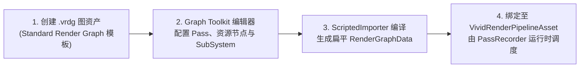

# VividRP

[English](README_EN.md) | 简体中文

VividRP 是一个面向新世代 Unity 的实验性可编程渲染管线（Scriptable Render Pipeline, SRP）包。它以**可视化、数据驱动的 RenderGraph 工作流**为核心，并在此基础上探索延迟渲染、GPU Driven、Bindless、光线追踪（DXR）、参考路径追踪、体积雾、虚拟纹理（VT/SVT）、虚拟阴影图（VSM）和时域超分辨率等高端渲染技术。

> [!IMPORTANT]
> - **Unity 版本基线**：当前开发与验证基线为 Unity `7000.0.0a9`（提交 `69e891f60f9a`，详见 [Unity 7000.0.0a9 兼容性说明](Documentation~/Unity7000a9Upgrade.md)）。
> - **核心依赖**：VividRP 依赖定制版 [CoreRP](https://github.com/af8a2a/CoreRP.git)。请先在 Package Manager 中选择 **Add package from git URL** 添加 `https://github.com/af8a2a/CoreRP.git`（或使用项目内置同步的 `Packages/CoreRP`）。
> - **推荐运行环境**：Windows + DirectX 12。Bindless、GPU Driven 16-bit 算术及光线追踪工作流均依赖 DX12 / DXR 与 Shader Model 6.2+ 能力。
> - **开发状态**：VividRP 正在积极迭代中。部分子系统为实验性实现，不承诺跨平台、生产就绪或向后兼容。
> - **权威参考**：本仓库不再与旧版 [VividRP](https://github.com/af8a2a/VividRP) 功能清单一一对应；请以当前源码、本文档和 [`Documentation~`](Documentation~/README.md) 为准。

---

## 核心工作流

VividRP 的渲染流程由 `.vrdg` 可视化图资产描述，从编辑到运行时的闭环如下：



1. **创建图资产**：在 Project 窗口选择 `Assets/Create/VividRP/Standard Render Graph` 创建可运行的标准模板图，或选择 `Assets/Create/VividRP/Render Graph` 创建空图。
2. **可视化编排**：双击 `.vrdg`，在基于 `com.unity.graphtoolkit` 的编辑器中连接 Pass 与资源端口，或使用 `SubSystem`（Local Subgraph）折叠复杂局部链路。
3. **导入与编译**：`RenderGraphImporter` 自动完成依赖推导、Pass Culling、图校验，并编译为扁平的运行时 `RenderGraphData`。
4. **管线绑定**：将生成的 `RenderGraphData` 赋给 `VividRenderPipelineAsset` 的 **Render Graph Asset** 字段。


### Pass 与资源模型

Pass 通过字段上的 `[RenderGraphResource]` 特性自动生成图端口。运行时由 `PassRecorder` 统一调度三类标准 Pass：

| Pass 基类 | 适用场景 |
| --- | --- |
| `RasterPass` | 光栅化渲染（自动管理 Render Target 绑定与 RenderList 绘制） |
| `ComputePass` | Compute Shader 调度（支持图形队列与 Async Compute） |
| `UnsafePass` | 需要直接访问原生 `CommandBuffer` 的复杂或多阶段场景 |

图编辑器原生支持 **Texture**、**Buffer**、**Render List**、**History**（相机持久跨帧资源）、**Preview** 和 **Acceleration Structure (RTAS)** 资源，并提供基于 Local Subgraph 的 **SubSystem** 封装能力：


---

## 已包含的能力概览

下列模块已在当前包中提供实现（具体可用性取决于项目配置、平台与硬件支持）：

| 领域 | 核心模块与特性 |
| --- | --- |
| **基础渲染** | Pre-Depth、GBuffer、延迟光照（支持 SimpleSlab 与 OpenPBR 原生材质路径）、Motion Vector、HZB、通用物体绘制、Color Pyramid |
| **阴影与光照** | • **阴影**：CSM / PCSS、虚拟阴影图（VSM，含静态/动态双池缓存与 SMRT 自适应射线）、方向光 DXR 阴影 + SIGMA 降噪<br>• **光照**：簇状光照（Clustered Lighting）、LTC 面光源、反射探针图集、ReGIR、天空与大气散射（Physically Based Sky / HDRI Sky） |
| **材质与着色** | • **内置着色器**：`StandardLit`（支持 Metallic / Smoothness / AO Remap Range）、`SimpleLit`、`SimpleForward`、`StandardLayeredLit`<br>• **BSDF 合约**：`SimpleSlabV1`（单层/双层实时能量补偿 BSDF）与 `OpenPBROpaqueV1`（原生 OpenPBR 1.1 延迟管线合约）<br>• **迁移工具**：包含 URP Lit 与 HDRP Lit 材质转换工具 |
| **GPU Driven** | • **几何与裁剪**：基于 meshoptimizer 的 Cluster LOD 生成、16B 共享组表、保守 FP16 实例/Meshlet 视锥裁剪、法线锥裁剪、双阶段 HZB 遮挡剔除、Visibility Buffer 渲染<br>• **场景表示**：`PrimitiveScene`（Author Handle + Camera Burst 粗剔除 `DrawSet`）<br>• **地形系统**：`VividTerrain`（Unity Terrain 无损复制转换、分块锁边界 Meshlet 烘焙、多级 LOD、最多 8 层材质与 Control Map 混合） |
| **抗锯齿与超分** | CMAA2、TAA、TSR、FSR3；支持 NVIDIA DLSS Super Resolution 与 Ray Reconstruction（需额外插件集成） |
| **后处理** | • **曝光与色调**：自动曝光（Unity / HDRP / Unreal 三套 Inspector 预设）、双边网格局部曝光（Local Exposure）、色彩分级（Color Grading）<br>• **光学与模糊**：Bloom（Mip Scattering 与 FFT 卷积模式）、景深（DoF）、镜头光晕（Data-Driven Lens Flare）<br>• **环境光与反射**：环境光遮蔽（XeGTAO 或 FidelityFX CACAO）、屏幕空间反射 SSR（含 REBLUR 时域稳定、Checkerboard 交织与 Hit-Distance 重建） |
| **体积效果** | 全局及局部体积雾、VBuffer、体积光照、高度雾合成（Aerial Perspective）与 Max-Z 生成 |
| **光线追踪与硬件加速** | • **基础光追**：可序列化 RTAS 描述符、`RTASBuildPass`、方向光光追阴影与调试 Pass<br>• **NVIDIA 集成**：NVAPI Shader Execution Reordering（SER）、RTX Texture Filtering（RTXTF） |
| **参考路径追踪** | • **积分器**：基于 OpenPBR 的多反弹 DXR 原型，支持解析光源与 HDRI 的 MIS / NEE、矩形/圆盘光源 BSDF 段命中评估、着色点感知的混合光源选择与空间索引<br>• **透射与次表面**：随机 RGB 几何透明度、薄壁透射、四层介质栈 + Beer–Lambert 吸收的实体折射、面部次表面散射耳部透射<br>• **降噪与调试**：NRD REBLUR 预览降噪、Unity Open Image Denoise (OIDN) 离线收敛降噪、Rendering Debugger 传输视图、确定性像素捕获 |
| **毛发路径追踪** | 基于 RTXCR Chiang 近场 BCSDF 的 `VividRP/Material/Hair` DXR 路径，支持 DOTS strand 几何、`HairDotsGpuStream` 持久 GPU 更新、动态运动向量、Reference PT、REBLUR 与 DLSS-RR 引导（当前不含光栅毛发或 groom 导入器） |
| **资源与子系统** | • **虚拟纹理（VT）**：通用 VT Core、SVT、GPU Driven 地形表面绑定、自适应 Mip Bias 与驻留过渡<br>• **Per-Object Buffer**：免 `MaterialPropertyBlock` 的逐 Renderer 16B 对齐 SSBO 数据系统、集中生成的 HLSL 布局与 CPU 基准测试<br>• **其他子系统**：DBuffer Decal、实验性 ECS 页式粒子系统（模拟/裁剪/排序/Billboard/Mesh/Stretch/Trail/碰撞/子发射器） |
| **编辑器与工具** | VividRP Wizard（DX12 / DXC 一键配置）、LWGUI + DXC Shader 性能分析后端、Roslyn Pass 节点生成器、AgenticDebugger（PIX / Frame Debugger / GC Profiler 自动化诊断） |

> [!TIP]
> 相机、灯光、反射探针及多数 Volume 设置均配有 VividRP 的附加组件（如 `VividAdditionalCameraData`、`VividAdditionalLightData`）或自定义 Inspector。

---

## 快速开始

1. **打开项目**：使用 Unity `7000.0.0a9`（或兼容版本）打开包含本项目的工作区。
2. **安装依赖**：确保 `Packages/CoreRP`（`com.unity.render-pipelines.core`）与本包已通过 Package Manager 加载。
3. **配置图形环境**：打开 **Window > Rendering > VividRP Wizard**，将 Windows Standalone 的首选图形 API 设为 **Direct3D 12**，并为当前 Build Profile 启用 **DXC**（切换图形 API 后需重启编辑器）。
4. **创建管线资产**：选择 `Assets/Create/VividRP/Vivid Render Pipeline` 创建 `VividRenderPipelineAsset`，并在 **Project Settings > Graphics** 中将其指定为当前 Render Pipeline。
5. **创建并绑定渲染图**：选择 `Assets/Create/VividRP/Standard Render Graph` 创建 `.vrdg` 资产，将其生成的 `RenderGraphData` 赋给管线资产的 **Render Graph Asset** 字段。
6. **初始化全局 Volume**：在管线资产 Inspector 中点击初始化 **Default Volume**，或在场景中创建全局 Volume Profile 配置天空、阴影与后处理。
7. **配置相机**：在场景主相机上确认已挂载 `VividAdditionalCameraData`，按需选择抗锯齿/超分模式（如 TAA、TSR、FSR3）。

---

## 高级特性配置指南

### 1. GPU Driven 与 Bindless

- **启用 GPU Driven**：在 `VividRenderPipelineAsset` Inspector 中勾选 **GPU Driven**。
- **配置 Bindless 原生插件**：由于 Unity 包内插件加载时机晚于 D3D12 描述符堆创建（`UUM-134389`），需在项目根目录执行以下脚本将 `UnityBindless.dll` 安装为预加载项目插件，然后重启 Unity：

```powershell
powershell -ExecutionPolicy Bypass -File .\Packages\VividRP\Setup-Bindless.ps1
```

### 2. 光线追踪、DLSS 与 NVIDIA SER

- **Ray Tracing**：需要 DXR 兼容显卡与 DirectX 12。在 Volume Profile 中添加 `VividRP/Ray Tracing/Settings` 并按需开启对应功能。
- **DLSS / Ray Reconstruction**：需要安装 NVIDIA 相关依赖，并在工程中定义 `DLSS_PLUGIN_INTEGRATE` 脚本宏。
- **Shader Execution Reordering (SER)**：在 Windows x86_64 + DX12 下为参考路径追踪提供可选硬件重排加速，在 `VividRP/Path Tracing/Reference Path Tracing` Volume 中勾选 **Shader Execution Reordering** 即可（详见 [SER 文档](Documentation~/NVAPIShaderExecutionReordering.md)）。

### 3. 参考路径追踪与 `StandardLit` 透射规则

参考路径追踪使用独立的 `.vrdg` 图与管线资产，专用于受控场景的着色与光照验证（非实时目标）：

- **几何覆盖 vs. 材质透射**：`StandardLit` 将二者显式分离（附加贴图均复用 Base Map UV）：
  - **随机几何覆盖（Stochastic Coverage）**：由 `Base Color.a × Base Map.a × Opacity Map.r` 决定。
  - **OpenPBR 透射权重**：由 `Transmission Weight × Transmission Map.r` 控制，透射颜色由 `Transmission Color` 指定。
- **薄壁与实体折射**：
  - **薄片几何**：开启 `Thin-Walled Transmission`。
  - **封闭实体**：关闭 `Thin-Walled Transmission`，通过 `Transmission Depth` 指定 `Transmission Color` 对应的 Beer–Lambert 吸收距离（支持最多 4 层实体介质嵌套）。
- **收敛与降噪**：屏幕底部会显示采样累积进度，达到 `Target Sample Count` 后自动停止采样并冻结历史。当 `com.unity.rendering.denoising` 可用时，可在 Editor 或 64 位 Standalone 下启用 **OIDN** 后端（每个收敛周期结束时提交一次降噪）。
- **RTX Texture Filtering (RTXTF)**：可在 Reference Path Tracing Volume 中启用，默认仅作用于不透明 `StandardLit` 表面的纹理采样（详见 [RTXTF 文档](Documentation~/RTXTextureFiltering.md)）。

### 4. 毛发路径追踪

毛发系统使用专用 `VividRP/Material/Hair` 材质与 Reference Path Tracing 图：

- 仅覆盖 DXR 光追路径（不含光栅化毛发预览），适合验证 DOTS strand 几何、动态变形运动向量以及 REBLUR / DLSS-RR 降噪引导。
- 可通过菜单 `VividRP > Hair > Create Chiang Validation Assets` 一键生成验证资产（详见 [毛发路径追踪文档](Documentation~/HairPathTracing.md)）。

---

## 目录结构导览

```text
Packages/VividRP/
├── Runtime/
│   ├── RenderPipeline/     # 管线核心、VividRenderPipelineAsset、全局设置与 Volume 集成
│   ├── RenderGraph/        # 运行时图数据、可序列化描述符、History/Preview、PassRecorder
│   ├── Core/               # Camera History 持久资源管理、DOTS Hair 几何与 GPU 流式更新等
│   ├── RenderPass/         # Core、Debug 与 Example 渲染 Pass
│   ├── SubSystem/          # GPUDriven、VirtualShadowMap、VirtualTexture、Volumetric、Sky、Decal、DLSS 等
│   ├── ComponentData/      # 相机、灯光、反射探针附加数据组件
│   ├── PerObjectBuffer/    # 免 MPB 的逐 Renderer SSBO 数据系统与基准测试
│   └── Experiment/Particle/# 实验性 ECS 页式粒子系统
├── Editor/
│   ├── RenderGraph/        # Graph Toolkit 编辑器、Importer、编译器、校验器与节点注册
│   ├── PipelineResource/   # [PipelineResource] 引擎资源收集与同步工具
│   └── AgenticDebugger/    # 面向 CLI/Agent 的 PIX、Frame Debugger 与 GC 诊断集成
├── Shaders/                # HLSL 着色器库（Core Public/Private、Material、OpenPBR、ThirdParty）
├── SourceGenerators~/      # 独立的 Roslyn Pass 节点增量生成器与 .NET 测试
├── Tools~/                 # DXC / GPU 独立几何与材质校验脚本、PIX 与诊断 CLI 工具
├── Documentation~/         # 架构、子系统、合约与工作流文档（含分类索引）
├── Roadmap~/               # 各子系统演进路线图与实验设计
└── Tests/Editor/           # Unity EditMode 自动化测试套件
```

---

## 资源同步与开发约定

- **RenderGraph 唯一真实来源**：`.vrdg` 是图的源文件，切勿手动修改导入生成的 `RenderGraphData`。
- **Pass 节点自动生成**：`VividRP.Runtime` 中符合条件的 Pass 由 `SourceGenerators~` 中的 Roslyn 增量生成器在编译期自动生成专用图节点，无需维护 `GeneratedRenderPassNodes.g.cs`；外部程序集的自定义 Pass 请使用通用节点的 `PassScript` 选项。
  - *升级提示*：若旧版图资产保存了 `VividRP.Editor.RenderGraph.Generated.<CustomPass>` 形式的外部程序集节点，请先替换为通用 Pass 节点并设置 `PassScript`。
- **引擎资源同步**：切勿手动编辑 `Runtime/Resources/PipelineResources.asset`。修改 `[PipelineResource]` 或 `[ResourcePath]` 声明后，选中 `PipelineResources.asset` 并在 Inspector 中点击 **Recollect Engine Resources**。
- **端口字段契约**：Pass 中标记了 `[RenderGraphResource]` 的字段名是图端口、预览与编译绑定的序列化契约，重命名前请同步检查 `.vrdg` 资产与测试。
- **跨帧 History 资源**：跨帧 Texture / Buffer 请使用相机所有的 `CameraHistoryTexture` / `CameraHistoryBuffer`；`PassRecorder` 会通过 `CameraHistoryRenderGraphBridge` 自动导入并在图执行成功后提交，无需在图尾手动复制。

---

## 文档导航与路线图

完整文档索引见 **[Documentation~/README.md](Documentation~/README.md)**。

### RenderGraph 与核心架构
- [RenderGraph 编辑器使用指南](Documentation~/RenderGraphEditor.md)
- [RenderGraph SubSystem（局部子图）](Documentation~/RenderGraphSubSystem.md)
- [RenderGraph 可序列化资源描述符与 PassBypass](Documentation~/RenderGraphResourceDescriptors.md)
- [Acceleration Structure (RTAS) 资源支持](Documentation~/AccelerationStructureSupport.md)
- [Per-Object Buffer 逐物体数据系统](Documentation~/PerObjectBuffer.md)

### 材质与着色系统
- [SimpleSlab V1 实时 BSDF 冻结合约](Documentation~/Material/SimpleSlabV1.md)
- [OpenPBROpaque V1 默认材质冻结合约](Documentation~/Material/OpenPBROpaqueV1.md)
- [LWGUI 集成与 DXC Shader 性能分析](Documentation~/LWGUI.md)

### GPU Driven、地形与场景表示
- [GPU Driven Cluster LOD 生成与运行时选择](Documentation~/GPUDrivenClusterLOD.md)
- [保守实例视锥裁剪（FP16 算术）](Documentation~/GPUDrivenInstanceCulling.md)
- [保守 Meshlet 视锥/法线锥/HZB 裁剪](Documentation~/GPUDrivenMeshletCulling.md)
- [PrimitiveScene V1：Author Handle 与 Camera DrawSet](Documentation~/PrimitiveSceneV1.md) / [V0 原型说明](Documentation~/PrimitiveScenePrototype.md)
- [VividTerrain 分块 Meshlet 烘焙与多级 LOD](Documentation~/VividTerrainBaking.md)
- [A/B 验证报告：主视图层级遍历](Documentation~/GPUDrivenMainTraversalAB.md) / [Cluster 生成质量](Documentation~/GPUDrivenGenerationQualityAB.md)

### 虚拟阴影图（VSM）与 SMRT
- [VirtualShadowMap 代码与目录布局](Documentation~/VirtualShadowMapCodeLayout.md)
- [VSM Shader 与 Unreal 5.7 参考关系](Documentation~/VirtualShadowMapShaderReference.md)
- [SMRT 生产自适应射线退出](Documentation~/SMRTAdaptiveRays.md)
- [SMRT 接收点与投影准备复用](Documentation~/SMRTReceiverPreparation.md)
- [SMRT 成本诊断工具](Documentation~/SMRTCostDiagnostics.md)

### 光线追踪、路径追踪与毛发
- [Chiang 毛发路径追踪与 DOTS GPU 流](Documentation~/HairPathTracing.md)
- [NVIDIA Shader Execution Reordering (SER)](Documentation~/NVAPIShaderExecutionReordering.md)
- [参考路径追踪中的 RTX Texture Filtering (RTXTF)](Documentation~/RTXTextureFiltering.md)

### 后处理、天空与虚拟纹理
- [Virtual Texture 核心架构](Documentation~/VirtualTextureCoreArchitecture.md)
- [环境光遮蔽（XeGTAO / FidelityFX CACAO）](Documentation~/AmbientOcclusion.md)
- [FFT 卷积 Bloom](Documentation~/FFTBloom.md)
- [双边网格局部曝光（Local Exposure）](Documentation~/LocalExposure.md)
- [天空系统路线图](Documentation~/SkySystemRoadmap.md) / [Physically Based Sky 与 HDRP 差距清单](Documentation~/PhysicallyBasedSkyHdrpGapInventory.md)

### 工具、配置与升级记录
- [VividRP Wizard（DX12 / DXC 配置向导）](Documentation~/VividRPWizard.md)
- [Bindless 原生插件设置说明](Documentation~/Bindless.md)
- [Unity 7000.0.0a9 升级与兼容性验证](Documentation~/Unity7000a9Upgrade.md)
- [Agentic PIX M3 验收记录](Documentation~/AgenticPixM3Acceptance.md) / [AgenticDebugger 说明](Editor/AgenticDebugger/README.md)
- [Roslyn RenderPass 节点生成器说明](SourceGenerators~/README.md)

### 演进路线图（`Roadmap~`）
- [Shadow](Roadmap~/Shadow.md) · [Virtual Shadow Map](Roadmap~/VirtualShadowMapRoadmap.md) · [Directional VSM 优化](Roadmap~/DirectionalVSMOptimization_20260917.md)
- [Sky](Roadmap~/Sky.md) · [Light Culling](Roadmap~/lightculling-roadmap.md)
- [Virtual Texture](Roadmap~/VirtualTextureSystem.md) · [SVT](Roadmap~/SVTRoadmap.md)
- [参考路径追踪](Roadmap~/ReferencePathTracingRoadmap.md) · [毛发路径追踪](Roadmap~/HairPathTracingRoadmap.md)
- [Agentic PIX 路线图](Roadmap~/AgenticPixRoadmap.md)
