# VividRP

[English](README_EN.md) | 简体中文

VividRP 是一个面向新世代 Unity 的实验性可编程渲染管线（Scriptable Render Pipeline, SRP）包。它以**可视化、数据驱动的 RenderGraph 工作流**为核心，并在此基础上探索延迟渲染、Substrate 多 Closure 材质体系（`.slab.shader`）与实时 Hybrid Shell / Marschner 毛发系统、实时发丝级毛发（3-Layer Visibility Atlas + Strand-Space 着色与 Biased L1 SH）、GPU Driven（GPUScene / Visibility Buffer）、Bindless、基于 Mesh/Global SDF 与 Surface Cache 的实时全局光照（Screen Probe Gather GI 与 UE5 Lumen 架构高光反射）、光线追踪（DXR）、参考路径追踪、Meshlet APV 光照烘焙、体积雾、虚拟纹理（VT/SVT）、虚拟阴影图（VSM）和时域超分辨率等高端渲染技术。

> [!IMPORTANT]
> - **Unity 版本基线**：当前开发与验证基线为 Unity `7000.0.0a22`（提交 `dbac4d68c4de`；历史升级记录见 [Unity 7000.0.0a16 兼容性说明](Documentation~/Unity7000a16Upgrade.md)）。
> - **核心依赖**：VividRP 依赖定制版 [CoreRP](https://github.com/af8a2a/CoreRP.git)（`17.7.0`）及 Unity 官方 `com.unity.collections`（`7.0.0`）、`com.unity.pipeline`（`1.0.1`）。请先在 Package Manager 中选择 **Add package from git URL** 添加 `https://github.com/af8a2a/CoreRP.git`（或使用项目内置同步的 `Packages/CoreRP`）。
> - **推荐运行环境**：Windows + DirectX 12。Bindless、GPU Driven 16-bit 算术及光线追踪工作流均依赖 DX12 / DXR 与 Shader Model 6.2+ 能力。
> - **开发状态**：VividRP 正在积极迭代中。部分子系统为实验性实现，不承诺跨平台、生产就绪或向后兼容。
> - **权威参考**：本仓库不再与旧版 [VividRP](https://github.com/af8a2a/VividRP) 功能清单一一对应；请以当前源码、本文档和 [`Documentation~`](Documentation~/README.md) 为准。

---

## 实时全局光照效果展示（Sponza）

以下画面全部采集自 Sponza 正午实时场景（GPU Driven Meshlet + Mesh/Global SDF + Surface Cache 多跳 Radiosity + Screen Probe Gather Diffuse GI + Lumen Specular Reflections，1920×1080 实时渲染，无离线光照贴图）：

| 二层廊柱多跳色彩溢色（Final Lit） | 同视角实时 Diffuse GI 分量（Screen Probe Gather） |
| :---: | :---: |
| 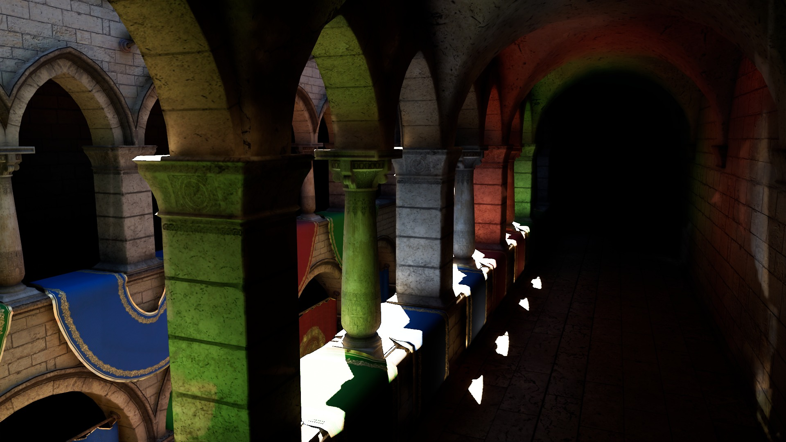 | 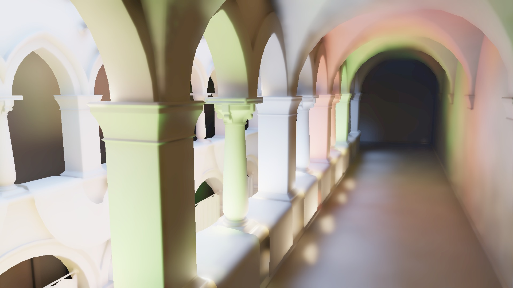 |
| **中庭漫反射反弹与旗帜金饰高光反射** | **双拱廊拱顶间接光反弹与阴影过渡** |
| 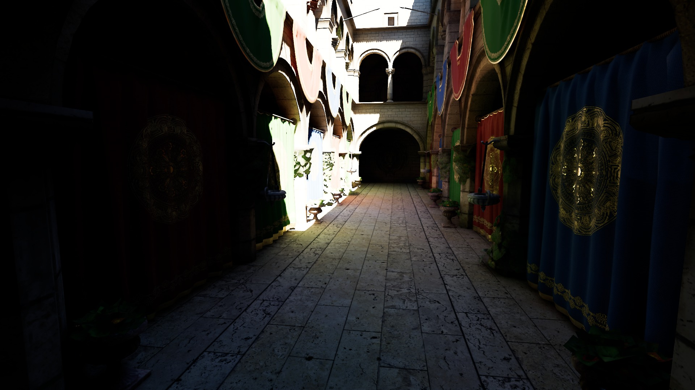 | 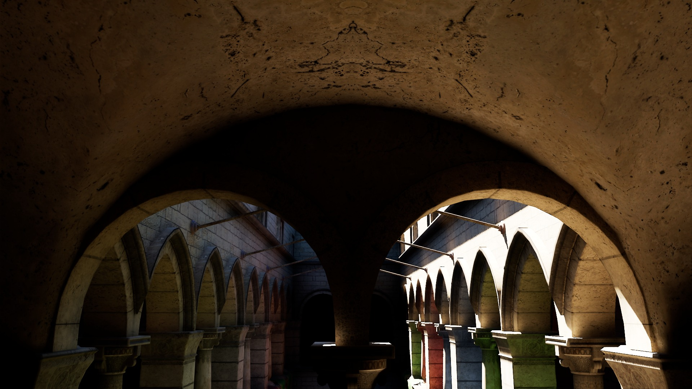 |

---

## Substrate 材质体系与实时毛发展示（`FurSlab` & `FurLookDev`）

VividRP 现已构建起**双目标 `.slab.shader` 材质编译器 + Substrate Closure Buffer（Tier 1/2/3）+ Hybrid Shells 实时毛发管线**，实现 Raster 与 GPU Driven（Visibility Buffer + DesktopBCn SVT）双路径同源着色：

- **Hybrid Shells 稀疏壳光线步进**：采用 **4–8 层物理壳 × 层内 4–6 步光线步进**（保持壳级硬件 Early-Z、不写 `SV_Depth`），在保持掠射轮廓与逆光透射一致的前提下实现 **3×–6× 几何压缩**与 **14%–41% GPU 降耗**（RTX 5070 Ti @ 1920×1080 Hero 场景相对 24 层纯壳基线 `0.826 ms`：`8×4` 降至 `0.710 ms` / `-14.0%`，`6×4` 降至 `0.597 ms` / `-27.7%`，`4×6` 降至 `0.486 ms` / `-41.2%`），并打通 GPUDriven 动态壳层放大、距离壳 LOD 与可编程 VSM/CSM 阴影。
- **Substrate 6-Slice Hair/Fur Closure**：`FurSlab` 支持 **OpenPBR V2（Fuzz + Anisotropy）** 与 **Karis Marschner + Dual Scattering + Yan 2017 Medulla** 双光照模型；后者打包为 6-Slice（24 B/px）`Substrate Hair Closure` 走 Tier 3 延迟光照，在 RTX 5070 Ti 1080p Hero 场景下 `GBufferPass`（`0.178 ms` vs `0.346 ms`）与 `DeferredLightingPass`（`0.620 ms` vs `0.825 ms`）均优于 OpenPBR Tier 2，且 256 组白炉球面积分 **0/256 能量越界**。
- **Houdini 22 DCC 资产闭环**：支持 `Procedural Lattice`、`2D Pattern Map`、`4×4 3D Flipbook Atlas` 与切线空间 `FlowMap` 叠加，配套 [Bake-VividFurPatterns.py](Tools~/Houdini/Bake-VividFurPatterns.py) 自动化烘焙与 GPUDriven SVT 双路径一致性校验（CurlyWool 4×4 SVT `FullMAE = 0.0187`）。

| Outdoors Material LookDev Playground（StandardLit / ClearCoat / Fabric / 4× FurSlab） | Houdini 22 DCC 图案与 Raster / GPUDriven SVT 一致性 |
| :---: | :---: |
| 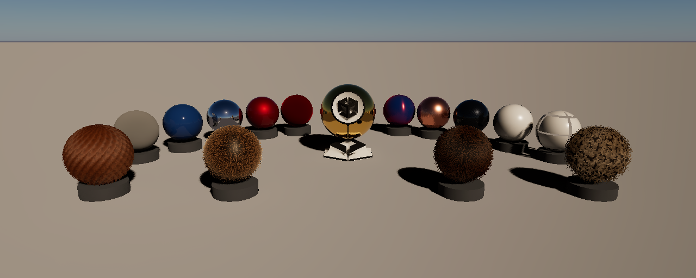 | 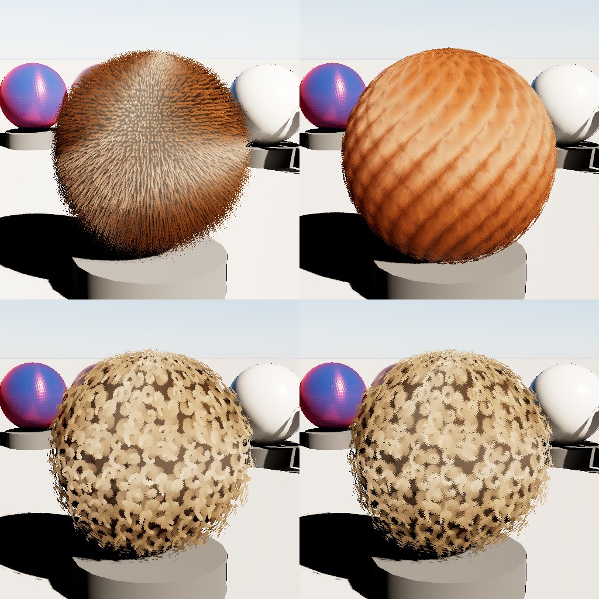 |
| **FurLookDev 室内三工位物理验证摄影棚全景（Fixed EV100 = 0.0）** | **Case 01：单纤维测角仪（`R / TT / TRT / Medulla` 分叶与鳞片倾角）** |
| 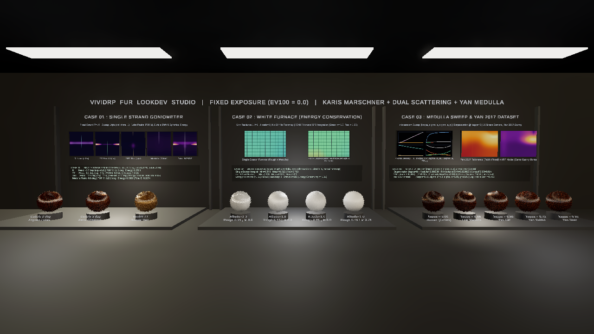 | 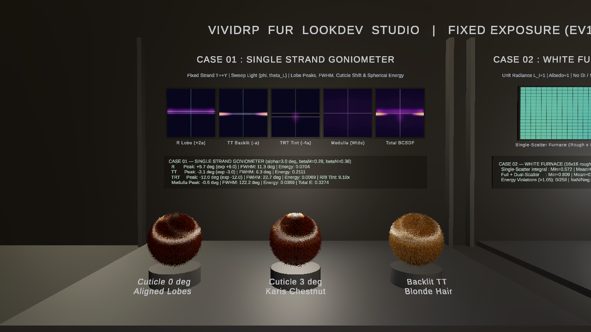 |
| **Case 02：白炉能量守恒（`16×16` 2048 方向积分，0/256 越界）** | **Case 03：髓质四轴扫描与 Yan 2017 实测动物毛发数据集对照** |
| 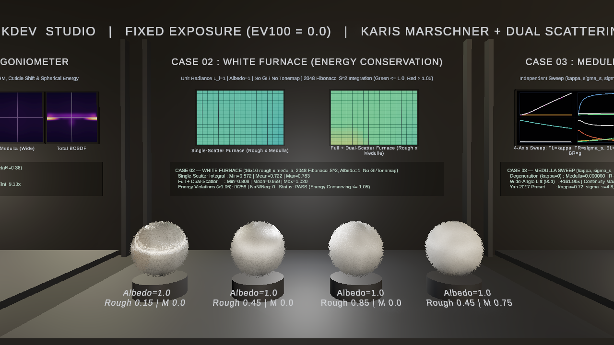 | 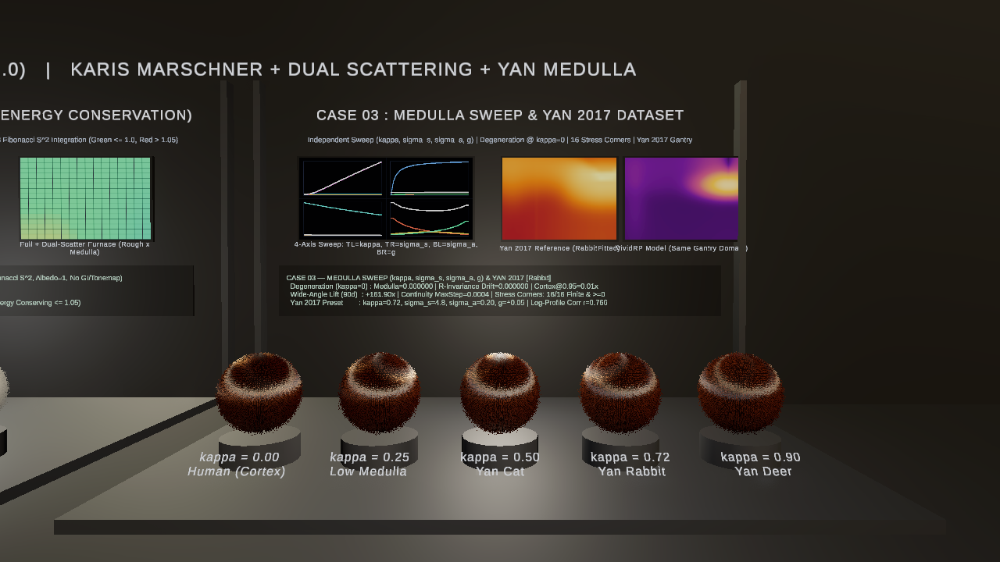 |

---

## 实时发丝级毛发与 3-Layer Visibility Atlas 展示（Strand Hair & `HairLookDev`）

VividRP 现已实现一套面向高密度发丝的**实时 Compute 软光栅 + 3-Layer Visibility Atlas + Strand-Space 逐顶点着色管线**，并与 DXR 参考路径追踪（RTXCR Chiang BCSDF）共享同一套 Houdini 22 `.vividhair` 资产：

- **64×64 分块 3-Layer Visibility Atlas 与 Compute 软光栅**：基于 32-bit 打包格式（`[31:20]` 12-bit 局部线性深度 + `[19:0]` 20-bit `SegmentId`）构建 **3 层深度排序可见性图集 + 1 层累加覆盖率缓冲**；在固定 `32–64 MB` 预算（`512–1024` Tiles）内支持自动 `×2 / ×4` 降分辨率与 8-tap Poisson 抖动、二次覆盖率重建，以及 3 层深层辐射外推（$w_i = C_i \cdot 0.25^{3-i}$）。
- **Strand-Space 着色与 Biased L1 SH 自阴影**：逐可见顶点复用 `VividHairFurBSDF.hlsl`（Karis Marschner `R / TT / TRT` + Zinke Dual Scattering + Yan Medulla + Chiang 黑色素模型），原生接入 Clustered Lighting、世界空间 CSM 阴影图集与 Sky IBL；配合 GPU 96³ 体素 + 遮挡网格三角面 **Biased L1 SH 烘焙器**（64 条 Fibonacci 射线 + `-5.0` 未命中负偏置，直接持久化至 `.vividhair` 资产）提供柔和自阴影与发丝内部散射过渡。
- **Phase S3 GPU 调度优化与实测指标**：引入 **1024-Bin 全局屏幕 Tile 计数排序**、**零 LDS 原子 Wave32 双像素请求栈**（`1.75 KB` LDS）、**自然序可见顶点压缩**（`HairBust_48k` 经 HZB 剔除压缩 `393,216 → 158,130` 可见顶点，约 **-60%**）以及紧接不透明 `HZBGeneratePass` 后的早期 **Async Compute 调度**。在 RTX 5070 Ti 1280×720 `HairLookDev` 场景（`HairSphere_16k` + `HairBust_48k`，共 **65,536 根发丝 / 475,136 线段**）实测中，优化路径与直接路径几乎像素无损（`Overview` `PSNR = 61.85 dB`、`BustFront` `PSNR = 63.32 dB`），间接着色阶段 `StrandHairShadingPass` 降至 **`0.028–0.029 ms`**（较未压缩路径提速约 **2.4×**），合成阶段 `StrandHairCompositionPass` 为 **`0.030–0.031 ms`**。

| 实时 Strand VisBuf（`HairLookDev` 全景，65,536 发丝） | 同相机 Reference PT Ground Truth（DXR Chiang） |
| :---: | :---: |
| 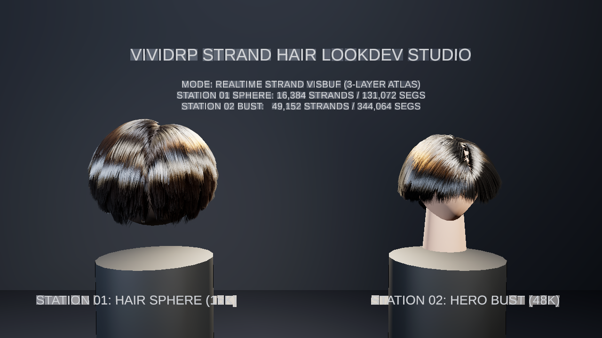 | 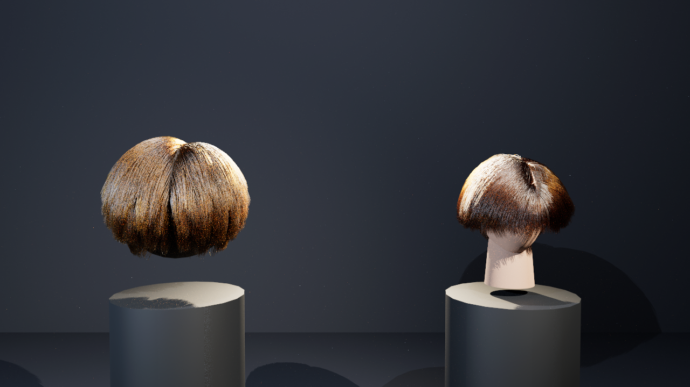 |
| **实时 Strand VisBuf（`HairBust_48k` 49,152 发丝正面特写）** | **同相机 Reference PT Ground Truth（`HairBust_48k`）** |
| 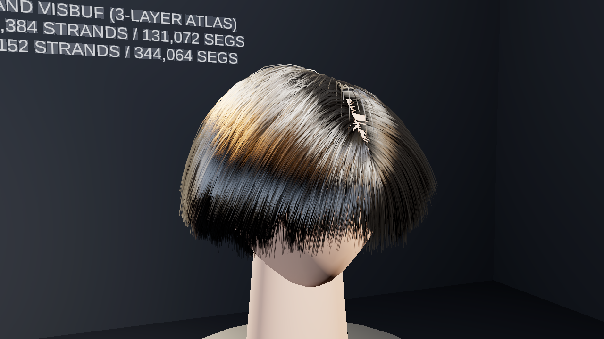 | 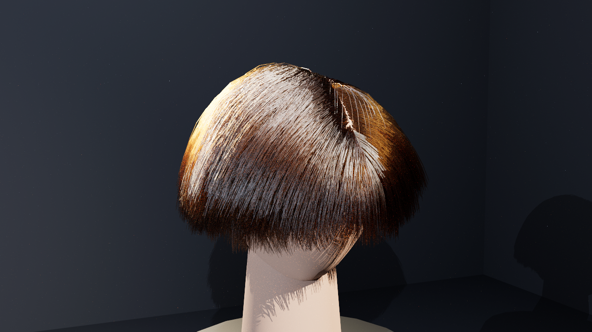 |
| **实时 Strand VisBuf（`HairSphere_16k` 发丝球近景细节）** | **同相机 Reference PT Ground Truth（`HairSphere_16k`）** |
| 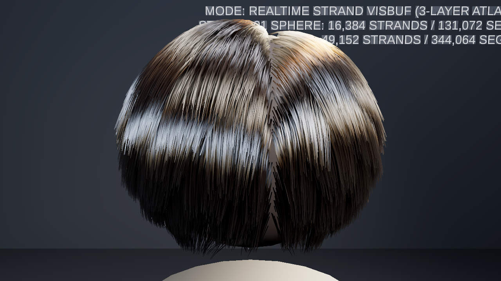 | 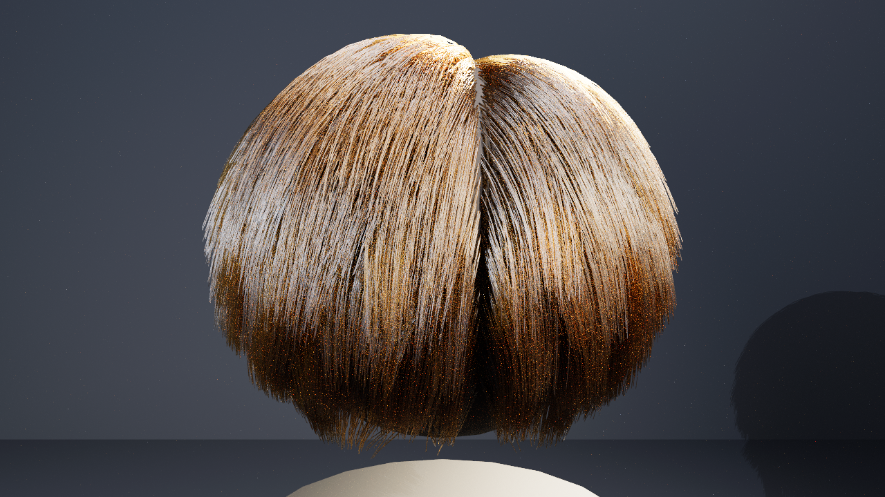 |
| **Debug：3-Layer Visibility Atlas 层数分布（`LayerCount`）** | **Debug：Biased L1 SH 方向自阴影（`DirectSelfShadow`）** |
| 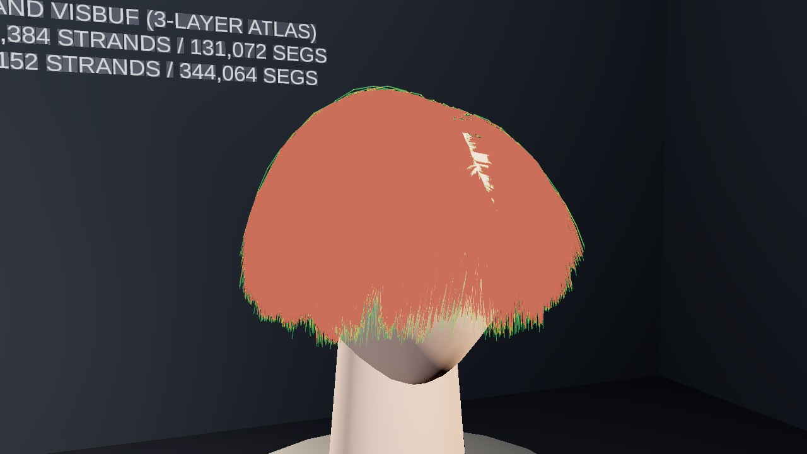 | 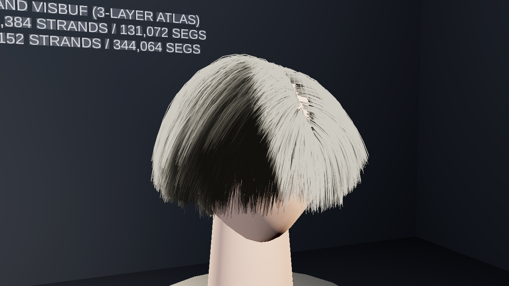 |

---

## 核心工作流

VividRP 的渲染流程由 `.vrdg` 可视化图资产描述，从编辑到运行时的闭环如下：

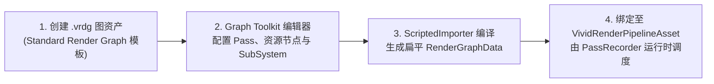

1. **创建图资产**：在 Project 窗口选择 `Assets/Create/VividRP/Standard Render Graph` 创建可运行的标准模板图，或选择 `Assets/Create/VividRP/Render Graph` 创建空图。
2. **可视化编排**：双击 `.vrdg`，在基于 `com.unity.graphtoolkit` 的编辑器中连接 Pass 与资源端口，或使用 `SubSystem`（Local Subgraph）折叠复杂局部链路。
3. **导入与编译**：`RenderGraphImporter` 自动完成依赖推导、Pass Culling、图校验，并编译为扁平的运行时 `RenderGraphData`。
4. **管线绑定**：将生成的 `RenderGraphData` 赋给 `VividRenderPipelineAsset` 的 **Render Graph Asset** 字段。

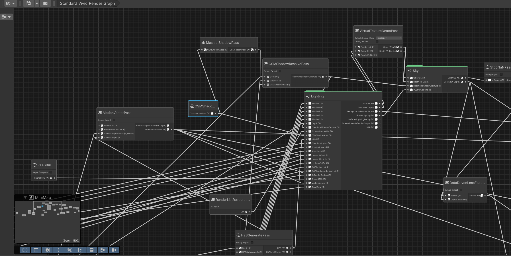

### Pass 与资源模型

Pass 通过字段上的 `[RenderGraphResource]` 特性自动生成图端口。运行时由 `PassRecorder` 统一调度三类标准 Pass：

| Pass 基类 | 适用场景 |
| --- | --- |
| `RasterPass` | 光栅化渲染（自动管理 Render Target 绑定与 RenderList 绘制） |
| `ComputePass` | Compute Shader 调度（支持图形队列与 Async Compute） |
| `UnsafePass` | 需要直接访问原生 `CommandBuffer` 的复杂或多阶段场景 |

图编辑器原生支持 **Texture**、**Buffer**、**Render List**、**History**（相机持久跨帧资源）、**Preview** 和 **Acceleration Structure (RTAS)** 资源，并提供基于 Local Subgraph 的 **SubSystem** 封装能力：

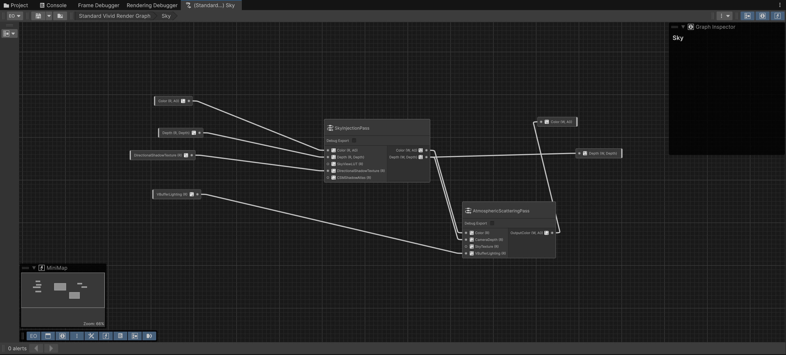

---

## 已包含的能力概览

下列模块已在当前包中提供实现（具体可用性取决于项目配置、平台与硬件支持）：

| 领域 | 核心模块与特性 |
| --- | --- |
| **基础渲染** | Pre-Depth、Early-Z GBuffer（Surface Summary + Substrate Closure Buffer UAV，支持 Tier 1/2 单 Closure、Tier 3 多 Closure 与 6-Slice `Hair` Closure）、延迟光照（SimpleSlab / OpenPBR V2 / Karis Marschner Hair）、Motion Vector（含动态 WPO 与 Visibility 壳层解包）、HZB、通用物体绘制、Color Pyramid |
| **实时全局光照与高光反射** | • **Surface Cache 与多跳 Radiosity**：自动化 Mesh Card 分配、动态光/天光重照、渐进多跳 Radiosity 累积与采样反馈<br>• **Screen Probe Gather Diffuse GI**：Full-Sphere 屏幕探针采集、HZB 屏幕追踪 + Mesh SDF + Global SDF + Far Radiance Cache + Occluded Sky 混合追踪、重要性采样引导、Adaptive Probe、像素级时域稳定与空间滤波、Rough Specular 输出<br>• **Lumen Specular Reflections（UE5 移植）**：首期 Software SDF 追踪后端（Tile 分类、VNDF GGX + STBN 光线生成、HZB Screen Trace、Wave/ZOrder2D 压缩、Mesh/Global SDF + Surface Cache）+ UE5 原生 Lumen Reflection Denoiser（BRDF 空间重建 Resolve、虚像命中点重投影时间滤波、方差引导双边滤波），支持 `Overview` / `ReflectionView` / `DedicatedReflectionRays` 调试视图（二期 HWRT 路线见 [LumenReflectionMigration.md](Documentation~/LumenReflectionMigration.md)） |
| **阴影与光照** | • **阴影**：CSM / PCSS、虚拟阴影图（VSM，含静态/动态双池缓存、SMRT 自适应射线与 GPUDriven 可编程毛发/WPO 阴影投射）、方向光 DXR 阴影 + SIGMA 降噪<br>• **Meshlet APV**：支持静态 MeshletRenderer 参与原生 Adaptive Probe Volumes 烘焙（`MeshletAPVBaking`），支持自动代理几何生成、无损还原与 Meta Pass 投影矩阵修正<br>• **光照与反射**：簇状光照（Clustered Lighting）、LTC 面光源、反射探针图集（支持 Proxy Box 与影响域可视化 Gizmo）、ReGIR、天空与大气散射（Physically Based Sky / HDRI Sky） |
| **材质与着色** | • **Substrate `.slab.shader` 体系**：双目标 Importer 自动编译 Raster Shader + GPUDriven 零 switch 独立 ComputeShader，支持 `@vivid-vertex` / `@vivid-coverage` / `@vivid-surface` / `@vivid-instancing` 钩子、手写参数与贴图自动反射进 GPU Buffer / SVT、Multi-Closure Tier 3 与 O(1) 方向反照率 LUT<br>• **内置 Slab 着色器**：`StandardLitSlab`、`FabricSlab`（HDRP 风格 CottonWool & Silk，双面与微织物细节）、`FurSlab`（Hybrid Shells 实时毛发）、`ClearCoatDualNormal`（双法线清漆碳纤维），并保留 `StandardLit` / `SimpleLit` / `SimpleForward` / `StandardLayeredLit`<br>• **现代 HLSL 与 BSDF 合约**：`UberPost.shader` **HLSL 2021** 试点（`#pragma hlsl_version 2021`）、`SimpleSlabV1`、`OpenPBROpaqueV1`（OpenPBR 1.1）与 6-Slice `Substrate Hair` ABI<br>• **LookDev 与迁移工具**：Outdoors Material LookDev Playground 模板、URP Lit 与 HDRP Lit 材质转换工具 |
| **GPU Driven** | • **GPUScene 与裁剪**：直消费 `PrimitiveScene` 的 Compute Scatter 增量上传与 SoA 热路径读取、meshoptimizer Cluster LOD 生成、16B 共享组表、保守 FP16 实例/Meshlet 视锥裁剪（含材质级 `MaxWPO` 包围球膨胀）、法线锥裁剪、双阶段 HZB 遮挡剔除<br>• **Visibility Buffer 与可编程光栅**：支持常规 Meshlet 与可编程 WPO/Coverage 光栅（含 GPUDriven 动态壳层放大与距离壳 LOD）、活跃材质 Bin 位图驱动的 Compute Resolve（零无效空桶 Dispatch）<br>• **有向距离场 (SDF)**：<br>&nbsp;&nbsp;– **Mesh SDF**：离线网格 SDF 烘焙（`VividMeshSdfBaker`）、`.meshsdf` 资产与 Importer、砖块化显存管理（`VividMeshSdfBricks`）、GPU 场景管理（`VividMeshSdfGpuScene`）及可视化/追踪调试 Pass（`MeshSdfVizDebugPass`、`MeshSdfTraceDebugPass`）<br>&nbsp;&nbsp;– **Global SDF**：多级分级裁剪图（Clipmap）体系（`VividGlobalSdfClipmap`）、分级区域更新与合成 Compute Shader（`GlobalSdfClipmapPass`）、GPU-Driven 帧级集成（`VividGlobalSdfFrameData`）与光线步进求交调试（`GlobalSdfTraceDebugPass`）<br>• **场景表示与地形**：`PrimitiveScene`（Author Handle + Camera Burst 粗剔除 `DrawSet`）、`VividTerrain`（Unity Terrain 无损复制转换、分块锁边界 Meshlet 烘焙、多级 LOD、最多 8 层材质与 Control Map 混合） |
| **抗锯齿与超分** | CMAA2、TAA、TSR、FSR3；支持 NVIDIA DLSS Super Resolution 与 Ray Reconstruction（需额外插件集成） |
| **后处理** | • **曝光与色调**：自动曝光（Unity / HDRP / Unreal 三套 Inspector 预设，支持直方图曲线重映射）、双边网格局部曝光（Local Exposure）、色彩分级（Color Grading）<br>• **光学与模糊**：Bloom（Mip Scattering 与 FFT 卷积模式）、景深（DoF）、镜头光晕（Data-Driven Lens Flare）<br>• **环境光与反射**：环境光遮蔽（XeGTAO 或 FidelityFX CACAO）、屏幕空间反射 SSR（含 REBLUR 时域稳定、Checkerboard 交织与 Hit-Distance 重建） |
| **体积效果** | 全局及局部体积雾、VBuffer、体积光照、高度雾合成（Aerial Perspective）与 Max-Z 生成 |
| **光线追踪与硬件加速** | • **基础光追**：可序列化 RTAS 描述符、`RTASBuildPass`、方向光光追阴影与调试 Pass<br>• **NVIDIA 集成**：NVAPI Shader Execution Reordering（SER）、RTX Texture Filtering（RTXTF） |
| **参考路径追踪** | • **积分器**：基于 OpenPBR 的多反弹 DXR 原型，支持解析光源与 HDRI 的 MIS / NEE、矩形/圆盘光源 BSDF 段命中评估、着色点感知的混合光源选择与空间索引<br>• **透射与次表面**：随机 RGB 几何透明度、薄壁透射、四层介质栈 + Beer–Lambert 吸收的实体折射、面部次表面散射耳部透射<br>• **降噪与调试**：NRD REBLUR 预览降噪、Unity Open Image Denoise (OIDN) 离线收敛降噪、Rendering Debugger 传输视图、确定性像素捕获 |
| **实时毛发与路径追踪毛发** | • **实时短毛（`FurSlab`）**：Hybrid Shells（稀疏壳 + 层内视线空间光线步进，保留壳级 Early-Z）、`VividFurShellRenderer` 实例化与距离壳 LOD、GPUDriven 动态壳放大与可编程 VSM/CSM 阴影、OpenPBR V2 / Karis Marschner + Dual Scattering + Yan 2017 Medulla 双光照模型、Houdini 22 FlowMap / 2D Pattern / 4×4 3D Flipbook 烘焙管线与 `Samples/FurLookDev` 室内物理验证摄影棚<br>• **实时发丝级毛发（Strand Hair）**：64×64 分块 32-bit 3-Layer Visibility Atlas + Additive Coverage、1024-Bin 全局屏幕 Tile 计数排序与零 LDS 原子 Wave32 双像素请求栈软光栅、HZB 自然序可见顶点压缩 + 早期 Async Compute 调度、Strand-Space `VividHairFurBSDF` 着色（Clustered Lights + 世界空间 CSM + Sky IBL）、GPU 96³ 体素 + 遮挡三角面 Biased L1 SH 烘焙器与 `Samples/HairLookDev` 同源验证摄影棚<br>• **毛发路径追踪**：基于 RTXCR Chiang 近场 BCSDF 的 `VividRP/Material/Hair` DXR 路径，共享 `.vividhair` / DOTS strand 几何、`HairDotsGpuStream` 持久 GPU 更新、动态运动向量、Reference PT、REBLUR 与 DLSS-RR 引导 |
| **资源与子系统** | • **虚拟纹理（VT）**：通用 VT Core、SVT、GPU Driven 地形表面绑定、自适应 Mip Bias 与驻留过渡，支持 GPU Driven Border Size 依赖追踪<br>• **Per-Object Buffer**：免 `MaterialPropertyBlock` 的逐 Renderer 16B 对齐 SSBO 数据系统、集中生成的 HLSL 布局与 CPU 基准测试（支持 `VividPerObjectColorExample` 等灵活别名扩展）<br>• **其他子系统**：DBuffer Decal、实验性 ECS 页式粒子系统（模拟/裁剪/排序/Billboard/Mesh/Stretch/Trail/碰撞/子发射器） |
| **编辑器与工具** | • **配置向导**：VividRP Wizard（DX12 / DXC 一键配置）<br>• **内存与安全诊断**：`VIVIDRP_STARTUP_SRP=minimal` 启动内存隔离模式与目录链接安全防护<br>• **性能与分析**：LWGUI + DXC Shader 静态性能分析后端、Roslyn Pass 节点生成器<br>• **诊断工具**：AgenticDebugger（PIX / Frame Debugger / GC Profiler 自动化诊断接口） |

> [!TIP]
> 相机、灯光、反射探针及多数 Volume 设置均配有 VividRP 的附加组件（如 `VividAdditionalCameraData`、`VividAdditionalLightData`、`VividAdditionalReflectionProbeData`）或自定义 Inspector。

---

## 快速开始

1. **打开项目**：使用 Unity `7000.0.0a22`（或兼容版本）打开包含本项目的工作区。
2. **安装依赖**：确保 `Packages/CoreRP`（`com.unity.render-pipelines.core`）与本包已通过 Package Manager 加载。
3. **配置图形环境**：打开 **Window > Rendering > VividRP Wizard**，将 Windows Standalone 的首选图形 API 设为 **Direct3D 12**，并为当前 Build Profile 启用 **DXC**（切换图形 API 后需重启编辑器）。
4. **创建管线资产**：选择 `Assets/Create/VividRP/Vivid Render Pipeline` 创建 `VividRenderPipelineAsset`，并在 **Project Settings > Graphics** 中将其指定为当前 Render Pipeline。
5. **创建并绑定渲染图**：选择 `Assets/Create/VividRP/Standard Render Graph` 创建 `.vrdg` 资产，将其生成的 `RenderGraphData` 赋给管线资产的 **Render Graph Asset** 字段。
6. **初始化全局 Volume**：在管线资产 Inspector 中点击初始化 **Default Volume**，或在场景中创建全局 Volume Profile 配置天空、阴影与后处理。
7. **配置相机**：在场景主相机上确认已挂载 `VividAdditionalCameraData`，按需选择抗锯齿/超分模式（如 TAA、TSR、FSR3）。

---

## 高级特性配置指南

### 1. GPU Driven 与 Bindless

- **启用 GPU Driven**：在 `VividRenderPipelineAsset` Inspector 中勾选 **GPU Driven**。
- **配置 Bindless 原生插件**：由于 Unity 包内插件加载时机晚于 D3D12 描述符堆创建（`UUM-134389`），需在项目根目录执行以下脚本将 `UnityBindless.dll` 安装为预加载项目插件，然后重启 Unity：

```powershell
powershell -ExecutionPolicy Bypass -File .\Packages\VividRP\Setup-Bindless.ps1
```

### 2. 有向距离场（Mesh SDF 与 Global SDF）

VividRP 提供了面向 GPU-Driven 场景的高性能分级距离场表示：

- **Mesh SDF 烘焙与导入**：
  - 选中网格后可通过 `VividMeshSdfBaker` 烘焙离线网格有向距离场，生成 `.meshsdf` 资产。
  - 在 `MeshletRenderer` Inspector 中指定对应的 `VividMeshSdfAsset`。
  - 运行时通过 `VividMeshSdfBricks` 将网格局部距离场砖块化分配并流式上传至 GPU 3D 纹理池。
- **Global SDF Clipmap**：
  - 运行时由 `GlobalSdfClipmapPass` 在相机周围调度多级（Cascaded）3D Clipmap 纹理。
  - 通过 `GlobalSdf.compute` 将静态网格与场景的 Mesh SDF 投影合成至全局距离场级联中，支持动态增量区域更新。
- **SDF 调试与可视化**：
  - 在渲染图中接入 `MeshSdfVizDebugPass`、`MeshSdfTraceDebugPass` 或 `GlobalSdfTraceDebugPass`，可通过光线步进直接观察网格局部或场景全局的距离场与法线切片。

### 3. Meshlet APV 光照探针烘焙

VividRP 支持使用静态 `MeshletRenderer` 参与 Unity 原生 Adaptive Probe Volumes（APV）烘焙：

- **烘焙入口**：点击菜单 **VividRP > Lighting > Bake Meshlet APV**，系统会自动为所有参与 GI 的静态 Meshlet 生成带独立生命周期的轻量代理几何供光照烘焙后端采样。
- **Meta-Pass 修正**：修复了在烘焙阶段 UV 空间光栅化下 `unity_MatrixVP` 被错误映射至相机视图的引擎问题，保证 albedo / emission 的高比例有效覆盖与精确的间接光色彩反弹。
- **验证场景**：可通过菜单 **VividRP > Samples > Open Meshlet APV Validation Scene** 打开标准验证固件（详见 [Meshlet APV 文档](Documentation~/MeshletAPVBaking.md)）。

### 4. 光线追踪、DLSS 与 NVIDIA SER

- **Ray Tracing**：需要 DXR 兼容显卡与 DirectX 12。在 Volume Profile 中添加 `VividRP/Ray Tracing/Settings` 并按需开启对应功能。
- **DLSS / Ray Reconstruction**：需要安装 NVIDIA 相关依赖，并在工程中定义 `DLSS_PLUGIN_INTEGRATE` 脚本宏。
- **Shader Execution Reordering (SER)**：在 Windows x86_64 + DX12 下为参考路径追踪提供可选硬件重排加速，在 `VividRP/Path Tracing/Reference Path Tracing` Volume 中勾选 **Shader Execution Reordering** 即可（详见 [SER 文档](Documentation~/NVAPIShaderExecutionReordering.md)）。

### 5. 参考路径追踪与 `StandardLit` 透射规则

参考路径追踪使用独立的 `.vrdg` 图与管线资产，专用于受控场景的着色与光照验证（非实时目标）：

- **几何覆盖 vs. 材质透射**：`StandardLit` 将二者显式分离（附加贴图均复用 Base Map UV）：
  - **随机几何覆盖（Stochastic Coverage）**：由 `Base Color.a × Base Map.a × Opacity Map.r` 决定。
  - **OpenPBR 透射权重**：由 `Transmission Weight × Transmission Map.r` 控制，透射颜色由 `Transmission Color` 指定。
- **薄壁与实体折射**：
  - **薄片几何**：开启 `Thin-Walled Transmission`。
  - **封闭实体**：关闭 `Thin-Walled Transmission`，通过 `Transmission Depth` 指定 `Transmission Color` 对应的 Beer–Lambert 吸收距离（支持最多 4 层实体介质嵌套）。
- **收敛与降噪**：屏幕底部会显示采样累积进度，达到 `Target Sample Count` 后自动停止采样并冻结历史。当 `com.unity.rendering.denoising` 可用时，可在 Editor 或 64 位 Standalone 下启用 **OIDN** 后端（每个收敛周期结束时提交一次降噪）。
- **RTX Texture Filtering (RTXTF)**：可在 Reference Path Tracing Volume 中启用，默认仅作用于不透明 `StandardLit` 表面的纹理采样（详见 [RTXTF 文档](Documentation~/RTXTextureFiltering.md)）。

### 6. Substrate `.slab.shader`、实时毛发（`FurSlab`）与 `FurLookDev` 摄影棚

VividRP 通过 `.slab.shader` 将光栅与 GPUDriven 材质统一到同一份源码与 Substrate 延迟光照体系下，并以 `FurSlab` 验证了复杂微表面与动物毛发的完整链路：

- **Hybrid Shells 实时毛发工作流**：
  - 在目标网格上挂载 `VividFurShellRenderer` 并指定 `VividRP/Material/FurSlab` 材质，推荐使用 **Hybrid 8×4（极致掠射轮廓）** 或 **6×4（最佳性价比）** 配置，开启距离壳 LOD 与稀疏 VSM 阴影以兼顾性能与画质。
  - 在 `FurShaderGUI` Inspector 中可无缝切换 **OpenPBR V2（Fuzz + Anisotropy）** 与 **Marschner Hair/Fur（R/TT/TRT + Dual Scattering + Yan Medulla）** 两种光照模型，面板会自动按当前光照模型过滤对应参数。
- **Houdini 22 DCC 烘焙与 SVT 接入**：
  - 使用 [Tools~/Houdini/Bake-VividFurPatterns.py](Tools~/Houdini/Bake-VividFurPatterns.py) 或打开 [Tools~/Houdini/VividFur_PatternBaker.hipnc](Tools~/Houdini/VividFur_PatternBaker.hipnc) 一键烘焙切线空间 `FlowMap`、`2D Pattern Map` 与 `4×4 3D Flipbook Atlas`，并通过 GPUDriven DesktopBCn SVT 驱动（完整通道编码与导入规范见 [FurSlab DCC 资产制作指南](Documentation~/Material/FurDCCAuthoringGuide.md)）。
- **物理验证摄影棚（`Samples/FurLookDev`）**：
  - 打开 `Samples/FurLookDev/FurLookDev.unity` 即可在固定曝光（`EV100 = 0.0`）环境下实时运行 `VividFurLookDevController` 诊断板，涵盖 **Case 01 单纤维测角仪**、**Case 02 16×16 白炉能量守恒网格**与 **Case 03 髓质四轴扫描 + Yan 2017 实测物种数据（Human / Cat / Rabbit / Raccoon / Deer）对照**。

### 7. 实时发丝级毛发（Strand Hair）与毛发路径追踪

VividRP 将**实时发丝级渲染**与**DXR 路径追踪基线**统一到同一套 `.vividhair` 资产与 `HairGroomRenderer` 组件上：

- **实时 Strand Hair 工作流（`Samples/HairLookDev`）**：
  - 使用 Houdini 22 脚本 [Tools~/Houdini/Export-VividHairGroom.py](Tools~/Houdini/Export-VividHairGroom.py) 导出包含发丝拓扑、宽度、Melanin/Redness 与可选遮挡网格的 `.vividhair` 资产，在场景中通过 `HairGroomRenderer` 挂载并由 `StrandHairRenderGraphHook` 自动调度至当前 RenderGraph。
  - 点击菜单 **VividRP > Hair > Bake Biased L1 SH for Scene Grooms** 可运行 GPU 96³ 体素 + 头部遮挡三角面 Biased L1 SH 烘焙器，并将 L1 SH 系数直接回写至 `.vividhair` 资产。
  - 打开 `Samples/HairLookDev/HairLookDev.unity` 即可实时检视 `HairSphere_16k`（16,384 发丝）与 `HairBust_48k`（49,152 发丝），并在 `StrandHairVisibilitySettings` 中切换 `LayerCount`、`NormalizedDepth12`、`BakedL1SHAO`、`DirectSelfShadow` 等调试视图。
- **毛发路径追踪基线**：
  - 使用专用 `VividRP/Material/Hair` 材质与 Reference Path Tracing 图覆盖 DXR 近场发丝路径，验证 DOTS strand 几何、动态变形运动向量以及 REBLUR / DLSS-RR 降噪引导。
  - 可通过菜单 `VividRP > Hair > Create Chiang Validation Assets` 一键生成验证资产（详见 [毛发路径追踪文档](Documentation~/HairPathTracing.md)）。

---

## 目录结构导览

```text
Packages/VividRP/
├── Runtime/
│   ├── RenderPipeline/     # 管线核心、VividRenderPipelineAsset、全局设置与 Volume 集成
│   ├── RenderGraph/        # 运行时图数据、可序列化描述符、History/Preview、PassRecorder
│   ├── Core/               # Camera History 持久资源管理、HairGroom (.vividhair) / DOTS Hair 几何与 GPU 流式更新等
│   ├── RenderPass/         # Core、Debug 与 Example 渲染 Pass（含 Strand Hair VisBuf/Shading、SDF、APV、VSM 等）
│   ├── SubSystem/          # GPUDriven (Meshlet/SDF/LOD)、VirtualShadowMap、VirtualTexture、Volumetric、Sky、Decal、DLSS 等
│   ├── ComponentData/      # 相机、灯光、反射探针附加数据组件
│   ├── PerObjectBuffer/    # 免 MPB 的逐 Renderer SSBO 数据系统与基准测试
│   └── Experiment/Particle/# 实验性 ECS 页式粒子系统
├── Editor/
│   ├── RenderGraph/        # Graph Toolkit 编辑器、Importer、编译器、校验器与节点注册
│   ├── PipelineResource/   # [PipelineResource] 引擎资源收集与同步工具
│   ├── Hair/               # .vividhair Importer、GPU Biased L1 SH 烘焙器与 Chiang 验证资产工具
│   ├── Lighting/           # Meshlet APV 烘焙工具与场景验证辅助
│   └── AgenticDebugger/    # 面向 CLI/Agent 的 PIX、Frame Debugger 与 GC 诊断集成
├── Shaders/                # HLSL 着色器库（Core Public/Private、Substrate/Slab 材质、FurSlab、StrandHair、OpenPBR、ThirdParty）
├── Samples/                # 验证与展示场景（HairLookDev、FurLookDev 摄影棚、SurfaceCacheCornellBox、MeshletAPV、DragonAttenuation 等）
├── SourceGenerators~/      # 独立的 Roslyn Pass 节点增量生成器与 .NET 测试
├── Tools~/                 # Houdini 22 毛发导出/烘焙脚本、DXC / GPU 独立几何与材质校验脚本、PIX 与诊断 CLI 工具
├── Documentation~/         # 架构、子系统、合约与工作流文档（含分类索引）
├── Roadmap~/               # 各子系统演进路线图与实验设计
└── Tests/Editor/           # Unity EditMode 自动化测试套件
```

---

## 资源同步与开发约定

- **RenderGraph 唯一真实来源**：`.vrdg` 是图的源文件，切勿手动修改导入生成的 `RenderGraphData`。
- **Pass 节点自动生成**：`VividRP.Runtime` 中符合条件的 Pass 由 `SourceGenerators~` 中的 Roslyn 增量生成器在编译期自动生成专用图节点，无需维护 `GeneratedRenderPassNodes.g.cs`；外部程序集的自定义 Pass 请使用通用节点的 `PassScript` 选项。
  - *升级提示*：若旧版图资产保存了 `VividRP.Editor.RenderGraph.Generated.<CustomPass>` 形式的外部程序集节点，请先替换为通用 Pass 节点并设置 `PassScript`。
- **引擎资源同步**：切勿手动编辑 `Runtime/Resources/PipelineResources.asset`。修改 `[PipelineResource]` 或 `[ResourcePath]` 声明后，选中 `PipelineResources.asset` 并在 Inspector 中点击 **Recollect Engine Resources**。
- **端口字段契约**：Pass 中标记了 `[RenderGraphResource]` 的字段名是图端口、预览与编译绑定的序列化契约，重命名前请同步检查 `.vrdg` 资产与测试。
- **跨帧 History 资源**：跨帧 Texture / Buffer 请使用相机所有的 `CameraHistoryTexture` / `CameraHistoryBuffer`；`PassRecorder` 会通过 `CameraHistoryRenderGraphBridge` 自动导入并在图执行成功后提交，无需在图尾手动复制。
- **目录链接与启动隔离**：在排查启动期高内存占用或句柄增长时，可设置 `VIVIDRP_STARTUP_SRP=minimal` 运行诊断模式；严禁在项目或包目录下创建指向自身的目录链接或 Junction，以避免 Unity `AssetIndexer` 递归遍历引发死循环与内存耗尽（详见 [启动内存隔离](Documentation~/StartupMemoryIsolation.md)）。

---

## 文档导航与路线图

完整文档索引见 **[Documentation~/README.md](Documentation~/README.md)**。

### RenderGraph 与核心架构
- [RenderGraph 编辑器使用指南](Documentation~/RenderGraphEditor.md)
- [RenderGraph SubSystem（局部子图）](Documentation~/RenderGraphSubSystem.md)
- [RenderGraph 可序列化资源描述符与 PassBypass](Documentation~/RenderGraphResourceDescriptors.md)
- [Acceleration Structure (RTAS) 资源支持](Documentation~/AccelerationStructureSupport.md)
- [Per-Object Buffer 逐物体数据系统](Documentation~/PerObjectBuffer.md)

### 材质与着色系统
- [SimpleSlab V1 实时 BSDF 冻结合约](Documentation~/Material/SimpleSlabV1.md)
- [OpenPBROpaque V1 默认材质冻结合约](Documentation~/Material/OpenPBROpaqueV1.md)
- [FurSlab DCC 资产制作与 Houdini 22 烘焙指南](Documentation~/Material/FurDCCAuthoringGuide.md)
- [LWGUI 集成与 DXC Shader 性能分析](Documentation~/LWGUI.md)
- [HLSL 2021 Pilot: UberPost 与 DXC 编译验证](Documentation~/Hlsl2021.md)

### GPU Driven、地形与场景表示
- [GPU Driven Cluster LOD 生成与运行时选择](Documentation~/GPUDrivenClusterLOD.md)
- [保守实例视锥裁剪（FP16 算术）](Documentation~/GPUDrivenInstanceCulling.md)
- [保守 Meshlet 视锥/法线锥/HZB 裁剪](Documentation~/GPUDrivenMeshletCulling.md)
- [PrimitiveScene V1：Author Handle 与 Camera DrawSet](Documentation~/PrimitiveSceneV1.md) / [V0 原型说明](Documentation~/PrimitiveScenePrototype.md)
- [VividTerrain 分块 Meshlet 烘焙与多级 LOD](Documentation~/VividTerrainBaking.md)
- [A/B 验证报告：主视图层级遍历](Documentation~/GPUDrivenMainTraversalAB.md) / [Cluster 生成质量](Documentation~/GPUDrivenGenerationQualityAB.md)

### 阴影、光照、实时 GI 与 APV
- [UE5 Lumen 高光反射移植进度与 HWRT 迁移文档](Documentation~/LumenReflectionMigration.md)
- [Meshlet APV 烘焙与验证说明](Documentation~/MeshletAPVBaking.md)
- [Sponza 正午画面基准与调优记录](Documentation~/SponzaNoonLook.md)
- [VirtualShadowMap 代码与目录布局](Documentation~/VirtualShadowMapCodeLayout.md)
- [VSM Shader 与 Unreal 5.7 参考关系](Documentation~/VirtualShadowMapShaderReference.md)
- [SMRT 生产自适应射线退出](Documentation~/SMRTAdaptiveRays.md)
- [SMRT 接收点与投影准备复用](Documentation~/SMRTReceiverPreparation.md)
- [SMRT 成本诊断工具](Documentation~/SMRTCostDiagnostics.md)

### 光线追踪、路径追踪与毛发
- [Chiang 毛发路径追踪与 DOTS GPU 流](Documentation~/HairPathTracing.md)
- [NVIDIA Shader Execution Reordering (SER)](Documentation~/NVAPIShaderExecutionReordering.md)
- [参考路径追踪中的 RTX Texture Filtering (RTXTF)](Documentation~/RTXTextureFiltering.md)

### 后处理、天空与虚拟纹理
- [Virtual Texture 核心架构](Documentation~/VirtualTextureCoreArchitecture.md)
- [环境光遮蔽（XeGTAO / FidelityFX CACAO）](Documentation~/AmbientOcclusion.md)
- [FFT 卷积 Bloom](Documentation~/FFTBloom.md)
- [双边网格局部曝光（Local Exposure）](Documentation~/LocalExposure.md)
- [天空系统路线图](Documentation~/SkySystemRoadmap.md) / [Physically Based Sky 与 HDRP 差距清单](Documentation~/PhysicallyBasedSkyHdrpGapInventory.md)

### 工具、配置与升级记录
- [VividRP Wizard（DX12 / DXC 配置向导）](Documentation~/VividRPWizard.md)
- [Bindless 原生插件设置说明](Documentation~/Bindless.md)
- [Unity 7000.0.0a16 兼容性与升级记录](Documentation~/Unity7000a16Upgrade.md) / [Unity 7000.0.0a9 升级记录](Documentation~/Unity7000a9Upgrade.md)
- [启动内存隔离与安全防护说明](Documentation~/StartupMemoryIsolation.md)
- [Agentic PIX M3 验收记录](Documentation~/AgenticPixM3Acceptance.md) / [AgenticDebugger 说明](Editor/AgenticDebugger/README.md)
- [Roslyn RenderPass 节点生成器说明](SourceGenerators~/README.md)

### 演进路线图（`Roadmap~`）
- [Shadow](Roadmap~/Shadow.md) · [Virtual Shadow Map](Roadmap~/VirtualShadowMapRoadmap.md) · [Directional VSM 优化](Roadmap~/DirectionalVSMOptimization_20260917.md)
- [Sky](Roadmap~/Sky.md) · [Light Culling](Roadmap~/lightculling-roadmap.md)
- [Virtual Texture](Roadmap~/VirtualTextureSystem.md) · [SVT](Roadmap~/SVTRoadmap.md)
- [参考路径追踪](Roadmap~/ReferencePathTracingRoadmap.md) · [毛发路径追踪](Roadmap~/HairPathTracingRoadmap.md)
- [Agentic PIX 路线图](Roadmap~/AgenticPixRoadmap.md)
