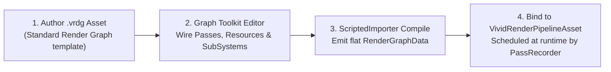
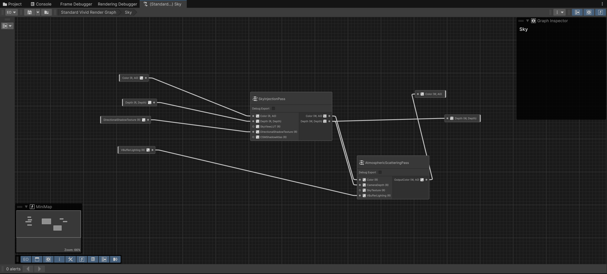

# VividRP

English | [简体中文](README.md)

VividRP is an experimental Scriptable Render Pipeline (SRP) package for next-generation Unity. It centers on a **visual, data-driven RenderGraph workflow** and explores high-end rendering systems including deferred rendering, GPU Driven, Bindless, Ray Tracing (DXR), reference path tracing, volumetrics, virtual texturing (VT/SVT), virtual shadow maps (VSM), and temporal upscaling.

> [!IMPORTANT]
> - **Unity Baseline**: The current development and verification baseline is Unity `7000.0.0a9` (revision `69e891f60f9a`; see [Unity 7000.0.0a9 Compatibility](Documentation~/Unity7000a9Upgrade.md)).
> - **Core Dependency**: VividRP depends on customized [CoreRP](https://github.com/af8a2a/CoreRP.git). In Package Manager, use **Add package from git URL** to add `https://github.com/af8a2a/CoreRP.git` (or use the synchronized `Packages/CoreRP` in the containing project).
> - **Recommended Platform**: Windows + DirectX 12. Bindless, GPU Driven 16-bit arithmetic, and Ray Tracing workflows require DX12 / DXR and Shader Model 6.2+ capabilities.
> - **Development Status**: VividRP is under active development. Several subsystems are experimental and are not guaranteed to be cross-platform, production-ready, or backward-compatible.
> - **Source of Truth**: This repository no longer maps one-to-one to the legacy [VividRP](https://github.com/af8a2a/VividRP) feature list. Treat the current source, this README, and [`Documentation~`](Documentation~/README.md) as the source of truth.

---

## Core Workflow

VividRP rendering pipelines are authored as visual `.vrdg` graph assets:



1. **Create a Graph Asset**: In the Project window, select `Assets/Create/VividRP/Standard Render Graph` for a runnable template, or `Assets/Create/VividRP/Render Graph` for an empty graph.
2. **Visual Authoring**: Double-click the `.vrdg` asset to configure passes, resource connections, and local `SubSystem` subgraphs in the `com.unity.graphtoolkit` editor.
3. **Import & Compile**: `RenderGraphImporter` automatically derives resource bindings and dependencies, performs pass culling, validates the graph, and compiles it into flat runtime `RenderGraphData`.
4. **Assign to Pipeline**: Assign the generated `RenderGraphData` to the **Render Graph Asset** field of a `VividRenderPipelineAsset`.


### Pass & Resource Model

Pass ports are generated automatically from fields marked with `[RenderGraphResource]`. At runtime, `PassRecorder` schedules three standard pass base types:

| Pass Base Class | Purpose |
| --- | --- |
| `RasterPass` | Raster rendering with automatic render target binding and RenderList drawing |
| `ComputePass` | Compute Shader dispatch on graphics or async compute queues |
| `UnsafePass` | Direct native `CommandBuffer` access for multi-stage or custom workflows |

The graph editor supports **Texture**, **Buffer**, **Render List**, **History** (camera-owned cross-frame resources), **Preview**, and **Acceleration Structure (RTAS)** resources, as well as Local Subgraph-based **SubSystems**:



---

## Included Capabilities

The modules below are implemented in the current package (availability depends on project configuration, platform, and hardware support):

| Area | Key Systems & Features |
| --- | --- |
| **Core Rendering** | Pre-depth, GBuffer, deferred lighting (with native SimpleSlab and OpenPBR material paths), motion vectors, HZB, general object drawing, and color pyramids |
| **Shadows & Lighting** | • **Shadows**: CSM / PCSS, Virtual Shadow Maps (VSM, with dual static/dynamic page pools and SMRT adaptive ray exit), directional DXR shadows with SIGMA denoising<br>• **Lighting**: Clustered lighting, LTC area lights, reflection-probe atlas, ReGIR, sky and atmospheric scattering (Physically Based Sky / HDRI Sky) |
| **Materials & Shading** | • **Built-in Shaders**: `StandardLit` (with Metallic / Smoothness / AO PBR remap ranges), `SimpleLit`, `SimpleForward`, and `StandardLayeredLit`<br>• **BSDF Contracts**: `SimpleSlabV1` (single/dual-layer energy-compensated real-time BSDF) and `OpenPBROpaqueV1` (native OpenPBR 1.1 deferred contract)<br>• **Migration Tools**: URP Lit and HDRP Lit material converters |
| **GPU Driven** | • **Geometry & Culling**: meshoptimizer-based Cluster LOD generation, 16B shared group table, conservative FP16 instance/meshlet frustum culling, normal-cone culling, two-stage HZB occlusion culling, Visibility Buffer rendering<br>• **Scene Representation**: `PrimitiveScene` (Author Handle + Camera Burst coarse culling `DrawSet`)<br>• **Terrain**: `VividTerrain` (non-destructive Unity Terrain duplication/conversion, border-locked chunked meshlet baking, multi-level LODs, up to 8 terrain layers with control-map blending) |
| **Anti-Aliasing & Upscaling** | CMAA2, TAA, TSR, and FSR3; NVIDIA DLSS Super Resolution & Ray Reconstruction (with plugin integration) |
| **Post-Processing** | • **Exposure & Grading**: Auto exposure (Unity, HDRP, and Unreal preset Inspectors), bilateral-grid Local Exposure, color grading<br>• **Optics & Blur**: Bloom (mip-scattering and FFT-convolution modes), depth of field (DoF), data-driven lens flares<br>• **AO & Reflections**: Ambient occlusion (XeGTAO or FidelityFX CACAO), screen-space reflections (SSR with REBLUR temporal stabilization, checkerboard interleaving, and hit-distance reconstruction) |
| **Volumetrics** | Global and local volumetric fog, VBuffer, volumetric lighting, aerial perspective compositing, and Max-Z generation |
| **Ray Tracing & HW Acceleration** | • **Ray Tracing**: Serializable RTAS descriptors, `RTASBuildPass`, directional ray-traced shadows, and debug passes<br>• **NVIDIA Integration**: NVAPI Shader Execution Reordering (SER), RTX Texture Filtering (RTXTF) |
| **Reference Path Tracing** | • **Integrator**: OpenPBR-based multi-bounce DXR prototype with analytic-light & HDRI MIS / NEE, rectangle/disc BSDF-segment evaluation, shading-point-aware mixed light selection, and spatial indexing<br>• **Transmission & SSS**: Stochastic RGB geometry opacity, thin-walled transmission, solid refraction with a 4-level medium stack and Beer–Lambert absorption, face SSS ear transmission<br>• **Denoising & Debug**: NRD REBLUR preview denoising, Unity Open Image Denoise (OIDN) backend, Rendering Debugger transport views, deterministic pixel capture |
| **Hair Path Tracing** | `VividRP/Material/Hair` DXR path based on the RTXCR Chiang near-field BCSDF, featuring DOTS strand geometry, persistent GPU strand updates (`HairDotsGpuStream`), dynamic motion vectors, Reference PT, REBLUR, and DLSS-RR guides (raster hair and groom importing are not included) |
| **Resources & Subsystems** | • **Virtual Texturing (VT)**: Generic VT Core, SVT, GPU Driven Terrain surface bindings, adaptive mip bias, and residency transitions<br>• **Per-Object Buffer**: `MaterialPropertyBlock`-free per-renderer 16B-aligned SSBO shader data, centralized generated HLSL layouts, and MPB CPU benchmark<br>• **Other Subsystems**: DBuffer Decals, experimental ECS paged-storage particle system (simulation, culling, sorting, Billboard/Mesh/Stretch rendering, trails, collisions, sub-emitters) |
| **Editor & Tooling** | VividRP Wizard (Windows DX12 / DXC setup), LWGUI + DXC shader performance monitor, Roslyn pass-node source generator, AgenticDebugger (PIX, Frame Debugger, and GC Profiler CLI automation) |

> [!TIP]
> Cameras, lights, reflection probes, and most Volume settings include VividRP companion components (such as `VividAdditionalCameraData` and `VividAdditionalLightData`) or custom Inspectors.

---

## Quick Start

1. **Open Project**: Open the containing project with Unity `7000.0.0a9` (or a compatible release).
2. **Verify Dependencies**: Ensure `Packages/CoreRP` (`com.unity.render-pipelines.core`) and this package are loaded in Package Manager.
3. **Configure Graphics API & DXC**: Open **Window > Rendering > VividRP Wizard** to place **Direct3D 12** first for Windows Standalone and configure **DXC** for the active Build Profile (restart Unity after changing the graphics API).
4. **Create Pipeline Asset**: Select `Assets/Create/VividRP/Vivid Render Pipeline` to create a `VividRenderPipelineAsset`, and assign it as the active render pipeline in **Project Settings > Graphics**.
5. **Create & Bind Render Graph**: Create a **Standard Render Graph** (`.vrdg`) and assign its generated `RenderGraphData` to the pipeline asset's **Render Graph Asset** field.
6. **Initialize Global Volume**: Initialize **Default Volume** in the pipeline asset Inspector, or create a scene Volume Profile for sky, shadows, and post-processing.
7. **Configure Camera**: Ensure the active camera has `VividAdditionalCameraData` and select the desired anti-aliasing / upscaling mode (e.g., TAA, TSR, FSR3).

---

## Advanced Feature Setup

### 1. GPU Driven & Bindless

- **Enable GPU Driven**: Check **GPU Driven** in the `VividRenderPipelineAsset` Inspector.
- **Install Bindless Native Plugin**: Because native plugins inside `Packages/...` can load after D3D12 descriptor heap creation (`UUM-134389`), run the setup script from the project root to install a preloaded copy into `Assets/Plugins`, then restart Unity:

```powershell
powershell -ExecutionPolicy Bypass -File .\Packages\VividRP\Setup-Bindless.ps1
```

### 2. Ray Tracing, DLSS, and NVIDIA SER

- **Ray Tracing**: Requires DXR-capable hardware and DirectX 12. Add `VividRP/Ray Tracing/Settings` to a Volume Profile.
- **DLSS / Ray Reconstruction**: Requires NVIDIA dependencies and the `DLSS_PLUGIN_INTEGRATE` scripting define symbol.
- **Shader Execution Reordering (SER)**: Optional hardware reordering acceleration for Reference Path Tracing on Windows x86_64 + DX12. Enable **Shader Execution Reordering** in the `VividRP/Path Tracing/Reference Path Tracing` Volume (see [SER Documentation](Documentation~/NVAPIShaderExecutionReordering.md)).

### 3. Reference Path Tracing & `StandardLit` Transmission Rules

Reference path tracing uses a dedicated `.vrdg` asset and pipeline asset for controlled-scene validation (not aimed at real-time frame rates):

- **Geometric Coverage vs. Material Transmission**: `StandardLit` separates coverage from transmission (both extra maps reuse Base Map UV):
  - **Stochastic Coverage**: Driven by `Base Color.a × Base Map.a × Opacity Map.r`.
  - **OpenPBR Transmission**: Driven by `Transmission Weight × Transmission Map.r`, tinted by `Transmission Color`.
- **Thin-Walled vs. Solid Refraction**:
  - **Thin Sheets**: Enable **Thin-Walled Transmission**.
  - **Closed Solids**: Disable **Thin-Walled Transmission** and use **Transmission Depth** to specify the Beer–Lambert absorption distance represented by **Transmission Color** (supports up to 4 nested solid media levels).
- **Convergence & Denoising**: Accumulation progress is displayed at the bottom of the screen and freezes upon reaching **Target Sample Count**. The **OIDN** backend is available in the Editor or 64-bit Standalone builds when `com.unity.rendering.denoising` is installed, submitting denoising once per convergence cycle.
- **RTX Texture Filtering (RTXTF)**: Can be enabled in the Reference Path Tracing Volume; used by default for opaque `StandardLit` surface texture reads (see [RTXTF Documentation](Documentation~/RTXTextureFiltering.md)).

### 4. Hair Path Tracing

Hair uses a dedicated `VividRP/Material/Hair` material and Reference Path Tracing graph:

- Covers the DXR ray-tracing path only (no raster hair preview), validating DOTS strand geometry, deforming-strand motion vectors, and REBLUR / DLSS-RR denoising guides.
- Generate test assets via `VividRP > Hair > Create Chiang Validation Assets` (see [Hair Path Tracing Documentation](Documentation~/HairPathTracing.md)).

---

## Directory Guide

```text
Packages/VividRP/
├── Runtime/
│   ├── RenderPipeline/     # Pipeline core, VividRenderPipelineAsset, global settings & Volume integration
│   ├── RenderGraph/        # Runtime graph data, serializable descriptors, History/Preview, PassRecorder
│   ├── Core/               # Camera History persistence, DOTS Hair geometry & GPU stream updates
│   ├── RenderPass/         # Core, Debug, and Example render passes
│   ├── SubSystem/          # GPUDriven, VirtualShadowMap, VirtualTexture, Volumetric, Sky, Decal, DLSS, etc.
│   ├── ComponentData/      # Companion camera, light, and reflection-probe components
│   ├── PerObjectBuffer/    # MPB-free per-renderer SSBO shader data system & CPU benchmark
│   └── Experiment/Particle/# Experimental ECS paged-storage particle system
├── Editor/
│   ├── RenderGraph/        # Graph Toolkit editor, importer, compiler, validator & node registry
│   ├── PipelineResource/   # [PipelineResource] collection and synchronization tools
│   └── AgenticDebugger/    # CLI/Agent-oriented PIX, Frame Debugger, and GC diagnostic bridges
├── Shaders/                # HLSL shaders (Core Public/Private, Material, OpenPBR, ThirdParty)
├── SourceGenerators~/      # Standalone Roslyn pass-node incremental generator & .NET tests
├── Tools~/                 # Standalone DXC / GPU geometry & material probes, PIX & diagnostic CLI tools
├── Documentation~/         # Architecture, subsystem, contract, and workflow docs (with index)
├── Roadmap~/               # Subsystem roadmaps and design notes
└── Tests/Editor/           # Unity EditMode automated test suite
```

---

## Resource Synchronization & Development Notes

- **RenderGraph Source of Truth**: `.vrdg` files are the source of truth. Never manually edit imported `RenderGraphData` contents.
- **Pass Node Code Generation**: Eligible passes in `VividRP.Runtime` receive dedicated graph nodes from the Roslyn incremental generator in `SourceGenerators~` at compile time (no `GeneratedRenderPassNodes.g.cs` file to maintain). Custom passes in external assemblies use the generic node's `PassScript` option.
  - *Upgrade Note*: If an older graph asset serialized a consumer pass as `VividRP.Editor.RenderGraph.Generated.<CustomPass>`, replace it with the generic pass node and assign `PassScript`.
- **Engine Resource Sync**: Never hand-edit `Runtime/Resources/PipelineResources.asset`. After changing `[PipelineResource]` or `[ResourcePath]` declarations, select `PipelineResources.asset` and click **Recollect Engine Resources** in the Inspector.
- **Port Field Contracts**: `[RenderGraphResource]` field names are serialization contracts for ports, previews, and compiled bindings. Review `.vrdg` assets and tests before renaming them.
- **Cross-Frame History Resources**: Use camera-owned `CameraHistoryTexture` / `CameraHistoryBuffer` for cross-frame resources. `PassRecorder` imports them via `CameraHistoryRenderGraphBridge` and commits them after successful graph execution without manual end-of-graph copies.

---

## Documentation & Roadmap

See **[Documentation~/README.md](Documentation~/README.md)** for the full categorized documentation index.

### RenderGraph & Core Architecture
- [RenderGraph Editor Guide](Documentation~/RenderGraphEditor.md)
- [RenderGraph SubSystem (Local Subgraph)](Documentation~/RenderGraphSubSystem.md)
- [RenderGraph Resource Descriptors & PassBypass](Documentation~/RenderGraphResourceDescriptors.md)
- [Acceleration Structure (RTAS) Support](Documentation~/AccelerationStructureSupport.md)
- [Per-Object Buffer System](Documentation~/PerObjectBuffer.md)

### Materials & Shading
- [SimpleSlab V1 Real-Time BSDF Frozen Contract](Documentation~/Material/SimpleSlabV1.md)
- [OpenPBROpaque V1 Default Material Frozen Contract](Documentation~/Material/OpenPBROpaqueV1.md)
- [LWGUI Integration & DXC Shader Performance Monitor](Documentation~/LWGUI.md)

### GPU Driven, Terrain & Scene Representation
- [GPU Driven Cluster LOD Generation & Runtime Selection](Documentation~/GPUDrivenClusterLOD.md)
- [Conservative Instance Frustum Culling (FP16)](Documentation~/GPUDrivenInstanceCulling.md)
- [Conservative Meshlet Frustum/Cone/HZB Culling](Documentation~/GPUDrivenMeshletCulling.md)
- [PrimitiveScene V1: Author Handle & Camera DrawSet](Documentation~/PrimitiveSceneV1.md) / [V0 Prototype](Documentation~/PrimitiveScenePrototype.md)
- [VividTerrain Chunked Meshlet Baking & Multi-Level LOD](Documentation~/VividTerrainBaking.md)
- [A/B Validation Reports: Main-View Traversal](Documentation~/GPUDrivenMainTraversalAB.md) / [Cluster Generation Quality](Documentation~/GPUDrivenGenerationQualityAB.md)

### Virtual Shadow Maps (VSM) & SMRT
- [VirtualShadowMap Code & Directory Layout](Documentation~/VirtualShadowMapCodeLayout.md)
- [VSM Shader vs. Unreal 5.7 Reference Mapping](Documentation~/VirtualShadowMapShaderReference.md)
- [SMRT Production Adaptive Ray Exit](Documentation~/SMRTAdaptiveRays.md)
- [SMRT Receiver & Projection Preparation Reuse](Documentation~/SMRTReceiverPreparation.md)
- [SMRT Cost Diagnostics](Documentation~/SMRTCostDiagnostics.md)

### Ray Tracing, Path Tracing & Hair
- [Chiang Hair Path Tracing & DOTS GPU Stream](Documentation~/HairPathTracing.md)
- [NVIDIA Shader Execution Reordering (SER)](Documentation~/NVAPIShaderExecutionReordering.md)
- [RTX Texture Filtering (RTXTF) in Reference Path Tracing](Documentation~/RTXTextureFiltering.md)

### Post-Processing, Sky & Virtual Texturing
- [Virtual Texture Core Architecture](Documentation~/VirtualTextureCoreArchitecture.md)
- [Ambient Occlusion (XeGTAO / FidelityFX CACAO)](Documentation~/AmbientOcclusion.md)
- [FFT Convolution Bloom](Documentation~/FFTBloom.md)
- [Bilateral Local Exposure](Documentation~/LocalExposure.md)
- [Sky System Roadmap](Documentation~/SkySystemRoadmap.md) / [Physically Based Sky HDRP Gap Inventory](Documentation~/PhysicallyBasedSkyHdrpGapInventory.md)

### Tooling, Setup & Upgrade Notes
- [VividRP Wizard (DX12 / DXC Setup)](Documentation~/VividRPWizard.md)
- [Bindless Native Plugin Setup](Documentation~/Bindless.md)
- [Unity 7000.0.0a9 Compatibility & Upgrade Notes](Documentation~/Unity7000a9Upgrade.md)
- [Agentic PIX M3 Acceptance](Documentation~/AgenticPixM3Acceptance.md) / [AgenticDebugger Guide](Editor/AgenticDebugger/README.md)
- [Roslyn RenderPass Node Source Generator](SourceGenerators~/README.md)

### Roadmaps (`Roadmap~`)
- [Shadow](Roadmap~/Shadow.md) · [Virtual Shadow Map](Roadmap~/VirtualShadowMapRoadmap.md) · [Directional VSM Optimization](Roadmap~/DirectionalVSMOptimization_20260917.md)
- [Sky](Roadmap~/Sky.md) · [Light Culling](Roadmap~/lightculling-roadmap.md)
- [Virtual Texture](Roadmap~/VirtualTextureSystem.md) · [SVT](Roadmap~/SVTRoadmap.md)
- [Reference Path Tracing](Roadmap~/ReferencePathTracingRoadmap.md) · [Hair Path Tracing](Roadmap~/HairPathTracingRoadmap.md)
- [Agentic PIX Roadmap](Roadmap~/AgenticPixRoadmap.md)
