# VividRP

English | [简体中文](README.md)

VividRP is an experimental Scriptable Render Pipeline (SRP) package for next-generation Unity. It centers on a **visual, data-driven RenderGraph workflow** and explores high-end rendering systems including deferred rendering, a Substrate multi-closure material architecture (`.slab.shader`) with real-time Hybrid Shell / Marschner fur, real-time strand-based hair (3-Layer Visibility Atlas + strand-space shading & Biased L1 SH), GPU Driven rendering (GPUScene / Visibility Buffer), Bindless, Mesh/Global SDF & Surface Cache real-time global illumination (Screen Probe Gather Diffuse GI & UE5-based Lumen Specular Reflections), Ray Tracing (DXR), reference path tracing, Meshlet APV light baking, volumetrics, virtual texturing (VT/SVT), virtual shadow maps (VSM), and temporal upscaling.

> [!IMPORTANT]
> - **Unity Baseline**: The current development and verification baseline is Unity `7000.0.0a22` (revision `dbac4d68c4de`; see [Unity 7000.0.0a16 Compatibility](Documentation~/Unity7000a16Upgrade.md) for historical upgrade notes).
> - **Core Dependencies**: VividRP depends on customized [CoreRP](https://github.com/af8a2a/CoreRP.git) (`17.7.0`) alongside Unity official `com.unity.collections` (`7.0.0`) and `com.unity.pipeline` (`1.0.1`). In Package Manager, use **Add package from git URL** to add `https://github.com/af8a2a/CoreRP.git` (or use the synchronized `Packages/CoreRP` in the containing project).
> - **Recommended Platform**: Windows + DirectX 12. Bindless, GPU Driven 16-bit arithmetic, and Ray Tracing workflows require DX12 / DXR and Shader Model 6.2+ capabilities.
> - **Development Status**: VividRP is under active development. Several subsystems are experimental and are not guaranteed to be cross-platform, production-ready, or backward-compatible.
> - **Source of Truth**: This repository no longer maps one-to-one to the legacy [VividRP](https://github.com/af8a2a/VividRP) feature list. Treat the current source, this README, and [`Documentation~`](Documentation~/README.md) as the source of truth.

---

## Real-Time Global Illumination Showcase (Sponza)

All frames below are captured live in the Sponza Noon scene at 1920×1080 with GPU Driven Meshlets, Mesh/Global SDF, Surface Cache multi-bounce radiosity, Screen Probe Gather Diffuse GI, and Lumen Specular Reflections (no baked lightmaps):

| Upper Colonnade Multi-Bounce Color Bleeding (Final Lit) | Isolated Real-Time Diffuse GI (Screen Probe Gather) |
| :---: | :---: |
| 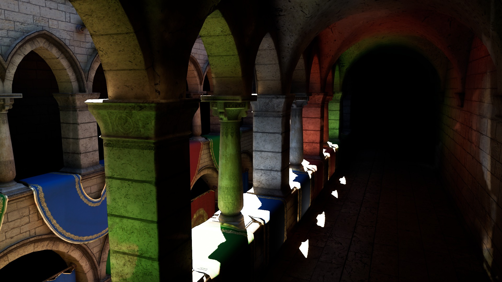 | 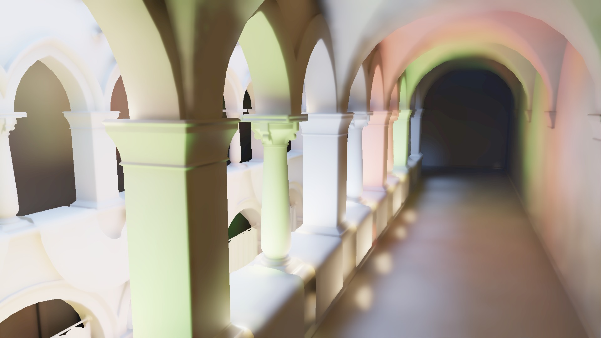 |
| **Atrium Indirect Bounce & Gilded Curtain Specular Reflections** | **Vaulted Arches Indirect Ceiling Bounce & Shadow Contrast** |
| 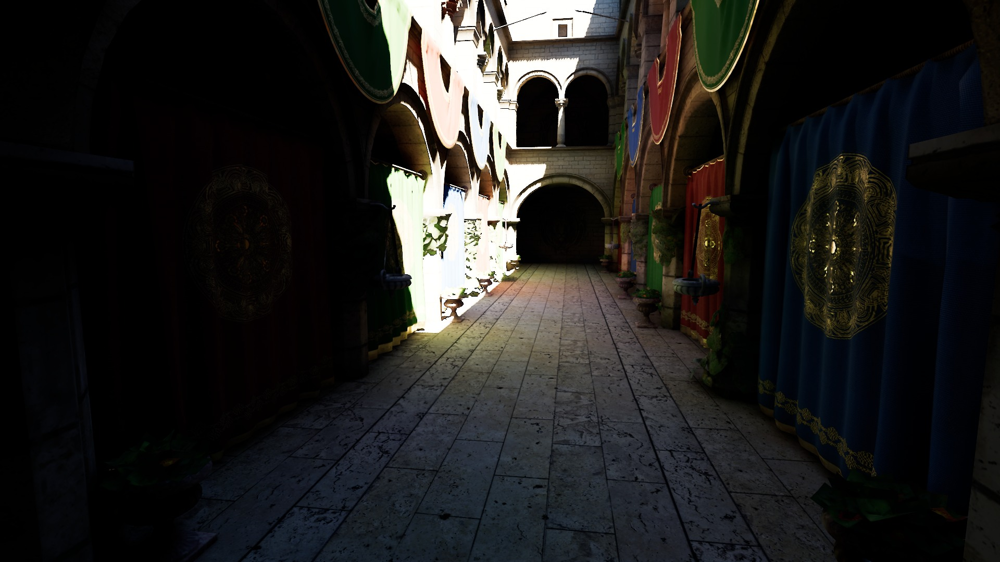 | 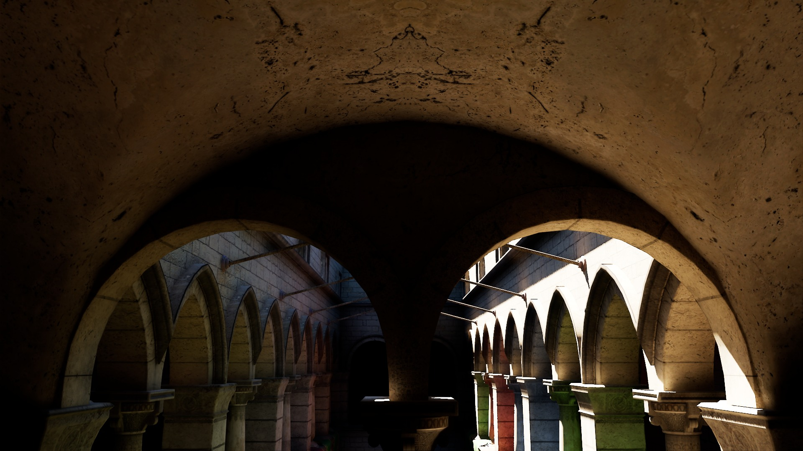 |

---

## Substrate Material System & Real-Time Fur Showcase (`FurSlab` & `FurLookDev`)

VividRP features a **dual-target `.slab.shader` material compiler + Substrate Closure Buffer (Tier 1/2/3) + Hybrid Shells real-time fur pipeline**, delivering unified shading across both Raster and GPU Driven (Visibility Buffer + DesktopBCn SVT) paths:

- **Hybrid Shells Sparse Raymarching**: Combines **4–8 physical shells × 4–6 in-slab raymarch steps** while preserving shell-level hardware Early-Z (no `SV_Depth` writes). Relative to a 24-shell pure baseline (`0.826 ms` Hero close-up on RTX 5070 Ti @ 1920×1080), Hybrid Shells achieve **3×–6× geometry compression** and **14%–41% GPU savings** (`8×4`: `0.710 ms` / `-14.0%`, `6×4`: `0.597 ms` / `-27.7%`, `4×6`: `0.486 ms` / `-41.2%`) with matching grazing silhouettes and backlit transmission, fully integrated with GPU-driven dynamic shell amplification, distance shell LOD, and programmable VSM/CSM shadows.
- **Substrate 6-Slice Hair/Fur Closure**: `FurSlab` supports both **OpenPBR V2 (Fuzz + Anisotropy)** and **Karis Marschner + Dual Scattering + Yan 2017 Medulla** lighting models. The Marschner/Medulla path packs into a 6-slice (24 B/px) `Substrate Hair Closure` evaluated in Tier 3 deferred lighting—outperforming OpenPBR Tier 2 on RTX 5070 Ti @ 1080p Hero (`GBufferPass`: `0.178 ms` vs `0.346 ms`; `DeferredLightingPass`: `0.620 ms` vs `0.825 ms`) with **0/256 energy violations** across the 16×16 white-furnace spherical integral grid.
- **Houdini 22 DCC Asset Pipeline**: Supports `Procedural Lattice`, `2D Pattern Map`, `4×4 3D Flipbook Atlas`, and tangent-space `FlowMap` layering, backed by the automated [Bake-VividFurPatterns.py](Tools~/Houdini/Bake-VividFurPatterns.py) baker and verified Raster vs. GPUDriven DesktopBCn SVT parity (CurlyWool 4×4 SVT `FullMAE = 0.0187`).

| Outdoors Material LookDev Playground (StandardLit / ClearCoat / Fabric / 4× FurSlab) | Houdini 22 DCC Patterns & Raster vs. GPUDriven SVT Parity |
| :---: | :---: |
| 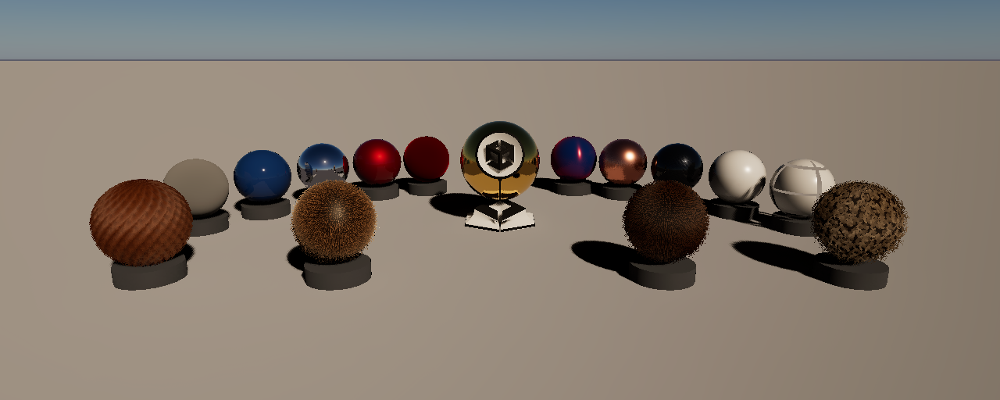 | 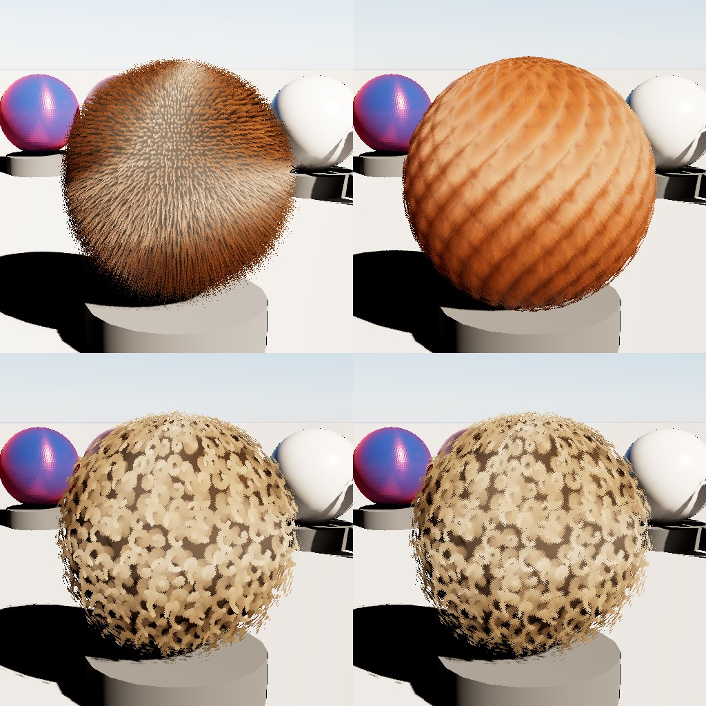 |
| **Indoor FurLookDev 3-Bay Studio Overview (Fixed EV100 = 0.0)** | **Case 01: Single Strand Goniometer (`R / TT / TRT / Medulla` Lobes & Cuticle Tilt)** |
| 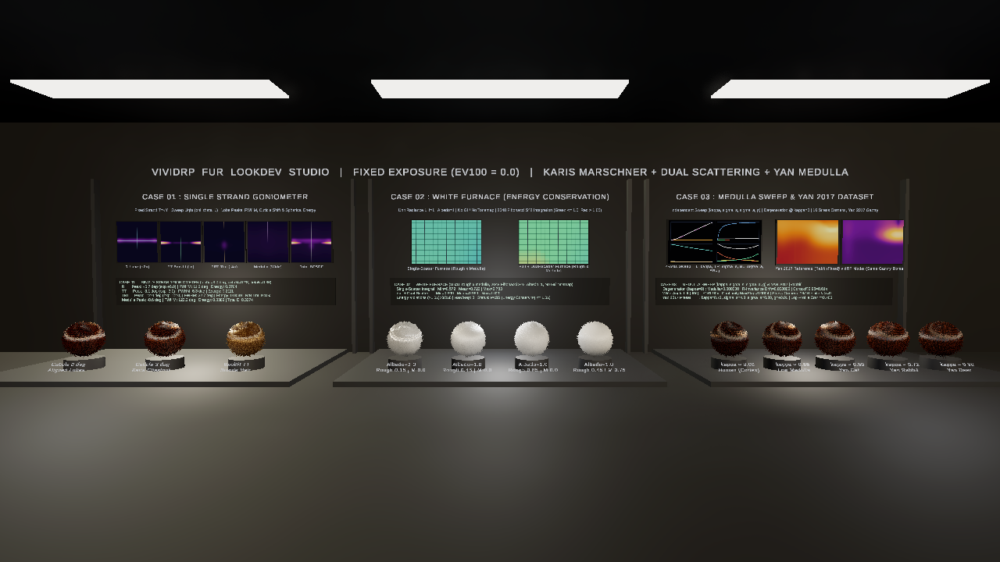 | 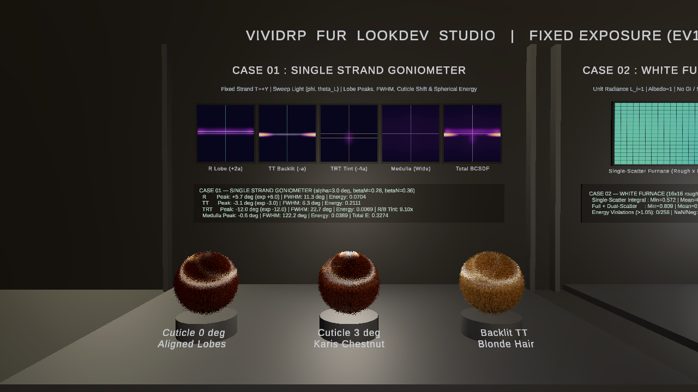 |
| **Case 02: White Furnace Energy Conservation (`16×16` 2048-Dir Integral, 0/256 Violations)** | **Case 03: 4-Axis Medulla Sweep & Yan 2017 Animal Fur Dataset Match** |
| 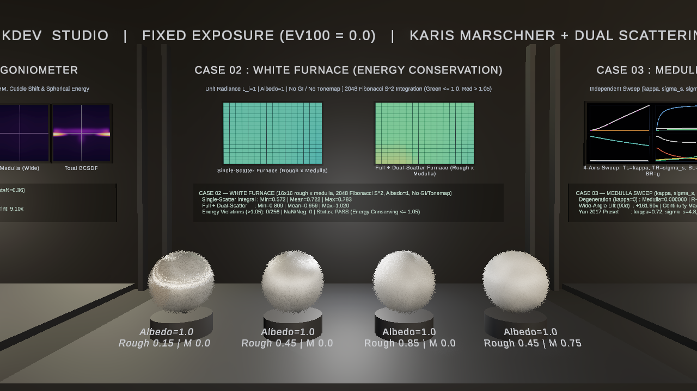 | 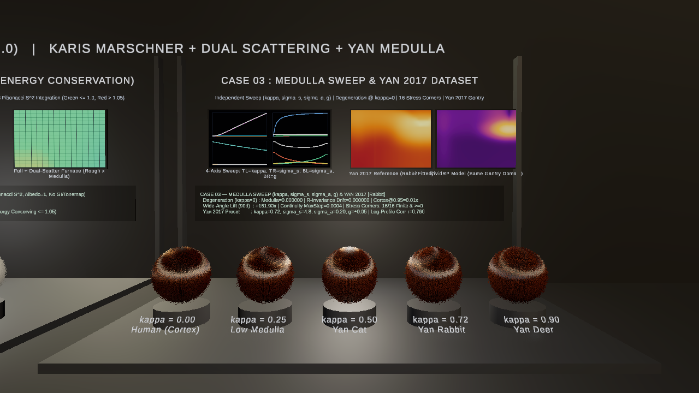 |

---

## Real-Time Strand-Based Hair & 3-Layer Visibility Atlas Showcase (Strand Hair & `HairLookDev`)

VividRP implements a **real-time Compute software rasterizer + 3-Layer Visibility Atlas + strand-space per-vertex shading pipeline** for dense strand hair, sharing the same Houdini 22 `.vividhair` assets directly with the DXR Reference Path Tracer (RTXCR Chiang BCSDF):

- **64×64 Tiled 3-Layer Visibility Atlas & Compute Rasterization**: Packs 3 depth-sorted visibility layers plus 1 additive coverage layer into a compact 32-bit format (`[31:20]` 12-bit local linear depth + `[19:0]` 20-bit `SegmentId`) within a bounded `32–64 MB` budget (`512–1024` tiles), featuring automatic `×2 / ×4` tile downscaling with 8-tap Poisson jitter, quadratic coverage reconstruction, and 3-layer deep-radiance extrapolation ($w_i = C_i \cdot 0.25^{3-i}$).
- **Strand-Space Shading & Biased L1 SH Self-Shadowing**: Evaluates `VividHairFurBSDF.hlsl` (Karis Marschner `R / TT / TRT` + Zinke Dual Scattering + Yan Medulla + Chiang melanin) per visible vertex with Clustered Lighting, world-space CSM shadow atlas, and Sky IBL. A GPU 96³ voxel + occluder-mesh triangle **Biased L1 SH Baker** (64 Fibonacci rays with `-5.0` negative miss bias, persisted directly into `.vividhair`) provides smooth self-shadowing and internal multiple scattering.
- **Phase S3 GPU Scheduling & Measured Parity**: Combines a **1024-bin global screen-tile counting sort**, a **zero-LDS-atomic Wave32 dual pixel-request stack** (`1.75 KB` LDS), **natural-order visible vertex compaction** (HZB compacts `HairBust_48k` from `393,216 → 158,130` visible vertices, ~**60%** reduction), and early **Async Compute scheduling** right after the final opaque `HZBGeneratePass`. In `HairLookDev` at 1280×720 on RTX 5070 Ti (`HairSphere_16k` + `HairBust_48k` = **65,536 strands / 475,136 segments**), the optimized path matches the direct path near-losslessly (`Overview` `PSNR = 61.85 dB`, `BustFront` `PSNR = 63.32 dB`), cutting `StrandHairShadingPass` to **`0.028–0.029 ms`** (~**2.4×** faster than uncompacted shading) with `StrandHairCompositionPass` at **`0.030–0.031 ms`**.

| Real-Time Strand VisBuf (`HairLookDev` Overview, 65,536 Strands) | Matched-Camera Reference PT Ground Truth (DXR Chiang) |
| :---: | :---: |
| 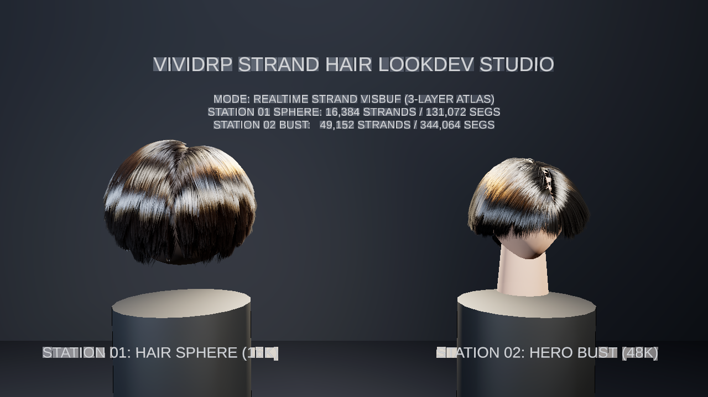 | 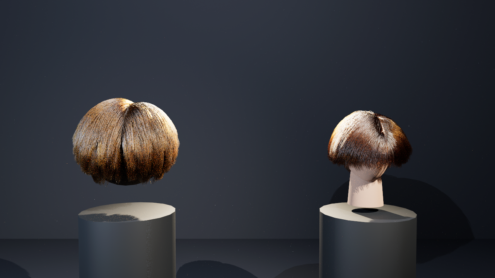 |
| **Real-Time Strand VisBuf (`HairBust_48k` 49,152 Strands Close-Up)** | **Matched-Camera Reference PT Ground Truth (`HairBust_48k`)** |
| 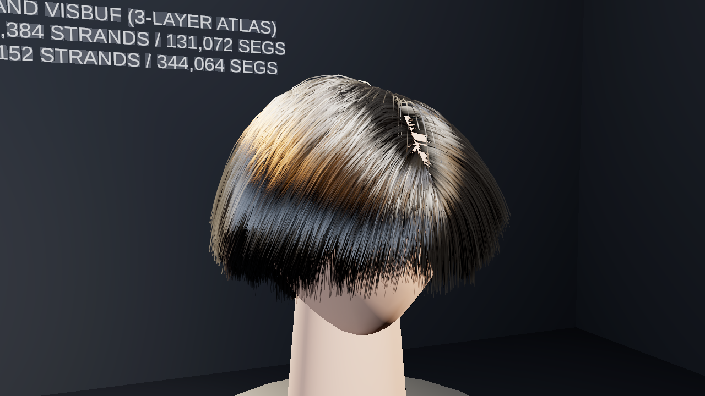 | 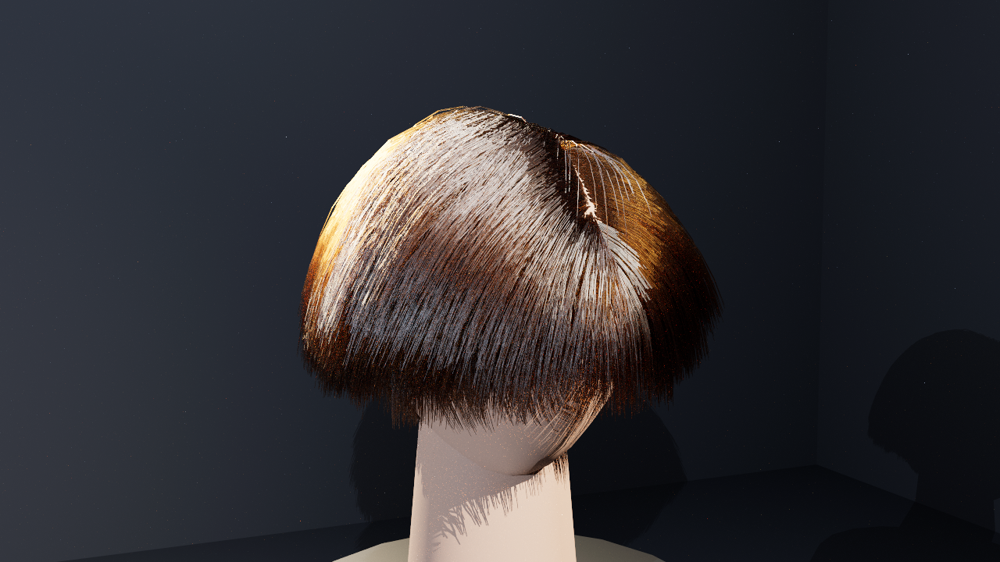 |
| **Real-Time Strand VisBuf (`HairSphere_16k` Strand Sphere Close-Up)** | **Matched-Camera Reference PT Ground Truth (`HairSphere_16k`)** |
| 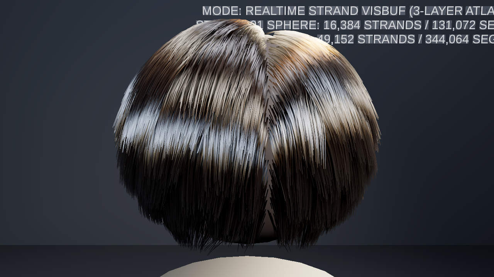 | 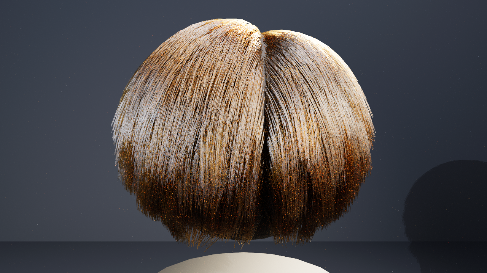 |
| **Debug: 3-Layer Visibility Atlas Layer Count (`LayerCount`)** | **Debug: Biased L1 SH Directional Self-Shadow (`DirectSelfShadow`)** |
| 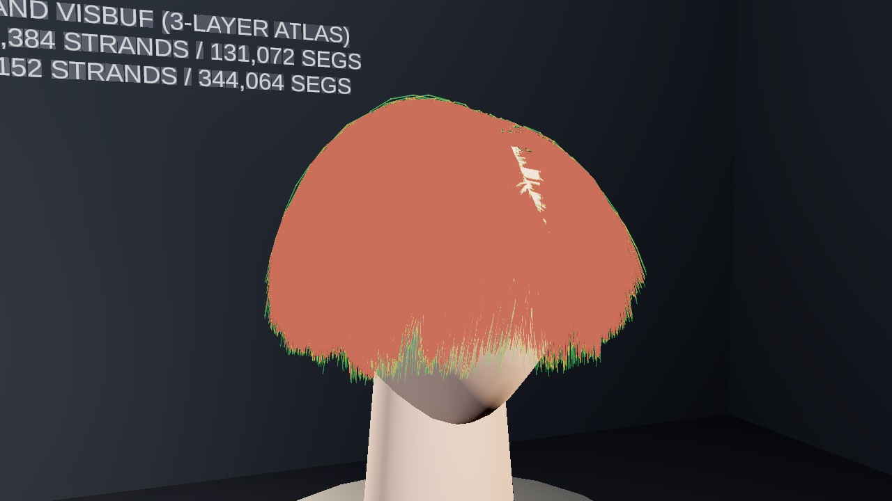 | 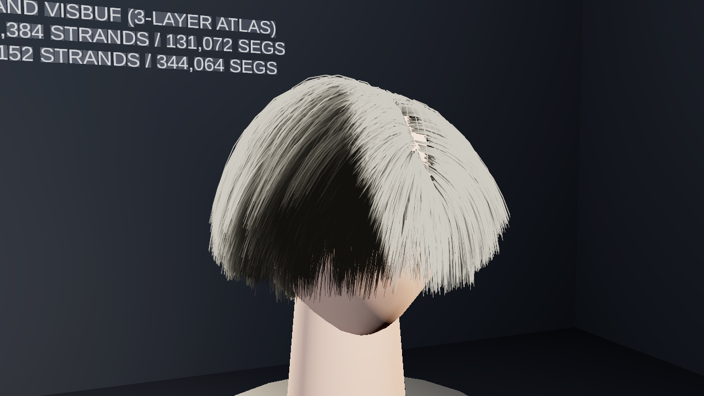 |

---

## Core Workflow

VividRP rendering pipelines are authored as visual `.vrdg` graph assets:

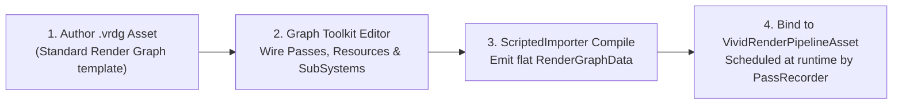

1. **Create a Graph Asset**: In the Project window, select `Assets/Create/VividRP/Standard Render Graph` for a runnable template, or `Assets/Create/VividRP/Render Graph` for an empty graph.
2. **Visual Authoring**: Double-click the `.vrdg` asset to configure passes, resource connections, and local `SubSystem` subgraphs in the `com.unity.graphtoolkit` editor.
3. **Import & Compile**: `RenderGraphImporter` automatically derives resource bindings and dependencies, performs pass culling, validates the graph, and compiles it into flat runtime `RenderGraphData`.
4. **Assign to Pipeline**: Assign the generated `RenderGraphData` to the **Render Graph Asset** field of a `VividRenderPipelineAsset`.

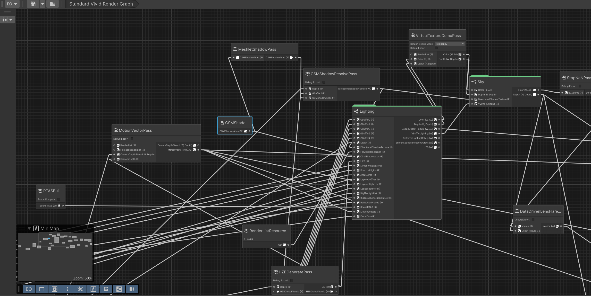

### Pass & Resource Model

Pass ports are generated automatically from fields marked with `[RenderGraphResource]`. At runtime, `PassRecorder` schedules three standard pass base types:

| Pass Base Class | Purpose |
| --- | --- |
| `RasterPass` | Raster rendering with automatic render target binding and RenderList drawing |
| `ComputePass` | Compute Shader dispatch on graphics or async compute queues |
| `UnsafePass` | Direct native `CommandBuffer` access for multi-stage or custom workflows |

The graph editor supports **Texture**, **Buffer**, **Render List**, **History** (camera-owned cross-frame resources), **Preview**, and **Acceleration Structure (RTAS)** resources, as well as Local Subgraph-based **SubSystems**:

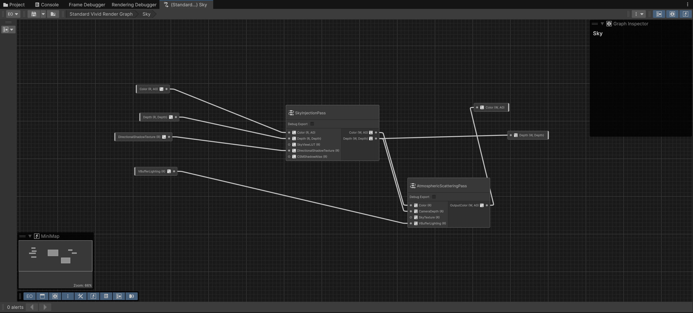

---

## Included Capabilities

The modules below are implemented in the current package (availability depends on project configuration, platform, and hardware support):

| Area | Key Systems & Features |
| --- | --- |
| **Core Rendering** | Pre-depth, Early-Z GBuffer (Surface Summary + Substrate Closure Buffer UAV supporting Tier 1/2 single-closure, Tier 3 multi-closure, and 6-slice `Hair` closure), deferred lighting (SimpleSlab / OpenPBR V2 / Karis Marschner Hair), motion vectors (with dynamic WPO and Visibility shell unpacking), HZB, general object drawing, and color pyramids |
| **Real-Time GI & Specular Reflections** | • **Surface Cache & Multi-Bounce Radiosity**: Automatic mesh card allocation, dynamic direct/sky relighting, progressive multi-bounce radiosity accumulation, and feedback<br>• **Screen Probe Gather Diffuse GI**: Full-sphere screen probe gathering, hybrid HZB screen trace + Mesh SDF + Global SDF + Far Radiance Cache + Occluded Sky tracing, importance sampling guides, adaptive probes, pixel-level temporal/spatial filtering, and Rough Specular<br>• **Lumen Specular Reflections (UE5 Port)**: Phase-1 Software SDF tracing backend (tile classification, VNDF GGX + STBN ray gen, HZB screen trace, wave/ZOrder2D compaction, Mesh/Global SDF + Surface Cache) + native UE5 Lumen Reflection Denoiser (BRDF spatial reconstruction resolve, virtual hit-point temporal accumulation, variance-guided bilateral spatial filter), with `Overview` / `ReflectionView` / `DedicatedReflectionRays` debug views (see [LumenReflectionMigration.md](Documentation~/LumenReflectionMigration.md) for the upcoming HWRT roadmap) |
| **Shadows & Lighting** | • **Shadows**: CSM / PCSS, Virtual Shadow Maps (VSM, with dual static/dynamic page pools, SMRT adaptive ray exit, and GPU-driven programmable fur/WPO shadow casting), directional DXR shadows with SIGMA denoising<br>• **Meshlet APV**: Native Adaptive Probe Volumes baking with static `MeshletRenderer` geometry (`MeshletAPVBaking`), including proxy geometry lifecycle management and Meta-pass UV-space projection matrix fix<br>• **Lighting & Reflections**: Clustered lighting, LTC area lights, reflection-probe atlas (with proxy box & influence volume gizmo visualization), ReGIR, sky and atmospheric scattering (Physically Based Sky / HDRI Sky) |
| **Materials & Shading** | • **Substrate `.slab.shader` System**: Dual-target importer compiling a single source to Raster Shader + standalone zero-switch GPUDriven ComputeShader, supporting `@vivid-vertex` / `@vivid-coverage` / `@vivid-surface` / `@vivid-instancing` hooks, automatic reflection of handwritten parameters & textures into GPU buffers / SVT, Multi-Closure Tier 3, and O(1) directional albedo LUTs<br>• **Built-in Slab Shaders**: `StandardLitSlab`, `FabricSlab` (HDRP-style CottonWool & Silk with double-sided & woven micro-detail), `FurSlab` (Hybrid Shells real-time fur), `ClearCoatDualNormal` (dual-normal carbon fiber), alongside `StandardLit`, `SimpleLit`, `SimpleForward`, and `StandardLayeredLit`<br>• **Modern HLSL & BSDF Contracts**: **HLSL 2021** pilot (`#pragma hlsl_version 2021`) in `UberPost.shader`, `SimpleSlabV1`, `OpenPBROpaqueV1` (OpenPBR 1.1), and 6-slice `Substrate Hair` ABI<br>• **LookDev & Migration Tools**: Outdoors Material LookDev Playground template, URP Lit and HDRP Lit material converters |
| **GPU Driven** | • **GPUScene & Culling**: Direct `PrimitiveScene` consumption with compute scatter uploads & SoA hot-path reads, meshoptimizer Cluster LOD generation, 16B shared group table, conservative FP16 instance/meshlet frustum culling (with per-material `MaxWPO` bounds padding), normal-cone culling, and two-stage HZB occlusion culling<br>• **Visibility Buffer & Programmable Raster**: Standard meshlet rasterization plus programmable WPO/Coverage raster (including GPU-driven dynamic shell amplification & distance shell LOD) and active-bin bitmask compute resolve (zero wasted empty-bin dispatches)<br>• **Signed Distance Fields (SDF)**:<br>&nbsp;&nbsp;– **Mesh SDF**: Offline mesh SDF baking (`VividMeshSdfBaker`), `.meshsdf` asset and importer, bricked storage management (`VividMeshSdfBricks`), GPU scene management (`VividMeshSdfGpuScene`), and visualization/ray-march tracing passes (`MeshSdfVizDebugPass`, `MeshSdfTraceDebugPass`)<br>&nbsp;&nbsp;– **Global SDF**: Cascaded 3D Clipmaps (`VividGlobalSdfClipmap`), regional update and composition compute shaders (`GlobalSdfClipmapPass`), GPU-driven frame integration (`VividGlobalSdfFrameData`), and ray-march trace debug pass (`GlobalSdfTraceDebugPass`)<br>• **Scene Representation & Terrain**: `PrimitiveScene` (Author Handle + Camera Burst coarse culling `DrawSet`), `VividTerrain` (non-destructive Unity Terrain duplication/conversion, border-locked chunked meshlet baking, multi-level LODs, up to 8 terrain layers with control-map blending) |
| **Anti-Aliasing & Upscaling** | CMAA2, TAA, TSR, and FSR3; NVIDIA DLSS Super Resolution & Ray Reconstruction (with plugin integration) |
| **Post-Processing** | • **Exposure & Grading**: Auto exposure (Unity, HDRP, and Unreal preset Inspectors with histogram curve remapping), bilateral-grid Local Exposure, color grading<br>• **Optics & Blur**: Bloom (mip-scattering and FFT-convolution modes), depth of field (DoF), data-driven lens flares<br>• **AO & Reflections**: Ambient occlusion (XeGTAO or FidelityFX CACAO), screen-space reflections (SSR with REBLUR temporal stabilization, checkerboard interleaving, and hit-distance reconstruction) |
| **Volumetrics** | Global and local volumetric fog, VBuffer, volumetric lighting, aerial perspective compositing, and Max-Z generation |
| **Ray Tracing & HW Acceleration** | • **Ray Tracing**: Serializable RTAS descriptors, `RTASBuildPass`, directional ray-traced shadows, and debug passes<br>• **NVIDIA Integration**: NVAPI Shader Execution Reordering (SER), RTX Texture Filtering (RTXTF) |
| **Reference Path Tracing** | • **Integrator**: OpenPBR-based multi-bounce DXR prototype with analytic-light & HDRI MIS / NEE, rectangle/disc BSDF-segment evaluation, shading-point-aware mixed light selection, and spatial indexing<br>• **Transmission & SSS**: Stochastic RGB geometry opacity, thin-walled transmission, solid refraction with a 4-level medium stack and Beer–Lambert absorption, face SSS ear transmission<br>• **Denoising & Debug**: NRD REBLUR preview denoising, Unity Open Image Denoise (OIDN) backend, Rendering Debugger transport views, deterministic pixel capture |
| **Real-Time Fur & Hair Path Tracing** | • **Real-Time Fur (`FurSlab`)**: Hybrid Shells (sparse shells + in-slab view-space raymarching with shell-level Early-Z), `VividFurShellRenderer` instancing & distance shell LOD, GPU-driven dynamic shell amplification & programmable VSM/CSM shadows, dual OpenPBR V2 / Karis Marschner + Dual Scattering + Yan 2017 Medulla lighting models, Houdini 22 FlowMap / 2D Pattern / 4×4 3D Flipbook pipeline, and the `Samples/FurLookDev` indoor verification studio<br>• **Real-Time Strand Hair**: 64×64 tiled 32-bit 3-Layer Visibility Atlas + additive coverage, 1024-bin global screen-tile counting sort & zero-LDS-atomic Wave32 dual pixel-request stack software rasterizer, HZB natural-order visible vertex compaction + early Async Compute scheduling, strand-space `VividHairFurBSDF` shading (Clustered Lights + world-space CSM + Sky IBL), GPU 96³ voxel + occluder-triangle Biased L1 SH baker, and the `Samples/HairLookDev` verification studio<br>• **Hair Path Tracing**: `VividRP/Material/Hair` DXR path based on the RTXCR Chiang near-field BCSDF, sharing `.vividhair` / DOTS strand geometry, persistent GPU strand updates (`HairDotsGpuStream`), dynamic motion vectors, Reference PT, REBLUR, and DLSS-RR guides |
| **Resources & Subsystems** | • **Virtual Texturing (VT)**: Generic VT Core, SVT, GPU Driven Terrain surface bindings, adaptive mip bias, residency transitions, and GPU-driven border size dependency tracking<br>• **Per-Object Buffer**: `MaterialPropertyBlock`-free per-renderer 16B-aligned SSBO shader data, centralized generated HLSL layouts, and MPB CPU benchmark (with `VividPerObjectColorExample` layout aliasing support)<br>• **Other Subsystems**: DBuffer Decals, experimental ECS paged-storage particle system (simulation, culling, sorting, Billboard/Mesh/Stretch rendering, trails, collisions, sub-emitters) |
| **Editor & Tooling** | • **Setup Wizard**: VividRP Wizard (Windows DX12 / DXC setup)<br>• **Memory & Safety Diagnostics**: `VIVIDRP_STARTUP_SRP=minimal` diagnostic mode and recursive directory-link safeguards<br>• **Performance & Analysis**: LWGUI + DXC shader performance monitor, Roslyn pass-node source generator<br>• **Automation**: AgenticDebugger (PIX, Frame Debugger, and GC Profiler CLI automation) |

> [!TIP]
> Cameras, lights, reflection probes, and most Volume settings include VividRP companion components (such as `VividAdditionalCameraData`, `VividAdditionalLightData`, and `VividAdditionalReflectionProbeData`) or custom Inspectors.

---

## Quick Start

1. **Open Project**: Open the containing project with Unity `7000.0.0a22` (or a compatible release).
2. **Verify Dependencies**: Ensure `Packages/CoreRP` (`com.unity.render-pipelines.core`) and this package are loaded in Package Manager.
3. **Configure Graphics API & DXC**: Open **Window > Rendering > VividRP Wizard** to place **Direct3D 12** first for Windows Standalone and configure **DXC** for the active Build Profile (restart Unity after changing the graphics API).
4. **Create Pipeline Asset**: Select `Assets/Create/VividRP/Vivid Render Pipeline` to create a `VividRenderPipelineAsset`, and assign it as the active render pipeline in **Project Settings > Graphics**.
5. **Create & Bind Render Graph**: Create a **Standard Render Graph** (`.vrdg`) and assign its generated `RenderGraphData` to the pipeline asset's **Render Graph Asset** field.
6. **Initialize Global Volume**: Initialize **Default Volume** in the pipeline asset Inspector, or create a scene Volume Profile for sky, shadows, and post-processing.
7. **Configure Camera**: Ensure the active camera has `VividAdditionalCameraData` and select the desired anti-aliasing / upscaling mode (e.g., TAA, TSR, FSR3).

---

## Advanced Feature Setup

### 1. GPU Driven & Bindless

- **Enable GPU Driven**: Check **GPU Driven** in the `VividRenderPipelineAsset` Inspector.
- **Install Bindless Native Plugin**: Because native plugins inside `Packages/...` can load after D3D12 descriptor heap creation (`UUM-134389`), run the setup script from the project root to install a preloaded copy into `Assets/Plugins`, then restart Unity:

```powershell
powershell -ExecutionPolicy Bypass -File .\Packages\VividRP\Setup-Bindless.ps1
```

### 2. Signed Distance Fields (Mesh SDF & Global SDF)

VividRP provides a high-performance hierarchical distance field representation for GPU-driven scenes:

- **Mesh SDF Baking & Importing**:
  - Bake offline mesh signed distance fields using `VividMeshSdfBaker` to generate `.meshsdf` assets.
  - Assign the `VividMeshSdfAsset` to `MeshletRenderer` components.
  - At runtime, `VividMeshSdfBricks` dynamically allocates and uploads bricked distance field volumes to the GPU 3D texture pool.
- **Global SDF Clipmap**:
  - `GlobalSdfClipmapPass` maintains cascaded 3D Clipmap textures centered on the camera.
  - `GlobalSdf.compute` projects and composites static Mesh SDF objects into the global clipmap volume, supporting incremental region updates.
- **SDF Debugging & Visualization**:
  - Attach `MeshSdfVizDebugPass`, `MeshSdfTraceDebugPass`, or `GlobalSdfTraceDebugPass` in the render graph to inspect distance field slices and normals via ray-marching.

### 3. Meshlet APV Light Probe Baking

VividRP supports Unity's native Adaptive Probe Volumes (APV) baking with static `MeshletRenderer` geometry:

- **Baking Entrypoint**: Click **VividRP > Lighting > Bake Meshlet APV**. The system generates managed temporary proxy geometries for static GI-contributing meshlets.
- **Meta-Pass Fix**: Fixes an engine issue where UV-space rasterization in Meta passes incorrectly mapped `unity_MatrixVP` to the camera view, restoring high albedo/emission coverage and diffuse color bouncing.
- **Validation Scene**: Open **VividRP > Samples > Open Meshlet APV Validation Scene** to verify probe placement and baked indirect lighting (see [Meshlet APV Documentation](Documentation~/MeshletAPVBaking.md)).

### 4. Ray Tracing, DLSS, and NVIDIA SER

- **Ray Tracing**: Requires DXR-capable hardware and DirectX 12. Add `VividRP/Ray Tracing/Settings` to a Volume Profile.
- **DLSS / Ray Reconstruction**: Requires NVIDIA dependencies and the `DLSS_PLUGIN_INTEGRATE` scripting define symbol.
- **Shader Execution Reordering (SER)**: Optional hardware reordering acceleration for Reference Path Tracing on Windows x86_64 + DX12. Enable **Shader Execution Reordering** in the `VividRP/Path Tracing/Reference Path Tracing` Volume (see [SER Documentation](Documentation~/NVAPIShaderExecutionReordering.md)).

### 5. Reference Path Tracing & `StandardLit` Transmission Rules

Reference path tracing uses a dedicated `.vrdg` asset and pipeline asset for controlled-scene validation (not aimed at real-time frame rates):

- **Geometric Coverage vs. Material Transmission**: `StandardLit` separates coverage from transmission (both extra maps reuse Base Map UV):
  - **Stochastic Coverage**: Driven by `Base Color.a × Base Map.a × Opacity Map.r`.
  - **OpenPBR Transmission**: Driven by `Transmission Weight × Transmission Map.r`, tinted by `Transmission Color`.
- **Thin-Walled vs. Solid Refraction**:
  - **Thin Sheets**: Enable **Thin-Walled Transmission**.
  - **Closed Solids**: Disable **Thin-Walled Transmission** and use **Transmission Depth** to specify the Beer–Lambert absorption distance represented by **Transmission Color** (supports up to 4 nested solid media levels).
- **Convergence & Denoising**: Accumulation progress is displayed at the bottom of the screen and freezes upon reaching **Target Sample Count**. The **OIDN** backend is available in the Editor or 64-bit Standalone builds when `com.unity.rendering.denoising` is installed, submitting denoising once per convergence cycle.
- **RTX Texture Filtering (RTXTF)**: Can be enabled in the Reference Path Tracing Volume; used by default for opaque `StandardLit` surface texture reads (see [RTXTF Documentation](Documentation~/RTXTextureFiltering.md)).

### 6. Substrate `.slab.shader`, Real-Time Fur (`FurSlab`), and `FurLookDev` Studio

VividRP unifies Raster and GPUDriven material authoring via `.slab.shader` and the Substrate deferred pipeline, validated end-to-end with `FurSlab`:

- **Hybrid Shells Real-Time Fur Workflow**:
  - Attach `VividFurShellRenderer` to a target mesh and assign a `VividRP/Material/FurSlab` material. **Hybrid 8×4** (hero grazing silhouettes) or **6×4** (best quality/cost balance) is recommended, paired with distance shell LOD and sparse VSM shadow casting.
  - Switch cleanly in `FurShaderGUI` between **OpenPBR V2 (Fuzz + Anisotropy)** and **Marschner Hair/Fur (R/TT/TRT + Dual Scattering + Yan Medulla)**; the Inspector automatically filters shading controls by the active lighting model.
- **Houdini 22 DCC Baking & SVT Integration**:
  - Run [Tools~/Houdini/Bake-VividFurPatterns.py](Tools~/Houdini/Bake-VividFurPatterns.py) or open [Tools~/Houdini/VividFur_PatternBaker.hipnc](Tools~/Houdini/VividFur_PatternBaker.hipnc) to bake tangent-space `FlowMap`, `2D Pattern Map`, and `4×4 3D Flipbook Atlas` assets for Raster and GPUDriven DesktopBCn SVT consumption (see [FurSlab DCC Authoring Guide](Documentation~/Material/FurDCCAuthoringGuide.md)).
- **Physical Verification Studio (`Samples/FurLookDev`)**:
  - Open `Samples/FurLookDev/FurLookDev.unity` to run `VividFurLookDevController` under fixed exposure (`EV100 = 0.0`), inspecting **Case 01 Single Strand Goniometer**, **Case 02 16×16 White Furnace Energy Conservation**, and **Case 03 4-Axis Medulla Sweep + Yan 2017 Measured Animal Fur Dataset (Human / Cat / Rabbit / Raccoon / Deer)**.

### 7. Real-Time Strand-Based Hair & Hair Path Tracing

VividRP unifies **real-time strand-based hair** and the **DXR Reference Path Tracing baseline** on the same `.vividhair` groom assets and `HairGroomRenderer` component:

- **Real-Time Strand Hair Workflow (`Samples/HairLookDev`)**:
  - Export `.vividhair` assets (strand topology, widths, Melanin/Redness, and optional occluder meshes) from Houdini 22 via [Tools~/Houdini/Export-VividHairGroom.py](Tools~/Houdini/Export-VividHairGroom.py), attach them to `HairGroomRenderer`, and let `StrandHairRenderGraphHook` schedule visibility, shading, and composition automatically in the active RenderGraph.
  - Run **VividRP > Hair > Bake Biased L1 SH for Scene Grooms** to execute the GPU 96³ voxel + head-occluder triangle Biased L1 SH baker and persist the resulting L1 SH coefficients directly into `.vividhair`.
  - Open `Samples/HairLookDev/HairLookDev.unity` to inspect `HairSphere_16k` (16,384 strands) and `HairBust_48k` (49,152 strands), and switch debug views (`LayerCount`, `NormalizedDepth12`, `BakedL1SHAO`, `DirectSelfShadow`, etc.) via `StrandHairVisibilitySettings`.
- **Hair Path Tracing Baseline**:
  - Uses the dedicated `VividRP/Material/Hair` material and Reference Path Tracing graph to validate DXR near-field strand paths, DOTS strand geometry, deforming-strand motion vectors, and REBLUR / DLSS-RR denoising guides.
  - Generate test assets via `VividRP > Hair > Create Chiang Validation Assets` (see [Hair Path Tracing Documentation](Documentation~/HairPathTracing.md)).

---

## Directory Guide

```text
Packages/VividRP/
├── Runtime/
│   ├── RenderPipeline/     # Pipeline core, VividRenderPipelineAsset, global settings & Volume integration
│   ├── RenderGraph/        # Runtime graph data, serializable descriptors, History/Preview, PassRecorder
│   ├── Core/               # Camera History persistence, HairGroom (.vividhair) / DOTS Hair geometry & GPU stream updates
│   ├── RenderPass/         # Core, Debug, and Example render passes (Strand Hair VisBuf/Shading, SDF, APV, VSM, etc.)
│   ├── SubSystem/          # GPUDriven (Meshlet/SDF/LOD), VirtualShadowMap, VirtualTexture, Volumetric, Sky, Decal, DLSS, etc.
│   ├── ComponentData/      # Companion camera, light, and reflection-probe components
│   ├── PerObjectBuffer/    # MPB-free per-renderer SSBO shader data system & CPU benchmark
│   └── Experiment/Particle/# Experimental ECS paged-storage particle system
├── Editor/
│   ├── RenderGraph/        # Graph Toolkit editor, importer, compiler, validator & node registry
│   ├── PipelineResource/   # [PipelineResource] collection and synchronization tools
│   ├── Hair/               # .vividhair importer, GPU Biased L1 SH baker, and Chiang validation asset builders
│   ├── Lighting/           # Meshlet APV baking tools and scene validation helpers
│   └── AgenticDebugger/    # CLI/Agent-oriented PIX, Frame Debugger, and GC diagnostic bridges
├── Shaders/                # HLSL shaders (Core Public/Private, Substrate/Slab Materials, FurSlab, StrandHair, OpenPBR, ThirdParty)
├── Samples/                # Validation & showcase scenes (HairLookDev, FurLookDev studio, SurfaceCacheCornellBox, MeshletAPV, DragonAttenuation, etc.)
├── SourceGenerators~/      # Standalone Roslyn pass-node incremental generator & .NET tests
├── Tools~/                 # Houdini 22 fur/hair export & baking scripts, standalone DXC / GPU geometry & material probes, PIX & diagnostic CLI tools
├── Documentation~/         # Architecture, subsystem, contract, and workflow docs (with index)
├── Roadmap~/               # Subsystem roadmaps and design notes
└── Tests/Editor/           # Unity EditMode automated test suite
```

---

## Resource Synchronization & Development Notes

- **RenderGraph Source of Truth**: `.vrdg` files are the source of truth. Never manually edit imported `RenderGraphData` contents.
- **Pass Node Code Generation**: Eligible passes in `VividRP.Runtime` receive dedicated graph nodes from the Roslyn incremental generator in `SourceGenerators~` at compile time (no `GeneratedRenderPassNodes.g.cs` file to maintain). Custom passes in external assemblies use the generic node's `PassScript` option.
  - *Upgrade Note*: If an older graph asset serialized a consumer pass as `VividRP.Editor.RenderGraph.Generated.<CustomPass>`, replace it with the generic pass node and assign `PassScript`.
- **Engine Resource Sync**: Never hand-edit `Runtime/Resources/PipelineResources.asset`. After changing `[PipelineResource]` or `[ResourcePath]` declarations, select `PipelineResources.asset` and click **Recollect Engine Resources** in the Inspector.
- **Port Field Contracts**: `[RenderGraphResource]` field names are serialization contracts for ports, previews, and compiled bindings. Review `.vrdg` assets and tests before renaming them.
- **Cross-Frame History Resources**: Use camera-owned `CameraHistoryTexture` / `CameraHistoryBuffer` for cross-frame resources. `PassRecorder` imports them via `CameraHistoryRenderGraphBridge` and commits them after successful graph execution without manual end-of-graph copies.
- **Directory Links & Startup Safeguards**: Set `VIVIDRP_STARTUP_SRP=minimal` to run a minimal diagnostic pipeline when investigating startup memory or handle growth; avoid junctions or symlinks pointing back to project/package directories to prevent recursive infinite loops in Unity's `AssetIndexer` (see [Startup Memory Isolation](Documentation~/StartupMemoryIsolation.md)).

---

## Documentation & Roadmap

See **[Documentation~/README.md](Documentation~/README.md)** for the full categorized documentation index.

### RenderGraph & Core Architecture
- [RenderGraph Editor Guide](Documentation~/RenderGraphEditor.md)
- [RenderGraph SubSystem (Local Subgraph)](Documentation~/RenderGraphSubSystem.md)
- [RenderGraph Resource Descriptors & PassBypass](Documentation~/RenderGraphResourceDescriptors.md)
- [Acceleration Structure (RTAS) Support](Documentation~/AccelerationStructureSupport.md)
- [Per-Object Buffer System](Documentation~/PerObjectBuffer.md)

### Materials & Shading
- [SimpleSlab V1 Real-Time BSDF Frozen Contract](Documentation~/Material/SimpleSlabV1.md)
- [OpenPBROpaque V1 Default Material Frozen Contract](Documentation~/Material/OpenPBROpaqueV1.md)
- [FurSlab DCC Authoring & Houdini 22 Baking Guide](Documentation~/Material/FurDCCAuthoringGuide.md)
- [LWGUI Integration & DXC Shader Performance Monitor](Documentation~/LWGUI.md)
- [HLSL 2021 Pilot: UberPost & DXC Validation](Documentation~/Hlsl2021.md)

### GPU Driven, Terrain & Scene Representation
- [GPU Driven Cluster LOD Generation & Runtime Selection](Documentation~/GPUDrivenClusterLOD.md)
- [Conservative Instance Frustum Culling (FP16)](Documentation~/GPUDrivenInstanceCulling.md)
- [Conservative Meshlet Frustum/Cone/HZB Culling](Documentation~/GPUDrivenMeshletCulling.md)
- [PrimitiveScene V1: Author Handle & Camera DrawSet](Documentation~/PrimitiveSceneV1.md) / [V0 Prototype](Documentation~/PrimitiveScenePrototype.md)
- [VividTerrain Chunked Meshlet Baking & Multi-Level LOD](Documentation~/VividTerrainBaking.md)
- [A/B Validation Reports: Main-View Traversal](Documentation~/GPUDrivenMainTraversalAB.md) / [Cluster Generation Quality](Documentation~/GPUDrivenGenerationQualityAB.md)

### Shadows, Lighting, Real-Time GI & APV
- [UE5 Lumen Specular Reflections Migration & HWRT Roadmap](Documentation~/LumenReflectionMigration.md)
- [Meshlet APV Bake Validation](Documentation~/MeshletAPVBaking.md)
- [Sponza Noon Lighting Benchmark](Documentation~/SponzaNoonLook.md)
- [VirtualShadowMap Code & Directory Layout](Documentation~/VirtualShadowMapCodeLayout.md)
- [VSM Shader vs. Unreal 5.7 Reference Mapping](Documentation~/VirtualShadowMapShaderReference.md)
- [SMRT Production Adaptive Ray Exit](Documentation~/SMRTAdaptiveRays.md)
- [SMRT Receiver & Projection Preparation Reuse](Documentation~/SMRTReceiverPreparation.md)
- [SMRT Cost Diagnostics](Documentation~/SMRTCostDiagnostics.md)

### Ray Tracing, Path Tracing & Hair
- [Chiang Hair Path Tracing & DOTS GPU Stream](Documentation~/HairPathTracing.md)
- [NVIDIA Shader Execution Reordering (SER)](Documentation~/NVAPIShaderExecutionReordering.md)
- [RTX Texture Filtering (RTXTF) in Reference Path Tracing](Documentation~/RTXTextureFiltering.md)

### Post-Processing, Sky & Virtual Texturing
- [Virtual Texture Core Architecture](Documentation~/VirtualTextureCoreArchitecture.md)
- [Ambient Occlusion (XeGTAO / FidelityFX CACAO)](Documentation~/AmbientOcclusion.md)
- [FFT Convolution Bloom](Documentation~/FFTBloom.md)
- [Bilateral Local Exposure](Documentation~/LocalExposure.md)
- [Sky System Roadmap](Documentation~/SkySystemRoadmap.md) / [Physically Based Sky HDRP Gap Inventory](Documentation~/PhysicallyBasedSkyHdrpGapInventory.md)

### Tooling, Setup & Upgrade Notes
- [VividRP Wizard (DX12 / DXC Setup)](Documentation~/VividRPWizard.md)
- [Bindless Native Plugin Setup](Documentation~/Bindless.md)
- [Unity 7000.0.0a16 Compatibility & Upgrade Notes](Documentation~/Unity7000a16Upgrade.md) / [Unity 7000.0.0a9 Notes](Documentation~/Unity7000a9Upgrade.md)
- [Startup Memory Isolation & Directory Link Safeguards](Documentation~/StartupMemoryIsolation.md)
- [Agentic PIX M3 Acceptance](Documentation~/AgenticPixM3Acceptance.md) / [AgenticDebugger Guide](Editor/AgenticDebugger/README.md)
- [Roslyn RenderPass Node Source Generator](SourceGenerators~/README.md)

### Roadmaps (`Roadmap~`)
- [Shadow](Roadmap~/Shadow.md) · [Virtual Shadow Map](Roadmap~/VirtualShadowMapRoadmap.md) · [Directional VSM Optimization](Roadmap~/DirectionalVSMOptimization_20260917.md)
- [Sky](Roadmap~/Sky.md) · [Light Culling](Roadmap~/lightculling-roadmap.md)
- [Virtual Texture](Roadmap~/VirtualTextureSystem.md) · [SVT](Roadmap~/SVTRoadmap.md)
- [Reference Path Tracing](Roadmap~/ReferencePathTracingRoadmap.md) · [Hair Path Tracing](Roadmap~/HairPathTracingRoadmap.md)
- [Agentic PIX Roadmap](Roadmap~/AgenticPixRoadmap.md)
